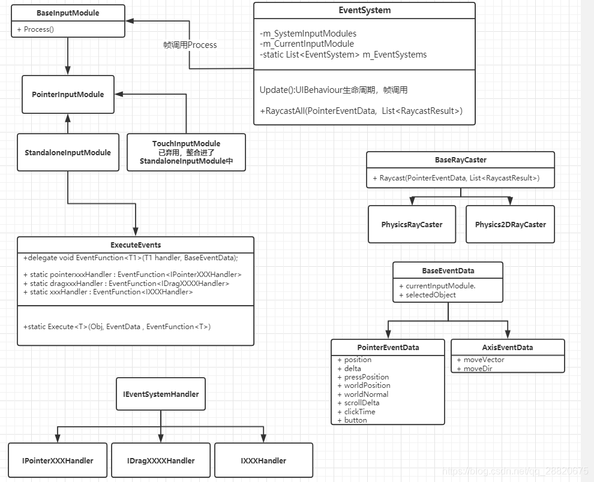
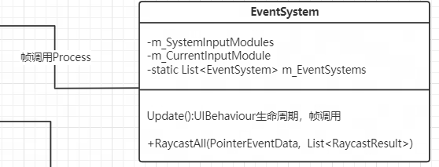

EventSytem
<!--more-->


# 一、EventSystem是什么

EventSystem **是 UGUI 交互体系的中央调度器**。它本身不处理具体的输入，也不实现射线检测，而是负责协调各个模块，**将原始的硬件输入（鼠标、触摸、键盘）转化为精确的 UI 事件，并派发给正确的对象。** EventSystem的主要功能包括：
- **管理所有的输入检测模块**（InputModule）。 EventSystem 使用输入模块（Input Modules）来处理不同类型的输入并**逐帧调用** Module 的执行函数 **Process()**，常见的输入模块包括 StandaloneInputModule（用于鼠标和键盘输入）和 TouchInputModule（用于触摸输入）。
- **调动射线捕捉模块**（Raycasters），为 InputModule 提供结果（具体的触点所穿透的对象信息）。 EventSystem 使用射线检测（Raycasting）来确定用户输入的位置和目标。它会发射一条射线，从输入设备（如鼠标或触摸点）的位置出发，检测与之相交的 UI 元素，并将事件传递给 UI 元素。
- **事件监听及处理**（ExecuteEvent）。 ==EventSystem== 会**捕获用户的输入事件，生成对应的 EventData 并将这些事件分发给相应的 UI 元素**。UI 元素可以通过实现特定的接口（如 IPointerClickHandler、IPointerEnterHandler 等）来监听和处理事件。EventSystem 会根据事件类型调用相应的接口方法。
EventSystem 中主要的类图如下：


# 二、EventSystem代码分析
下面精简了EventSystem部分代码，保留了主要的逻辑部分：
<details>
<summary>点击展开代码</summary>

```cs
[AddComponentMenu("Event/Event System")]
[DisallowMultipleComponent]
/// <summary>
/// Handles input, raycasting, and sending events.
/// </summary>
/// <remarks>
/// The EventSystem is responsible for processing and handling events in a Unity scene. A scene should only contain one EventSystem. The EventSystem works in conjunction with a number of modules and mostly just holds state and delegates functionality to specific, overrideable components.
/// When the EventSystem is started it searches for any BaseInputModules attached to the same GameObject and adds them to an internal list. On update each attached module receives an UpdateModules call, where the module can modify internal state. After each module has been Updated the active module has the Process call executed.This is where custom module processing can take place.
/// </remarks>
public class EventSystem : UIBehaviour
{
    private List<BaseInputModule> m_SystemInputModules = new List<BaseInputModule>();

    private BaseInputModule m_CurrentInputModule;

    private  static List<EventSystem> m_EventSystems = new List<EventSystem>();

    /// <summary>
    /// Return the current EventSystem.
    /// </summary>
    public static EventSystem current
    {
        get { return m_EventSystems.Count > 0 ? m_EventSystems[0] : null; }
        set
        {
            int index = m_EventSystems.IndexOf(value);

            if (index > 0)
            {
                m_EventSystems.RemoveAt(index);
                m_EventSystems.Insert(0, value);
            }
            else if (index < 0)
            {
                Debug.LogError("Failed setting EventSystem.current to unknown EventSystem " + value);
            }
        }
    }

    private GameObject m_CurrentSelected;

    /// <summary>
    /// The currently active EventSystems.BaseInputModule.
    /// </summary>
    public BaseInputModule currentInputModule
    {
        get { return m_CurrentInputModule; }
    }

    /// <summary>
    /// The GameObject currently considered active by the EventSystem.
    /// </summary>
    public GameObject currentSelectedGameObject
    {
        get { return m_CurrentSelected; }
    }

    protected EventSystem()
    {}

    /// <summary>
    /// Recalculate the internal list of BaseInputModules.
    /// </summary>
    public void UpdateModules()
    {
        //把当前 GameObject 上所有 BaseInputModule 组件收集进 m_SystemInputModules 这个列表里，而不是返回一个新数组。
        GetComponents(m_SystemInputModules); 
        var systemInputModulesCount = m_SystemInputModules.Count;
        for (int i = systemInputModulesCount - 1; i >= 0; i--)
        {
            if (m_SystemInputModules[i] && m_SystemInputModules[i].IsActive())
                continue;

            m_SystemInputModules.RemoveAt(i);
        }
    }

    private bool m_SelectionGuard;

    /// <summary>
    /// Set the object as selected. Will send an OnDeselect the the old selected object and OnSelect to the new selected object.
    /// </summary>
    /// <param name="selected">GameObject to select.</param>
    /// <param name="pointer">Associated EventData.</param>
    public void SetSelectedGameObject(GameObject selected, BaseEventData pointer)
    {
        if (m_SelectionGuard)
        {
            Debug.LogError("Attempting to select " + selected +  "while already selecting an object.");
            return;
        }

        m_SelectionGuard = true;
        if (selected == m_CurrentSelected)
        {
            m_SelectionGuard = false;
            return;
        }

        // Debug.Log("Selection: new (" + selected + ") old (" + m_CurrentSelected + ")");
        ExecuteEvents.Execute(m_CurrentSelected, pointer, ExecuteEvents.deselectHandler);
        m_CurrentSelected = selected;
        ExecuteEvents.Execute(m_CurrentSelected, pointer, ExecuteEvents.selectHandler);
        m_SelectionGuard = false;
    }

    private BaseEventData m_DummyData;
    private BaseEventData baseEventDataCache
    {
        get
        {
            if (m_DummyData == null)
                m_DummyData = new BaseEventData(this);

            return m_DummyData;
        }
    }

    /// <summary>
    /// Set the object as selected. Will send an OnDeselect the the old selected object and OnSelect to the new selected object.
    /// </summary>
    /// <param name="selected">GameObject to select.</param>
    public void SetSelectedGameObject(GameObject selected)
    {
        SetSelectedGameObject(selected, baseEventDataCache);
    }

    //对射线检测产生的所有命中结果（RaycastResult）进行排序，以确定哪个 UI 元素在最“前面”
    private static int RaycastComparer(RaycastResult lhs, RaycastResult rhs)
    {
        if (lhs.module != rhs.module)
        {
            var lhsEventCamera = lhs.module.eventCamera;
            var rhsEventCamera = rhs.module.eventCamera;
            if (lhsEventCamera != null && rhsEventCamera != null && lhsEventCamera.depth != rhsEventCamera.depth)
            {
                // need to reverse the standard compareTo
                if (lhsEventCamera.depth < rhsEventCamera.depth)
                    return 1;
                if (lhsEventCamera.depth == rhsEventCamera.depth) //这条if是防御性变成 ，保持三路比较的“完整性”，提升可读性
                    return 0;

                return -1;
            }

            if (lhs.module.sortOrderPriority != rhs.module.sortOrderPriority)
                return rhs.module.sortOrderPriority.CompareTo(lhs.module.sortOrderPriority);

            if (lhs.module.renderOrderPriority != rhs.module.renderOrderPriority)
                return rhs.module.renderOrderPriority.CompareTo(lhs.module.renderOrderPriority);
        }

        // Renderer sorting
        if (lhs.sortingLayer != rhs.sortingLayer)
        {
            // Uses the layer value to properly compare the relative order of the layers.
            var rid = SortingLayer.GetLayerValueFromID(rhs.sortingLayer);
            var lid = SortingLayer.GetLayerValueFromID(lhs.sortingLayer);
            return rid.CompareTo(lid);
        }

        if (lhs.sortingOrder != rhs.sortingOrder)
            return rhs.sortingOrder.CompareTo(lhs.sortingOrder);

        //当两个命中结果来自同一个根 Canvas 时，谁的 depth 更大，谁就排在前面
        // comparing depth only makes sense if the two raycast results have the same root canvas (case 912396)
        if (lhs.depth != rhs.depth && lhs.module.rootRaycaster == rhs.module.rootRaycaster)
            return rhs.depth.CompareTo(lhs.depth);

        if (lhs.distance != rhs.distance)
            return lhs.distance.CompareTo(rhs.distance);

        //处理2D 物理射线检测 // 只有项目安装了 2D Physics 包，这段代码才参与编译
        #if PACKAGE_PHYSICS2D
        // Sorting group
        if (lhs.sortingGroupID != SortingGroup.invalidSortingGroupID && rhs.sortingGroupID != SortingGroup.invalidSortingGroupID)
        {
            if (lhs.sortingGroupID != rhs.sortingGroupID)
                return lhs.sortingGroupID.CompareTo(rhs.sortingGroupID);
            if (lhs.sortingGroupOrder != rhs.sortingGroupOrder)
                return rhs.sortingGroupOrder.CompareTo(lhs.sortingGroupOrder);
        }
        #endif

        return lhs.index.CompareTo(rhs.index);
    }

    //委托实例只在类型初始化时创建一次，之后所有排序都复用同一个实例，零额外分配。
    private static readonly Comparison<RaycastResult> s_RaycastComparer = RaycastComparer;

    /// <summary>
    /// Raycast into the scene using all configured BaseRaycasters.
    /// </summary>
    /// <param name="eventData">Current pointer data.</param>
    /// <param name="raycastResults">List of 'hits' to populate.</param>
    public void RaycastAll(PointerEventData eventData, List<RaycastResult> raycastResults)
    {
        raycastResults.Clear();
        var modules = RaycasterManager.GetRaycasters();
        var modulesCount = modules.Count;
        for (int i = 0; i < modulesCount; ++i)
        {
            var module = modules[i];
            if (module == null || !module.IsActive())
                continue;

            module.Raycast(eventData, raycastResults);
        }

        raycastResults.Sort(s_RaycastComparer);
    }

    protected override void OnEnable()
    {
        base.OnEnable();
        m_EventSystems.Add(this);

    }

    protected override void OnDisable()
    {
        if (m_CurrentInputModule != null)
        {
            m_CurrentInputModule.DeactivateModule();
            m_CurrentInputModule = null;
        }

        m_EventSystems.Remove(this);

        base.OnDisable();
    }

    /*
        * 在 EventSystem 每帧更新时，遍历所有已注册的输入模块（Input Module），
        * 逐个调用它们的 UpdateModule()，让每个模块刷新自己的内部状态。
        * 它是“模块更新”环节，发生在真正处理输入（Process()）之前。
        */
    private void TickModules()
    {
        var systemInputModulesCount = m_SystemInputModules.Count;
        for (var i = 0; i < systemInputModulesCount; i++)
        {
            if (m_SystemInputModules[i] != null)
                m_SystemInputModules[i].UpdateModule();
        }
    }

    protected virtual void Update()
    {
        if (current != this) //场景里可能有多个 EventSystem 实例，但同一时刻只应该有一个负责处理输入,那么就由
            return;
        TickModules(); // 阶段 1：刷新所有输入模块的内部状态

        // 阶段 2：选出这一帧应该由哪个输入模块处理
        bool changedModule = false;
        var systemInputModulesCount = m_SystemInputModules.Count;
        for (var i = 0; i < systemInputModulesCount; i++)
        {
            var module = m_SystemInputModules[i];
            if (module.IsModuleSupported() && module.ShouldActivateModule()) //平台支持以及模块是否想被激活
            {
                if (m_CurrentInputModule != module)
                {
                    ChangeEventModule(module);
                    changedModule = true;
                }
                break;
            }
        }
        //没有找到就找第一个有效的模块
        // no event module set... set the first valid one...
        if (m_CurrentInputModule == null)
        {
            for (var i = 0; i < systemInputModulesCount; i++)
            {
                var module = m_SystemInputModules[i];
                if (module.IsModuleSupported())
                {
                    ChangeEventModule(module);
                    changedModule = true;
                    break;
                }
            }
        }
        // 阶段 3：被选中的模块处理输入
        if (!changedModule && m_CurrentInputModule != null)
            m_CurrentInputModule.Process();
    }

    private void ChangeEventModule(BaseInputModule module)
    {
        if (m_CurrentInputModule == module)
            return;

        if (m_CurrentInputModule != null)
            m_CurrentInputModule.DeactivateModule();

        if (module != null)
            module.ActivateModule();
        m_CurrentInputModule = module;
    }
}

```
</details>

## 2.1 eventsystem的功能
由代码的备注，我们可以知道EventSystem的大致情况：
- 功能：处理输入、射线和发送事件
- 备注：EventSystem 负责在 Unity 场景中处理和管理事件。一个场景中应该只包含一个 EventSystem。EventSystem 与多个模块协同工作，**主要是保存状态并将功能委托给特定的、可重写的组件**。当 EventSystem 启动时，它会搜索附加到同一个（EventSystem所在的） GameObject 的**所有 BaseInputModules**，并将它们添加到一个**内部列表中**。在每次更新时，每个附加的模块都会接收到一个 UpdateModules 调用，模块可以在此调用中修改内部状态。在每个模块更新之后，活动模块会执行 Process 调用，这是自定义模块处理的地方。
<details>
<summary>点击展开代码</summary>

```cs
/// <summary>
/// Handles input, raycasting, and sending events.
/// </summary>
/// <remarks>
/// The EventSystem is responsible for processing and handling events in a Unity scene. A scene should only contain one EventSystem. The EventSystem works in conjunction with a number of modules and mostly just holds state and delegates functionality to specific, overrideable components.
/// When the EventSystem is started it searches for any BaseInputModules attached to the same GameObject and adds them to an internal list. On update each attached module receives an UpdateModules call, where the module can modify internal state. After each module has been Updated the active module has the Process call executed.This is where custom module processing can take place.
/// </remarks>
```
</details>

## 2.2 定义

<details>
<summary>点击展开代码</summary>

```cs
private List<BaseInputModule> m_SystemInputModules = new List<BaseInputModule>();

private BaseInputModule m_CurrentInputModule;

private  static List<EventSystem> m_EventSystems = new List<EventSystem>();

/// <summary>
/// Return the current EventSystem.
/// </summary>
public static EventSystem current
{
    get { return m_EventSystems.Count > 0 ? m_EventSystems[0] : null; }
    set
    {
        int index = m_EventSystems.IndexOf(value);

        if (index > 0)
        {
            m_EventSystems.RemoveAt(index);
            m_EventSystems.Insert(0, value);
        }
        else if (index < 0)
        {
            Debug.LogError("Failed setting EventSystem.current to unknown EventSystem " + value);
        }
    }
}

protected EventSystem()
{}
```
</details>

- 类中定义了三个变量，分别用于管理【输入模块集合】、【当前激活的模块】和【全局事件系统示例】
### 2.2.1 m_SystemInputModules
- 作用：缓存当前 EventSystem 上挂载的所有输入模块（如 StandaloneInputModule、TouchInputModule 等）。
- 填充时机：在 OnEnable / OnDisable 或模块启停时通过 GetComponents<BaseInputModule>() 收集。
- 简单说：它是「候选模块池」，每帧都会过一遍

### 2.2.2 m_CurrentInputModule
- 作用：指向当前实际生效的那个输入模块，**同一时刻只会有一个模块负责处理输入事件**。
- 切换时机：当模块集合变化（例如某个模块被禁用/启用）时，ChangeEventModule 会把旧的模块 DeactivateModule()，把新的模块 ActivateModule() 并赋给它

### 2.2.3 m_EventSystems
- 作用：静态列表，保存场景/全局中**所有**处于激活状态的 **EventSystem 实例**.
  - m_EventSystems 这个字段属于 EventSystem 这个类型本身，而不是属于某个具体的 EventSystem
- 填充时机：
  - 在 OnEnable 中把实例加入列表；
  - 在 OnDisable 中移除。

数据流大致是：m_SystemInputModules（候选池）→ 每帧 TickModules() → 选出 m_CurrentInputModule（值班）→ 调用其 Process()；

### 2.2.4 current
- 作用：静态属性，当前场景中生效的EventSystem

### 2.2.5 构造函数 protected EventSystem()
- 这个组件只能由 Unity 的组件创建流程（AddComponent / 编辑器挂载）或子类继承来实例化，不能由外部代码直接 new
  - 通过 AddComponent 时，引擎在原生层分配对象，然后由内部机制调用 C# 构造函数。
- 选 protected 而非 private，是为了**给子类继承留出调用 base() 的通道**；
- 选 protected 而非 public，是为了在编译期阻止“绕过 Unity 组件系统直接 new”这种必然出错的用法。
  - Unity 的组件对象是**双层结构——C# 包装对象 + C++ 原生对象**。如果你直接 new EventSystem()
    - 只创建了 C# 那一层“空壳”；
    - 没有对应的 C++ 原生对象，没有挂到任何 GameObject 上，没有生命周期管理；
    - 后续调用任何依赖原生层的 API 都会出问题。

## 2.3 具体方法
### 2.3.1 UpdateModules
<details>
<summary>点击展开代码</summary>

```cs
/// <summary>
/// Recalculate the internal list of BaseInputModules.
/// </summary>
public void UpdateModules()
{
    //把当前 GameObject 上所有 BaseInputModule 组件收集进 m_SystemInputModules 这个列表里，而不是返回一个新数组。
    GetComponents(m_SystemInputModules); 
    var systemInputModulesCount = m_SystemInputModules.Count;
    for (int i = systemInputModulesCount - 1; i >= 0; i--)
    {
        if (m_SystemInputModules[i] && m_SystemInputModules[i].IsActive())
            continue;

        m_SystemInputModules.RemoveAt(i);
    }
}
```
</details>

- 该方法通过GetComponents(m_SystemInputModules);**获取该组件所在的GameObject所挂载的所有基于BaseInputModule的输入模块**。如果模块存在且处于激活状态，则保留在列表，否则移除
- 该函数一般在其他InputModule的OnEnable() 及 OnDisable() 方法中调用，用于更新输入模块列表

### 2.3.2 SetSelectedGameObject

<details>
<summary>点击展开代码</summary>

```cs
/// <summary>
/// Set the object as selected. Will send an OnDeselect the the old selected object and OnSelect to the new selected object.
/// </summary>
/// <param name="selected">GameObject to select.</param>
/// <param name="pointer">Associated EventData.</param>
public void SetSelectedGameObject(GameObject selected, BaseEventData pointer)
{
    if (m_SelectionGuard)
    {
        Debug.LogError("Attempting to select " + selected +  "while already selecting an object.");
        return;
    }

    m_SelectionGuard = true;
    if (selected == m_CurrentSelected)
    {
        m_SelectionGuard = false;
        return;
    }

    // Debug.Log("Selection: new (" + selected + ") old (" + m_CurrentSelected + ")");
    ExecuteEvents.Execute(m_CurrentSelected, pointer, ExecuteEvents.deselectHandler);
    m_CurrentSelected = selected;
    ExecuteEvents.Execute(m_CurrentSelected, pointer, ExecuteEvents.selectHandler);
    m_SelectionGuard = false;
}


private BaseEventData m_DummyData;
private BaseEventData baseEventDataCache
{
    get
    {
        if (m_DummyData == null)
            m_DummyData = new BaseEventData(this);

        return m_DummyData;
    }
}


// <summary>
/// Set the object as selected. Will send an OnDeselect the the old selected object and OnSelect to the new selected object.
/// </summary>
/// <param name="selected">GameObject to select.</param>
public void SetSelectedGameObject(GameObject selected)
{
    SetSelectedGameObject(selected, baseEventDataCache);
}
```
</details>

- **该方法设置选中对象，并且通过ExecuteEvents.Execute通知 “旧选中对象”取消选中，“新选中对象”被选中**
  - 即会对 旧对象触发其OnDeselect，对新选中对象触发其OnSelect
- ExecuteEvents.Execute 如何工作
  - 从 m_CurrentSelected 这个 GameObject 开始，沿父级向上冒泡，找到所有实现了 IDeselectHandler 的组件，对每个组件调用 OnDeselect(pointer)/OnSelect
  - ExecuteEvents.deselectHandler 一个静态缓存的委托
  - ExecuteEvents.Execute 从 target 开始，沿自身和父级向上冒泡，查找实现了 T 接口的组件；T 由传入的 functor 的类型推断得出，决定“找什么接口”；functor 决定“找到后调用哪个方法”。
    - 针对ExecuteEvents.deselectHandler来说 其实就是找实现了IDeselectHandler的组件
    ```cs
    public static EventFunction<IDeselectHandler> deselectHandler
    {
        get { return s_DeselectHandler; }
    }
    ```
- SetSelectedGameObject 方法**有两个重载**，**前者接受一个额外的 BaseEventData 参数**，用于传递事件数据；后者只接受一个 GameObject 参数，会使用 baseEventDataCache **方法传递一个默认的 BaseEventData 对象**。
  - 因此为了**不重复创建 BaseEventData 对象**，EventSystem 类中定义了一个 **m_DummyData 变量**，用于缓存 BaseEventData 对象。**这种做法可以减少内存分配的开销。**


### 2.3.2 RaycastAll（射线检测）

<details>
<summary>点击展开代码</summary>

```cs
//对射线检测产生的所有命中结果（RaycastResult）进行排序，以确定哪个 UI 元素在最“前面”
private static int RaycastComparer(RaycastResult lhs, RaycastResult rhs)
{
    if (lhs.module != rhs.module)
    {
        var lhsEventCamera = lhs.module.eventCamera;
        var rhsEventCamera = rhs.module.eventCamera;
        if (lhsEventCamera != null && rhsEventCamera != null && lhsEventCamera.depth != rhsEventCamera.depth)
        {
            // need to reverse the standard compareTo
            if (lhsEventCamera.depth < rhsEventCamera.depth)
                return 1;
            if (lhsEventCamera.depth == rhsEventCamera.depth) //这条if是防御性变成 ，保持三路比较的“完整性”，提升可读性
                return 0;

            return -1;
        }

        if (lhs.module.sortOrderPriority != rhs.module.sortOrderPriority)
            return rhs.module.sortOrderPriority.CompareTo(lhs.module.sortOrderPriority);

        if (lhs.module.renderOrderPriority != rhs.module.renderOrderPriority)
            return rhs.module.renderOrderPriority.CompareTo(lhs.module.renderOrderPriority);
    }

    // Renderer sorting
    if (lhs.sortingLayer != rhs.sortingLayer)
    {
        // Uses the layer value to properly compare the relative order of the layers.
        var rid = SortingLayer.GetLayerValueFromID(rhs.sortingLayer);
        var lid = SortingLayer.GetLayerValueFromID(lhs.sortingLayer);
        return rid.CompareTo(lid);
    }

    if (lhs.sortingOrder != rhs.sortingOrder)
        return rhs.sortingOrder.CompareTo(lhs.sortingOrder);

    //当两个命中结果来自同一个根 Canvas 时，谁的 depth 更大，谁就排在前面
    // comparing depth only makes sense if the two raycast results have the same root canvas (case 912396)
    if (lhs.depth != rhs.depth && lhs.module.rootRaycaster == rhs.module.rootRaycaster)
        return rhs.depth.CompareTo(lhs.depth);

    if (lhs.distance != rhs.distance)
        return lhs.distance.CompareTo(rhs.distance);

    //处理2D 物理射线检测 // 只有项目安装了 2D Physics 包，这段代码才参与编译
    #if PACKAGE_PHYSICS2D
    // Sorting group
    if (lhs.sortingGroupID != SortingGroup.invalidSortingGroupID && rhs.sortingGroupID != SortingGroup.invalidSortingGroupID)
    {
        if (lhs.sortingGroupID != rhs.sortingGroupID)
            return lhs.sortingGroupID.CompareTo(rhs.sortingGroupID);
        if (lhs.sortingGroupOrder != rhs.sortingGroupOrder)
            return rhs.sortingGroupOrder.CompareTo(lhs.sortingGroupOrder);
    }
    #endif

    return lhs.index.CompareTo(rhs.index);
}

//委托实例只在类型初始化时创建一次，之后所有排序都复用同一个实例，零额外分配。
private static readonly Comparison<RaycastResult> s_RaycastComparer = RaycastComparer;

/// <summary>
/// Raycast into the scene using all configured BaseRaycasters.
/// </summary>
/// <param name="eventData">Current pointer data.</param>
/// <param name="raycastResults">List of 'hits' to populate.</param>
public void RaycastAll(PointerEventData eventData, List<RaycastResult> raycastResults)
{
    raycastResults.Clear();
    var modules = RaycasterManager.GetRaycasters();
    var modulesCount = modules.Count;
    for (int i = 0; i < modulesCount; ++i)
    {
        var module = modules[i];
        if (module == null || !module.IsActive())
            continue;

        module.Raycast(eventData, raycastResults);
    }

    raycastResults.Sort(s_RaycastComparer);
}
```

</details>

- 接下来是 RaycastAll 方法，用于对场景中的所有 BaseRaycaster 进行射线检测。
  - 首先会清空射线结果列表raycastResults
  - 通过RaycasterManager，拿到所有基于BaseRaycaster 的注册了的射线
  - 遍历射线列表，如果射线存在且处于激活状态，则通过各个射线的module.Raycast(eventData, raycastResults)，将结果加入raycastResults列表中
  - 最后使用s_RaycastComparer排序规则，对射线结果进行排序
- 关于RaycastAll几个注意的地方：
  - 1.RaycastAll并不直接调用，而是通过InputModule调用。InputModule通过process方法调用RaycastAll
    - 调用路径一般为：EventSystem.Update() → m_CurrentInputModule.Process() → PointerInputModule.GetMousePointerEventData() (或 GetTouchPointerEventData) → EventSystem.RaycastAll() → BaseRaycaster.Raycast() (如 GraphicRaycaster / PhysicsRaycaster)
  - 2.RaycastComparer 方法用于对射线检测结果进行排序，总体而言就是将更接近摄像机的结果排在前面


### 2.3.3 TickModules、Update、OnEnable、OnDisable

<details>
<summary>点击展开代码</summary>

```cs
protected override void OnEnable()
{
    base.OnEnable();
    m_EventSystems.Add(this);

}

protected override void OnDisable()
{
    if (m_CurrentInputModule != null)
    {
        m_CurrentInputModule.DeactivateModule();
        m_CurrentInputModule = null;
    }

    m_EventSystems.Remove(this);

    base.OnDisable();
}

/*
    * 在 EventSystem 每帧更新时，遍历所有已注册的输入模块（Input Module），
    * 逐个调用它们的 UpdateModule()，让每个模块刷新自己的内部状态。
    * 它是“模块更新”环节，发生在真正处理输入（Process()）之前。
    */
private void TickModules()
{
    var systemInputModulesCount = m_SystemInputModules.Count;
    for (var i = 0; i < systemInputModulesCount; i++)
    {
        if (m_SystemInputModules[i] != null)
            m_SystemInputModules[i].UpdateModule();
    }
}

protected virtual void Update()
{
    if (current != this) //场景里可能有多个 EventSystem 实例，但同一时刻只应该有一个负责处理输入,那么就由
        return;
    TickModules(); // 阶段 1：刷新所有输入模块的内部状态

    // 阶段 2：选出这一帧应该由哪个输入模块处理
    bool changedModule = false;
    var systemInputModulesCount = m_SystemInputModules.Count;
    for (var i = 0; i < systemInputModulesCount; i++)
    {
        var module = m_SystemInputModules[i];
        if (module.IsModuleSupported() && module.ShouldActivateModule()) //平台支持以及模块是否想被激活
        {
            if (m_CurrentInputModule != module)
            {
                ChangeEventModule(module);
                changedModule = true;
            }
            break;
        }
    }
    //没有找到就找第一个有效的模块
    // no event module set... set the first valid one...
    if (m_CurrentInputModule == null)
    {
        for (var i = 0; i < systemInputModulesCount; i++)
        {
            var module = m_SystemInputModules[i];
            if (module.IsModuleSupported())
            {
                ChangeEventModule(module);
                changedModule = true;
                break;
            }
        }
    }
    // 阶段 3：被选中的模块处理输入
    if (!changedModule && m_CurrentInputModule != null)
        m_CurrentInputModule.Process();
}

private void ChangeEventModule(BaseInputModule module)
{
    if (m_CurrentInputModule == module)
        return;

    if (m_CurrentInputModule != null)
        m_CurrentInputModule.DeactivateModule();

    if (module != null)
        module.ActivateModule();
    m_CurrentInputModule = module;
}
```
</details>

1. OnEnable 和 OnDisable 
- EventSystem 启用时调用 OnEnable，用于将当前的EventSystem 实例添加到 m_EventSystems 列表
- EventSystem 禁用时调用 OnDisable，用于将当前的EventSystem 实例从m_EventSystems 列表中删除
2. update
- update会在每一帧调用TickModules();且保证只有一个eventsystem在调用
- update会先调用 TickModules()
  - TickModules()会遍历所有的输入模块，调用其UpdateModule()，让模块感知本帧的输入变化、刷新内部缓存以便后面找出一个有效的模块
- 再次遍历所有的输入模块，找出这一帧应该由哪个输入模块处理（平台支持且当帧像被激活的输入模块）
  - 如果遍历没找到，则找到第一个平台支持的模块
- 将找到的模块通过ChangeEventModule设置为当前模块
- 调用当前模块的process

### 2.3.5 小结
以上我们对EventSystem代码进行了分析。
首先，挂载了 EventSystem 的 GameObject 会在启动时收集所有的输入模块并添加到 m_SystemInputModules 列表中。然后，EventSystem 会在每一帧调用 Update 方法，遍历所有的输入模块，找到并设置当前输入模块，同时调用其 Process 方法，完成事件的处理。
此外，EventSystem 还提供了一些方法用于设置选中的游戏对象、射线检测等功能。这些方法会在 InputModule 及 Raycaster 中调用。

另外，可以看到代码中不乏涉及到一些其他代码的内容，后续会针对InputModule、Raycasters、ExecuteEvents进行说明。

# 三、InputModule（输入模块）
输入模块都继承于BaseInputModule，而BaseInputModule又使用到了BaseInput，因此在学习InputModule之前先了解一下BaseInput

其次输入模块中都会用到一个xxEventData的数据类，对这块内容也需要关注一下其具体存有哪些信息

## 3.1 BaseInput

<details>
<summary>点击展开代码</summary>

```cs

/// <summary>
/// Interface to the Input system used by the BaseInputModule. With this it is possible to bypass the Input system with your own but still use the same InputModule. For example this can be used to feed fake input into the UI or interface with a different input system.
/// </summary>
public class BaseInput : UIBehaviour
{
    /// <summary>
    /// Interface to Input.compositionString. Can be overridden to provide custom input instead of using the Input class.
    /// </summary>
    public virtual string compositionString
    {
        get { return Input.compositionString; }
    }

    /// <summary>
    /// Interface to Input.imeCompositionMode. Can be overridden to provide custom input instead of using the Input class.
    /// </summary>
    public virtual IMECompositionMode imeCompositionMode
    {
        get { return Input.imeCompositionMode; }
        set { Input.imeCompositionMode = value; }
    }

    /// <summary>
    /// Interface to Input.compositionCursorPos. Can be overridden to provide custom input instead of using the Input class.
    /// </summary>
    public virtual Vector2 compositionCursorPos
    {
        get { return Input.compositionCursorPos; }
        set { Input.compositionCursorPos = value; }
    }

    /// <summary>
    /// Interface to Input.mousePresent. Can be overridden to provide custom input instead of using the Input class.
    /// </summary>
    public virtual bool mousePresent
    {
        get { return Input.mousePresent; }
    }

    /// <summary>
    /// Interface to Input.GetMouseButtonDown. Can be overridden to provide custom input instead of using the Input class.
    /// </summary>
    /// <param name="button"></param>
    /// <returns></returns>
    public virtual bool GetMouseButtonDown(int button)
    {
        return Input.GetMouseButtonDown(button);
    }

    /// <summary>
    /// Interface to Input.GetMouseButtonUp. Can be overridden to provide custom input instead of using the Input class.
    /// </summary>
    public virtual bool GetMouseButtonUp(int button)
    {
        return Input.GetMouseButtonUp(button);
    }

    /// <summary>
    /// Interface to Input.GetMouseButton. Can be overridden to provide custom input instead of using the Input class.
    /// </summary>
    public virtual bool GetMouseButton(int button)
    {
        return Input.GetMouseButton(button);
    }

    /// <summary>
    /// Interface to Input.mousePosition. Can be overridden to provide custom input instead of using the Input class.
    /// </summary>
    public virtual Vector2 mousePosition
    {
        get { return Input.mousePosition; }
    }

    /// <summary>
    /// Interface to Input.mouseScrollDelta. Can be overridden to provide custom input instead of using the Input class.
    /// </summary>
    public virtual Vector2 mouseScrollDelta
    {
        get { return Input.mouseScrollDelta; }
    }

    /// <summary>
    /// Interface to Input.touchSupported. Can be overridden to provide custom input instead of using the Input class.
    /// </summary>
    public virtual bool touchSupported
    {
        get { return Input.touchSupported; }
    }

    /// <summary>
    /// Interface to Input.touchCount. Can be overridden to provide custom input instead of using the Input class.
    /// </summary>
    public virtual int touchCount
    {
        get { return Input.touchCount; }
    }

    /// <summary>
    /// Interface to Input.GetTouch. Can be overridden to provide custom input instead of using the Input class.
    /// </summary>
    /// <param name="index">Touch index to get</param>
    public virtual Touch GetTouch(int index)
    {
        return Input.GetTouch(index);
    }

    /// <summary>
    /// Interface to Input.GetAxisRaw. Can be overridden to provide custom input instead of using the Input class.
    /// </summary>
    /// <param name="axisName">Axis name to check</param>
    public virtual float GetAxisRaw(string axisName)
    {
        return Input.GetAxisRaw(axisName);
    }

    /// <summary>
    /// Interface to Input.GetButtonDown. Can be overridden to provide custom input instead of using the Input class.
    /// </summary>
    /// <param name="buttonName">Button name to get</param>
    public virtual bool GetButtonDown(string buttonName)
    {
        return Input.GetButtonDown(buttonName);
    }
}
```
</details>


该类是BaseInputModule中处理输入的接口类。
- 通过它，你可以用自己的输入系统绕过 Unity 的默认 Input 系统，但仍然复用同一个输入模块。
  - 可以看到代码中每一个的注释前面都表示 ： 可以重写它，以提供自定义输入。**即写一个新类继承 BaseInput，重写属性和方法**
- BaseInput **本身是对Input模块的一层封装**，其中的属性、方法都来源于Input类的静态变量和静态函数
- BaseInputModule 不直接调用 Input.xxx，而是通过一个 BaseInput 实例来读取（input属性）

### 3.1.1 BaseInput各类属性和函数意义
1. 鼠标相关
- mousePresent 当前设备是否存在鼠标
- mousePosition	鼠标在屏幕坐标系中的位置
- mouseScrollDelta	鼠标滚轮的滚动增量
- GetMouseButtonDown(int)	指定鼠标键本帧是否按下
- GetMouseButtonUp(int)	指定鼠标键本帧是否松开
- GetMouseButton(int)	指定鼠标键当前是否处于按住状态
button 参数：0 左键、1 右键、2 中键。PointerEventData.button 也是同一套枚举。
2. 触摸相关
- touchSupported	当前平台是否支持触摸输入
- touchCount	当前活跃触摸点的数量
- GetTouch(int index)	获取指定索引的触摸点数据（Touch 结构体）
  - Touch 里包含 position、phase、fingerId、deltaPosition 等，是触摸交互的核心数据。
3. 键盘 / 轴相关
- GetAxisRaw(string axisName)	获取指定轴的原始值（不做平滑）
- GetButtonDown(string buttonName)	指定按钮本帧是否按下
4. IME 输入法相关 ——Input Method Editor（输入法编辑器） 
- compositionString	输入法正在组合、尚未确认的字符串。InputField 显示中文/日文输入法组字过程中的候选文字（带下划线的那段）
  - 组字阶段：正在输入、尚未确认的字符（如拼音 nihao 或候选汉字）
- imeCompositionMode	IME 的组合模式（如 Auto、On、Off）	控制何时启用输入法；InputField 获得焦点时可能需要开启 IME
  - 开关控制：决定 IME 是否启用、何时启用
- compositionCursorPos	组合字符串的光标位置	让输入法的候选框/光标定位到正确位置，保证组字体验正常
  - 光标定位：让候选框和光标出现在正确位置

## 3.2 EventData
EventData 是 UGUI 事件系统中的一套数据类体系（以 AbstractEventData 为根，BaseEventData 为基础，派生出 PointerEventData、AxisEventData 等）。**它主要由 InputModule 根据原始输入构建，用于在事件流转过程中封装和传递交互上下文——从 Raycaster 的射线检测、ExecuteEvents 的冒泡派发，一直到用户脚本的事件回调**。它存储的是“这次交互发生在哪里、涉及哪个按键、拖拽到什么程度”等具体信息。


### 3.2.1 BaseEventData.cs

<details>
<summary>点击展开代码</summary>

```cs
/// <summary>
/// A class that can be used for sending simple events via the event system.
/// </summary>
public abstract class AbstractEventData
{
    protected bool m_Used;

    /// <summary>
    /// Reset the event.
    /// </summary>
    public virtual void Reset()
    {
        m_Used = false;
    }

    /// <summary>
    /// Use the event.
    /// </summary>
    /// <remarks>
    /// Internally sets a flag that can be checked via used to see if further processing should happen.
    /// </remarks>
    public virtual void Use()
    {
        m_Used = true;
    }

    /// <summary>
    /// Is the event used?
    /// </summary>
    public virtual bool used
    {
        get { return m_Used; }
    }
}

/// <summary>
/// A class that contains the base event data that is common to all event types in the new EventSystem.
/// </summary>
public class BaseEventData : AbstractEventData
{
    private readonly EventSystem m_EventSystem;
    public BaseEventData(EventSystem eventSystem)
    {
        m_EventSystem = eventSystem;
    }

    /// <summary>
    /// >A reference to the BaseInputModule that sent this event.
    /// </summary>
    public BaseInputModule currentInputModule
    {
        get { return m_EventSystem.currentInputModule; }
    }

    /// <summary>
    /// The object currently considered selected by the EventSystem.
    /// </summary>
    public GameObject selectedObject
    {
        get { return m_EventSystem.currentSelectedGameObject; }
        set { m_EventSystem.SetSelectedGameObject(value, this); }
    }
}
```
</details>

代码中可以看到 实际上定义了一个抽象基类AbstractEventData和继承它的具体子类BaseEventData

#### 3.2.1.1 AbstractEventData
可以看到该抽象类较为精简。 只有一个bool字段和三个围绕该字段的三个成员。它的全部职责就是回答一个问题：**“这个事件是否已经被某个处理者消费掉了？”**
- 为什么需要“used”标记
  - UGUI 的事件派发是**冒泡式**的：ExecuteEvents.Execute 从目标**开始沿父级向上找处理者**。如果**子物体处理了事件，父物体通常不应该再处理一次**。**Use()** 就是处理者用来**声明“我消费了”**的标记，后续处理者或调用方可以通过 used 判断是否应该停止。
- 为什么是 abstract
  - 因为它只承载“消费状态”这一个通用概念，**本身不包含任何具体的事件信息**。单独 new 一个 AbstractEventData **没有意义**——它必须被子类化，由子类补充“这次事件到底是什么”的上下文。
- 为什么 Reset() 和 Use() 是 virtual 的
  - 给子类留出扩展空间。比如某些子类可能需要在 Reset 时额外清理自己的字段，或在 Use 时触发额外逻辑

#### 3.2.1.2 BaseEventData
该类继承于AbstractEventData，在其“消费标记”之上，增加了对EventSystem的引用。
1. 构造函数注入 EventSystem，并设为 readonly
- readonly 让EventSystem 只能在声明时或构造函数里赋值，之后任何地方都不能再改
- 每个BaseEventData 示例在创建时，就必须绑定一个EventSystem，之后不可更改。**这样确保了事件数据始终知道自己属于哪一个事件系统**
之前在EventSystem中的m_DummyData就是将EventSystem传入构造函数中
```cs
m_DummyData = new BaseEventData(this); // this 就是 EventSystem
```
2. currentInputModule：只读转发，不存储
- 它不自己保存输入模块引用，而是每次 get 时去问 EventSystem。这保证了数据始终是实时的——如果 EventSystem 切换了当前输入模块，通过 eventData.currentInputModule 读到的也是最新的。

3. SelectedObject 的 set：整个类最巧妙的一行
- 它调用的正是 SetSelectedGameObject(GameObject selected, BaseEventData pointer) 这个双参数重载。
  - 把 this（当前这个 BaseEventData 实例）作为第二个参数传进去
  - **当你通过 eventData.selectedObject = someObject 来设置选中对象时，someObject 收到的 OnSelect(BaseEventData) 回调中，拿到的 eventData 参数就是你现在正在用的这个实例**

4. SelectedObject 的  get 同样是实时转发
- 读的是 EventSystem 当前的选中对象，而不是缓存值

### 3.2.2 AxisEventData
<details>
<summary>点击展开代码</summary>

```cs
/// <summary>
/// Event Data associated with Axis Events (Controller / Keyboard).
/// </summary>
public class AxisEventData : BaseEventData
{
    /// <summary>
    /// Raw input vector associated with this event.
    /// </summary>
    public Vector2 moveVector { get; set; }

    /// <summary>
    /// MoveDirection for this event.
    /// </summary>
    public MoveDirection moveDir { get; set; }

    public AxisEventData(EventSystem eventSystem)
        : base(eventSystem)
    {
        moveVector = Vector2.zero;
        moveDir = MoveDirection.None;
    }
}
```
</details>

AxisEventData 是UGUI事件数据体系中专门**为键盘和手柄等非指针设备设计**的“导航事件数据”封装类，其继承自BaseEventData，因此也拥有基类的 used 标记、currentInputModule（当前输入模块）和 selectedObject（当前选中对象）等通用上下文能力。

其定义了两个属性
1. moveVector
   - 摇杆或方向键的原始模拟量，包含方向和大小的精确信息。
2. moveDir
   - 告知导航系统是向 Left、Right、Up、Down 还是 None 移动，用于确定“下一个选中对象”的查找方向


### 3.2.3 PointerEventData

<details>
<summary>点击展开代码</summary>

```cs
using System;
using System.Text;
using System.Collections.Generic;

namespace UnityEngine.EventSystems
{
    /// <summary>
    /// Each touch event creates one of these containing all the relevant information.
    /// </summary>
    public class PointerEventData : BaseEventData
    {
        /// <summary>
        /// Input press tracking.
        /// </summary>
        public enum InputButton
        {
            /// <summary>
            /// Left button
            /// </summary>
            Left = 0,

            /// <summary>
            /// Right button.
            /// </summary>
            Right = 1,

            /// <summary>
            /// Middle button
            /// </summary>
            Middle = 2
        }

        /// <summary>
        /// The state of a press for the given frame.
        /// </summary>
        public enum FramePressState
        {
            /// <summary>
            /// Button was pressed this frame.
            /// </summary>
            Pressed,

            /// <summary>
            /// Button was released this frame.
            /// </summary>
            Released,

            /// <summary>
            /// Button was pressed and released this frame.
            /// </summary>
            PressedAndReleased,

            /// <summary>
            /// Same as last frame.
            /// </summary>
            NotChanged
        }

        /// <summary>
        /// The object that received 'OnPointerEnter'.
        /// </summary>
        public GameObject pointerEnter { get; set; }

        // The object that received OnPointerDown
        private GameObject m_PointerPress;

        /// <summary>
        /// The raw GameObject for the last press event. This means that it is the 'pressed' GameObject even if it can not receive the press event itself.
        /// </summary>
        public GameObject lastPress { get; private set; }

        /// <summary>
        /// The object that the press happened on even if it can not handle the press event.
        /// </summary>
        public GameObject rawPointerPress { get; set; }

        /// <summary>
        /// The object that is receiving 'OnDrag'.
        /// </summary>
        public GameObject pointerDrag { get; set; }

        /// <summary>
        /// The object that should receive the 'OnPointerClick' event.
        /// </summary>
        public GameObject pointerClick { get; set; }

        /// <summary>
        /// RaycastResult associated with the current event.
        /// </summary>
        public RaycastResult pointerCurrentRaycast { get; set; }

        /// <summary>
        /// RaycastResult associated with the pointer press.
        /// </summary>
        public RaycastResult pointerPressRaycast { get; set; }

        public List<GameObject> hovered = new List<GameObject>();

        /// <summary>
        /// Is it possible to click this frame
        /// </summary>
        public bool eligibleForClick { get; set; }

        /// <summary>
        /// The index of the display that this pointer event comes from.
        /// </summary>
        public int displayIndex { get; set; }

        /// <summary>
        /// Id of the pointer (touch id).
        /// </summary>
        public int pointerId { get; set; }

        /// <summary>
        /// Current pointer position.
        /// </summary>
        public Vector2 position { get; set; }

        /// <summary>
        /// Pointer delta since last update.
        /// </summary>
        public Vector2 delta { get; set; }

        /// <summary>
        /// Position of the press.
        /// </summary>
        public Vector2 pressPosition { get; set; }

        /// <summary>
        /// World-space position where a ray cast into the screen hits something
        /// </summary>

        [Obsolete("Use either pointerCurrentRaycast.worldPosition or pointerPressRaycast.worldPosition")]
        public Vector3 worldPosition { get; set; }

        /// <summary>
        /// World-space normal where a ray cast into the screen hits something
        /// </summary>
        [Obsolete("Use either pointerCurrentRaycast.worldNormal or pointerPressRaycast.worldNormal")]
        public Vector3 worldNormal { get; set; }

        /// <summary>
        /// The last time a click event was sent. Used for double click
        /// </summary>
        public float clickTime { get; set; }

        /// <summary>
        /// Number of clicks in a row.
        /// </summary>
        /// <example>
        /// <code>
        /// <![CDATA[
        /// using UnityEngine;
        /// using System.Collections;
        /// using UnityEngine.UI;
        /// using UnityEngine.EventSystems;// Required when using Event data.
        ///
        /// public class ExampleClass : MonoBehaviour, IPointerDownHandler
        /// {
        ///     public void OnPointerDown(PointerEventData eventData)
        ///     {
        ///         //Grab the number of consecutive clicks and assign it to an integer varible.
        ///         int i = eventData.clickCount;
        ///         //Display the click count.
        ///         Debug.Log(i);
        ///     }
        /// }
        /// ]]>
        ///</code>
        /// </example>
        public int clickCount { get; set; }

        /// <summary>
        /// The amount of scroll since the last update.
        /// </summary>
        public Vector2 scrollDelta { get; set; }

        /// <summary>
        /// Should a drag threshold be used?
        /// </summary>
        /// <remarks>
        /// If you do not want a drag threshold set this to false in IInitializePotentialDragHandler.OnInitializePotentialDrag.
        /// </remarks>
        public bool useDragThreshold { get; set; }

        /// <summary>
        /// Is a drag operation currently occuring.
        /// </summary>
        public bool dragging { get; set; }

        /// <summary>
        /// The EventSystems.PointerEventData.InputButton for this event.
        /// </summary>
        public InputButton button { get; set; }


        /// <summary>
        /// The amount of pressure currently applied by a touch.
        /// </summary>
        /// <remarks>
        /// If the device does not report pressure, the value of this property is 1.0f.
        /// </remarks>
        /// <seealso cref="UnityEngine.UIElements.IPointerEvent" />
        public float pressure { get; set; }
        /// <summary>
        /// The pressure applied to an additional pressure-sensitive control on the stylus.
        /// </summary>
        /// <seealso cref="UnityEngine.UIElements.IPointerEvent" />
        public float tangentialPressure { get; set; }
        /// <summary>
        /// The angle of the stylus relative to the surface, in radians
        /// </summary>
        /// <remarks>
        /// A value of 0 indicates that the stylus is parallel to the surface. A value of pi/2 indicates that it is perpendicular to the surface.
        /// </remarks>
        /// <seealso cref="UnityEngine.UIElements.IPointerEvent" />
        public float altitudeAngle { get; set; }
        /// <summary>
        /// The angle of the stylus relative to the x-axis, in radians.
        /// </summary>
        /// <remarks>
        /// A value of 0 indicates that the stylus is pointed along the x-axis of the device.
        /// </remarks>
        /// <seealso cref="UnityEngine.UIElements.IPointerEvent" />
        public float azimuthAngle { get; set; }
        /// <summary>
        /// The rotation of the stylus around its axis, in radians.
        /// </summary>
        /// <seealso cref="UnityEngine.UIElements.IPointerEvent" />
        public float twist { get; set; }
        /// <summary>
        /// Specifies the angle of the pen relative to the X & Y axis, in radians.
        /// </summary>
        /// <seealso cref="UnityEngine.UIElements.IPointerEvent" />
        public Vector2 tilt { get; set; }
        /// <summary>
        /// Specifies the state of the pen. For example, whether the pen is in contact with the screen or tablet, whether the pen is inverted, and whether buttons are pressed.
        /// </summary>
        /// <seealso cref="UnityEngine.UIElements.IPointerEvent" />
        public PenStatus penStatus { get; set; }
        /// <summary>
        /// An estimate of the radius of a touch.
        /// </summary>
        /// <remarks>
        /// Add `radiusVariance` to get the maximum touch radius, subtract it to get the minimum touch radius.
        /// </remarks>
        /// <seealso cref="UnityEngine.UIElements.IPointerEvent" />
        public Vector2 radius { get; set; }
        /// <summary>
        /// The accuracy of the touch radius.
        /// </summary>
        /// <remarks>
        /// Add this value to the radius to get the maximum touch radius, subtract it to get the minimum touch radius.
        /// </remarks>
        public Vector2 radiusVariance { get; set; }
        /// <summary>
        /// Specifies in the case of a pointer exit if the pointer has fully exited the area or if it has just entered a child.
        /// </summary>
        public bool fullyExited { get; set; }
        /// <summary>
        /// Specifies in the case of a pointer enter if the pointer has entered a new area or if it has just reentered a parent after leaving a child.
        /// </summary>
        public bool reentered { get; set; }
        /// <seealso cref="UnityEngine.UIElements.IPointerEvent" />

        public PointerEventData(EventSystem eventSystem) : base(eventSystem)
        {
            eligibleForClick = false;

            displayIndex = 0;
            pointerId = -1;
            position = Vector2.zero; // Current position of the mouse or touch event
            delta = Vector2.zero; // Delta since last update
            pressPosition = Vector2.zero; // Delta since the event started being tracked
            clickTime = 0.0f; // The last time a click event was sent out (used for double-clicks)
            clickCount = 0; // Number of clicks in a row. 2 for a double-click for example.

            scrollDelta = Vector2.zero;
            useDragThreshold = true;
            dragging = false;
            button = InputButton.Left;

            pressure = 0f;
            tangentialPressure = 0f;
            altitudeAngle = 0f;
            azimuthAngle = 0f;
            twist = 0f;
            tilt = new Vector2(0f, 0f);
            penStatus = PenStatus.None;
            radius = Vector2.zero;
            radiusVariance = Vector2.zero;
        }

        /// <summary>
        /// Is the pointer moving.
        /// </summary>
        public bool IsPointerMoving()
        {
            return delta.sqrMagnitude > 0.0f;
        }

        /// <summary>
        /// Is scroll being used on the input device.
        /// </summary>
        public bool IsScrolling()
        {
            return scrollDelta.sqrMagnitude > 0.0f;
        }

        /// <summary>
        /// The camera associated with the last OnPointerEnter event.
        /// </summary>
        public Camera enterEventCamera
        {
            get { return pointerCurrentRaycast.module == null ? null : pointerCurrentRaycast.module.eventCamera; }
        }

        /// <summary>
        /// The camera associated with the last OnPointerPress event.
        /// </summary>
        public Camera pressEventCamera
        {
            get { return pointerPressRaycast.module == null ? null : pointerPressRaycast.module.eventCamera; }
        }

        /// <summary>
        /// The GameObject that received the OnPointerDown.
        /// </summary>
        public GameObject pointerPress
        {
            get { return m_PointerPress; }
            set
            {
                if (m_PointerPress == value)
                    return;

                lastPress = m_PointerPress;
                m_PointerPress = value;
            }
        }

        public override string ToString()
        {
            var sb = new StringBuilder();
            sb.AppendLine("<b>Position</b>: " + position);
            sb.AppendLine("<b>delta</b>: " + delta);
            sb.AppendLine("<b>eligibleForClick</b>: " + eligibleForClick);
            sb.AppendLine("<b>pointerEnter</b>: " + pointerEnter);
            sb.AppendLine("<b>pointerPress</b>: " + pointerPress);
            sb.AppendLine("<b>lastPointerPress</b>: " + lastPress);
            sb.AppendLine("<b>pointerDrag</b>: " + pointerDrag);
            sb.AppendLine("<b>Use Drag Threshold</b>: " + useDragThreshold);
            sb.AppendLine("<b>Current Raycast:</b>");
            sb.AppendLine(pointerCurrentRaycast.ToString());
            sb.AppendLine("<b>Press Raycast:</b>");
            sb.AppendLine(pointerPressRaycast.ToString());
            sb.AppendLine("<b>Display Index:</b>");
            sb.AppendLine(displayIndex.ToString());
            sb.AppendLine("<b>pressure</b>: " + pressure);
            sb.AppendLine("<b>tangentialPressure</b>: " + tangentialPressure);
            sb.AppendLine("<b>altitudeAngle</b>: " + altitudeAngle);
            sb.AppendLine("<b>azimuthAngle</b>: " + azimuthAngle);
            sb.AppendLine("<b>twist</b>: " + twist);
            sb.AppendLine("<b>tilt</b>: " + tilt);
            sb.AppendLine("<b>penStatus</b>: " + penStatus);
            sb.AppendLine("<b>radius</b>: " + radius);
            sb.AppendLine("<b>radiusVariance</b>: " + radiusVariance);
            return sb.ToString();
        }
    }
}

```
</details>

PointerEventData 是 UGUI 事件系统中使用最频繁、承载信息最丰富的事件数据类。如果说 BaseEventData 定义了事件的“通用上下文”，那么 PointerEventData 就完整**记录了一次指针交互的全部细节**，是鼠标、触摸、手写笔等操作在事件系统中的“数据身份证”。
同理，PointerEventData 继承了BaseEventData，也拥有了其通用能力。
该EventData定位很明确，用于指针事件（鼠标/触摸）。**每次触摸事件或鼠标交互，都会创建（或复用）一个 PointerEventData 实例，用来承载这次交互的所有相关信息。**

它的属性覆盖了指针交互的完整生命周期：**从位置移动、按下抬起、点击判定，到拖拽状态和射线检测结果**
该类中的属性和方法较多，常用的内容大致分为四类：

1. 位置与移动
这类属性描述了指针“在哪里”以及“怎么动”的。
- position	当前指针在屏幕空间中的坐标	射线检测的起点；判断指针位置
- pressPosition	指针最后一次按下时的屏幕坐标	计算拖拽的起始点；判断点击是否有效
- delta	自上一帧以来指针的移动增量	**在 OnDrag** 中实现物体跟随鼠标的平滑移动
- scrollDelta	滚轮的滚动增量	ScrollRect 等组件实现滚动效果的数据来源

2. 按钮与点击
这类属性回答了“哪个键触发了事件”以及“点击了几次”。
- button	触发事件的鼠标按键类型（Left/Right/Middle）	区分左键点击、右键菜单等
- clickCount	连续点击的次数（1为单击，2为双击）	实现双击、三击等交互逻辑
- clickTime	上次发送点击事件的时间戳	与 clickCount 配合，内部用于判定双击
- pointerId	指针的唯一标识符。鼠标为负数（-1左键，-2右键，-3中键）；触摸为非负数（手指ID）	在多点触控中区分不同的手指

3. 交互对象与射线检测
这是 PointerEventData 中与 UGUI 射线检测链路结合最紧密的部分
- pointerCurrentRaycast	当前帧的射线检测结果（RaycastResult）	获取指针当前正下方的 UI 对象，是 IsPointerOverGameObject 等判断的依据
- pointerPressRaycast	按下时的射线检测结果	即使指针随后移开，此结果仍保留，用于判断拖拽是否在有效范围内
- pointerEnter	当前指针悬停在哪个 GameObject 上	处理 OnPointerEnter 和 OnPointerExit 逻辑
- pointerPress	接收了 OnPointerDown 的 GameObject	追踪按下事件的接收者
- pointerDrag	当前正在接收 OnDrag 的 GameObject	在拖拽过程中，知道是哪个对象在响应
- hovered	指针当前悬停的所有对象列表（按层级排序）	精细化管理多个重叠 UI 的悬停状态

```
在绝大多数情况下，pointerCurrentRaycast.gameObject 和 pointerEnter 指向的是同一个 GameObject，但它们描述的是两个不同层面的概念，因此在特定场景下可能不一致。

pointerCurrentRaycast：这是一个 RaycastResult 结构体，代表当前这一帧射线检测的原始结果。它的 gameObject 字段就是被射线直接命中的那个物体

pointerEnter：这是一个 GameObject 引用，代表接收 OnPointerEnter 事件的对象。

什么时候会不一致？

当射线命中的物体自身没有实现 IPointerEnterHandler 接口时，事件会向上冒泡给父级。这时：
· pointerCurrentRaycast.gameObject = 被射线直接命中的子物体。
· pointerEnter = 实际处理了 OnPointerEnter 的父物体。
```

4. 状态标志
- dragging	当前是否正在进行拖拽操作	在 ProcessDrag 中被设置，决定是否派发 Drag 事件
- eligibleForClick	当前指针状态是否符合触发点击的条件	**如果发生了拖拽（移动超过 pixelDragThreshold），此标志可能被设为 false，从而抑制 PointerClick 事件**
- useDragThreshold	是否启用拖拽阈值检测	**决定移动多远的距离才被判定为拖拽而非点击**

## 3.3 BaseInputModule

<details>
<summary>点击展开代码</summary>

```cs
[RequireComponent(typeof(EventSystem))]
/// <summary>
/// A base module that raises events and sends them to GameObjects.
/// </summary>
/// <remarks>
/// An Input Module is a component of the EventSystem that is responsible for raising events and sending them to GameObjects for handling. The BaseInputModule is a class that all Input Modules in the EventSystem inherit from. Examples of provided modules are TouchInputModule and StandaloneInputModule, if these are inadequate for your project you can create your own by extending from the BaseInputModule.
/// </remarks>
/// <example>
/// <code>
/// <![CDATA[
/// using UnityEngine;
/// using UnityEngine.EventSystems;
///
/// /**
///  * Create a module that every tick sends a 'Move' event to
///  * the target object
///  */
/// public class MyInputModule : BaseInputModule
/// {
///     public GameObject m_TargetObject;
///
///     public override void Process()
///     {
///         if (m_TargetObject == null)
///             return;
///         ExecuteEvents.Execute (m_TargetObject, new BaseEventData (eventSystem), ExecuteEvents.moveHandler);
///     }
/// }
/// ]]>
///</code>
/// </example>
public abstract class BaseInputModule : UIBehaviour
{
    [NonSerialized]
    protected List<RaycastResult> m_RaycastResultCache = new List<RaycastResult>();

    /// <summary>
    /// True if pointer hover events will be sent to the parent
    /// </summary>
    [SerializeField] private bool m_SendPointerHoverToParent = true;
    //This is needed for testing
    internal bool sendPointerHoverToParent { get { return m_SendPointerHoverToParent; } set { m_SendPointerHoverToParent = value; } }

    private AxisEventData m_AxisEventData;

    private EventSystem m_EventSystem;
    private BaseEventData m_BaseEventData;

    protected BaseInput m_InputOverride;
    private BaseInput m_DefaultInput;

    /// <summary>
    /// The current BaseInput being used by the input module.
    /// </summary>
    public BaseInput input
    {
        get
        {
            if (m_InputOverride != null)
                return m_InputOverride;

            if (m_DefaultInput == null)
            {
                var inputs = GetComponents<BaseInput>();
                foreach (var baseInput in inputs)
                {
                    // We dont want to use any classes that derrive from BaseInput for default.
                    if (baseInput != null && baseInput.GetType() == typeof(BaseInput))
                    {
                        m_DefaultInput = baseInput;
                        break;
                    }
                }

                if (m_DefaultInput == null)
                    m_DefaultInput = gameObject.AddComponent<BaseInput>();
            }

            return m_DefaultInput;
        }
    }

    /// <summary>
    /// Used to override the default BaseInput for the input module.
    /// </summary>
    /// <remarks>
    /// With this it is possible to bypass the Input system with your own but still use the same InputModule. For example this can be used to feed fake input into the UI or interface with a different input system.
    /// </remarks>
    public BaseInput inputOverride
    {
        get { return m_InputOverride; }
        set { m_InputOverride = value; }
    }

    protected EventSystem eventSystem
    {
        get { return m_EventSystem; }
    }

    protected override void OnEnable()
    {
        base.OnEnable();
        m_EventSystem = GetComponent<EventSystem>();
        m_EventSystem.UpdateModules();
    }

    protected override void OnDisable()
    {
        m_EventSystem.UpdateModules();
        base.OnDisable();
    }

    /// <summary>
    /// Process the current tick for the module.
    /// </summary>
    public abstract void Process();

    /// <summary>
    /// Return the first valid RaycastResult.
    /// </summary>
    protected static RaycastResult FindFirstRaycast(List<RaycastResult> candidates)
    {
        var candidatesCount = candidates.Count;
        for (var i = 0; i < candidatesCount; ++i)
        {
            if (candidates[i].gameObject == null)
                continue;

            return candidates[i];
        }
        return new RaycastResult();
    }

    /// <summary>
    /// Given an input movement, determine the best MoveDirection.
    /// </summary>
    /// <param name="x">X movement.</param>
    /// <param name="y">Y movement.</param>
    protected static MoveDirection DetermineMoveDirection(float x, float y)
    {
        return DetermineMoveDirection(x, y, 0.6f);
    }

    /// <summary>
    /// Given an input movement, determine the best MoveDirection.
    /// </summary>
    /// <param name="x">X movement.</param>
    /// <param name="y">Y movement.</param>
    /// <param name="deadZone">Dead zone.</param>
    protected static MoveDirection DetermineMoveDirection(float x, float y, float deadZone)
    {
        // if vector is too small... just return
        if (new Vector2(x, y).sqrMagnitude < deadZone * deadZone)
            return MoveDirection.None;

        if (Mathf.Abs(x) > Mathf.Abs(y))
        {
            return x > 0 ? MoveDirection.Right : MoveDirection.Left;
        }

        return y > 0 ? MoveDirection.Up : MoveDirection.Down;
    }

    /// <summary>
    /// Given 2 GameObjects, return a common root GameObject (or null).
    /// </summary>
    /// <param name="g1">GameObject to compare</param>
    /// <param name="g2">GameObject to compare</param>
    /// <returns></returns>
    protected static GameObject FindCommonRoot(GameObject g1, GameObject g2)
    {
        if (g1 == null || g2 == null)
            return null;

        var t1 = g1.transform;
        while (t1 != null)
        {
            var t2 = g2.transform;
            while (t2 != null)
            {
                if (t1 == t2)
                    return t1.gameObject;
                t2 = t2.parent;
            }
            t1 = t1.parent;
        }
        return null;
    }

    // walk up the tree till a common root between the last entered and the current entered is found
    // send exit events up to (but not including) the common root. Then send enter events up to
    // (but not including) the common root.
    // Send move events before exit, after enter, and on hovered objects when pointer data has changed.
    protected void HandlePointerExitAndEnter(PointerEventData currentPointerData, GameObject newEnterTarget)
    {
        // if we have no target / pointerEnter has been deleted
        // just send exit events to anything we are tracking
        // then exit
        if (newEnterTarget == null || currentPointerData.pointerEnter == null)
        {
            var hoveredCount = currentPointerData.hovered.Count;
            for (var i = 0; i < hoveredCount; ++i)
            {
                currentPointerData.fullyExited = true;
                ExecuteEvents.Execute(currentPointerData.hovered[i], currentPointerData, ExecuteEvents.pointerMoveHandler);
                ExecuteEvents.Execute(currentPointerData.hovered[i], currentPointerData, ExecuteEvents.pointerExitHandler);
            }

            currentPointerData.hovered.Clear();

            if (newEnterTarget == null)
            {
                currentPointerData.pointerEnter = null;
                return;
            }
        }

        // if we have not changed hover target
        if (currentPointerData.pointerEnter == newEnterTarget && newEnterTarget)
        {
            if (currentPointerData.IsPointerMoving())
            {
                var hoveredCount = currentPointerData.hovered.Count;
                for (var i = 0; i < hoveredCount; ++i)
                    ExecuteEvents.Execute(currentPointerData.hovered[i], currentPointerData, ExecuteEvents.pointerMoveHandler);
            }
            return;
        }

        GameObject commonRoot = FindCommonRoot(currentPointerData.pointerEnter, newEnterTarget);
        GameObject pointerParent = ((Component)newEnterTarget.GetComponentInParent<IPointerExitHandler>())?.gameObject;

        // and we already an entered object from last time
        if (currentPointerData.pointerEnter != null)
        {
            // send exit handler call to all elements in the chain
            // until we reach the new target, or null!
            // ** or when !m_SendPointerEnterToParent, stop when meeting a gameobject with an exit event handler
            Transform t = currentPointerData.pointerEnter.transform;

            while (t != null)
            {
                // if we reach the common root break out!
                if (m_SendPointerHoverToParent && commonRoot != null && commonRoot.transform == t)
                    break;

                // if we reach a PointerExitEvent break out!
                if (!m_SendPointerHoverToParent && pointerParent == t.gameObject)
                    break;

                currentPointerData.fullyExited = t.gameObject != commonRoot && currentPointerData.pointerEnter != newEnterTarget;
                ExecuteEvents.Execute(t.gameObject, currentPointerData, ExecuteEvents.pointerMoveHandler);
                ExecuteEvents.Execute(t.gameObject, currentPointerData, ExecuteEvents.pointerExitHandler);
                currentPointerData.hovered.Remove(t.gameObject);

                if (m_SendPointerHoverToParent) t = t.parent;

                // if we reach the common root break out!
                if (commonRoot != null && commonRoot.transform == t)
                    break;

                if (!m_SendPointerHoverToParent) t = t.parent;
            }
        }

        // now issue the enter call up to but not including the common root
        var oldPointerEnter = currentPointerData.pointerEnter;
        currentPointerData.pointerEnter = newEnterTarget;
        if (newEnterTarget != null)
        {
            Transform t = newEnterTarget.transform;

            while (t != null)
            {
                currentPointerData.reentered = t.gameObject == commonRoot && t.gameObject != oldPointerEnter;
                // if we are sending the event to parent, they are already in hover mode at that point. No need to bubble up the event.
                if (m_SendPointerHoverToParent && currentPointerData.reentered)
                    break;

                ExecuteEvents.Execute(t.gameObject, currentPointerData, ExecuteEvents.pointerEnterHandler);
                ExecuteEvents.Execute(t.gameObject, currentPointerData, ExecuteEvents.pointerMoveHandler);
                currentPointerData.hovered.Add(t.gameObject);

                // stop when encountering an object with the pointerEnterHandler
                if (!m_SendPointerHoverToParent && t.gameObject.GetComponent<IPointerEnterHandler>() != null)
                    break;

                if (m_SendPointerHoverToParent) t = t.parent;

                // if we reach the common root break out!
                if (commonRoot != null && commonRoot.transform == t)
                    break;

                if (!m_SendPointerHoverToParent) t = t.parent;
            }
        }
    }

    /// <summary>
    /// Given some input data generate an AxisEventData that can be used by the event system.
    /// </summary>
    /// <param name="x">X movement.</param>
    /// <param name="y">Y movement.</param>
    /// <param name="deadZone">Dead zone.</param>
    protected virtual AxisEventData GetAxisEventData(float x, float y, float moveDeadZone)
    {
        if (m_AxisEventData == null)
            m_AxisEventData = new AxisEventData(eventSystem);

        m_AxisEventData.Reset();
        m_AxisEventData.moveVector = new Vector2(x, y);
        m_AxisEventData.moveDir = DetermineMoveDirection(x, y, moveDeadZone);
        return m_AxisEventData;
    }

    /// <summary>
    /// Generate a BaseEventData that can be used by the EventSystem.
    /// </summary>
    protected virtual BaseEventData GetBaseEventData()
    {
        if (m_BaseEventData == null)
            m_BaseEventData = new BaseEventData(eventSystem);

        m_BaseEventData.Reset();
        return m_BaseEventData;
    }

    /// <summary>
    /// If the module is pointer based, then override this to return true if the pointer is over an event system object.
    /// </summary>
    /// <param name="pointerId">Pointer ID</param>
    /// <returns>Is the given pointer over an event system object?</returns>
    public virtual bool IsPointerOverGameObject(int pointerId)
    {
        return false;
    }

    /// <summary>
    /// Should the module be activated.
    /// </summary>
    public virtual bool ShouldActivateModule()
    {
        return enabled && gameObject.activeInHierarchy;
    }

    /// <summary>
    /// Called when the module is deactivated. Override this if you want custom code to execute when you deactivate your module.
    /// </summary>
    public virtual void DeactivateModule()
    {}

    /// <summary>
    /// Called when the module is activated. Override this if you want custom code to execute when you activate your module.
    /// </summary>
    public virtual void ActivateModule()
    {}

    /// <summary>
    /// Update the internal state of the Module.
    /// </summary>
    public virtual void UpdateModule()
    {}

    /// <summary>
    /// Check to see if the module is supported. Override this if you have a platform specific module (eg. TouchInputModule that you do not want to activate on standalone.)
    /// </summary>
    /// <returns>Is the module supported.</returns>
    public virtual bool IsModuleSupported()
    {
        return true;
    }

    /// <summary>
    /// Returns Id of the pointer following <see cref="UnityEngine.UIElements.PointerId"/> convention.
    /// </summary>
    /// <param name="sourcePointerData">PointerEventData whose pointerId will be converted to UI Toolkit pointer convention.</param>
    /// <seealso cref="UnityEngine.UIElements.IPointerEvent" />
    public virtual int ConvertUIToolkitPointerId(PointerEventData sourcePointerData)
    {
#if PACKAGE_UITOOLKIT
        return sourcePointerData.pointerId < 0 ?
            UIElements.PointerId.mousePointerId :
            UIElements.PointerId.touchPointerIdBase + sourcePointerData.pointerId;
#else
        return -1;
#endif
    }
}
```
</details>

BaseInputModule 是 UGUI 事件系统中所有输入模块的抽象基类，它的核心作用是将硬件输入（鼠标、键盘、触摸）翻译为 UGUI 事件，并派发给场景中的 GameObject。
- Unity提供了一些输入模块，如TouchInputModule 和 StandaloneInputModule。当无法满足项目需求时，可以通过**继承BaseInputModule创建自定义的输入模块**
可以看到BaseInputModule 被添加了 [RequireComponent(typeof(EventSystem))]，因此其必须附加到一个EventSystem上

#### 3.3.1 变量及属性（⭐⭐）
m_RaycastResultCache、m_AxisEventData、m_BaseEventData均是缓存复用的变量。
- m_RaycastResultCache 
  - 用于缓存射线检测结果
  - 添加[NonSerialized]，即告诉 Unity 序列化系统忽略它。这是运行时临时数据，不需要存进场景或预制体
- m_AxisEventData
  - 用于缓存 键盘方向键和手柄等 轴数据
- m_EventSystem
  - BaseInputModule所附加的EventSystem
- m_BaseEventData
  - 缓存基础事件数据
- **m_InputOverride、inputOverride 与 input**（⭐⭐）
  - 该属性用于input属性，当访问input时。由代码可知，如果m_InputOverride不为空，则返回m_InputOverride，否则遍历GameObject上的所有BaseInput，找到第一个类型为 BaseInput 的组件并返回。如果没有找到，则创建一个新的 BaseInput 组件并返回。
  - m_InputOverride对应的属性为 inputOverride
  - **通过设置inputOverride，你可以用自己的输入实现绕过 Unity 的 Input 系统，同时继续复用同一个输入模块。例如，可以用它向 UI 注入模拟输入，或者对接一套不同的输入系统。**
    - 即替换掉输入模块原本要用的那个 BaseInput
    - 通过 inputOverride，你可以塞入一个自定义的 BaseInput 子类，它不调用 Input 类，而是从任何你想用的来源读数据（新 Input System、网络、录制文件、AI 逻辑等）

#### 3.3.2 方法
1. OnEnable 和 OnDisable（输入模块启用和禁用）
可见在两个方法内都调用了所附加的EventSystem的UpdateModules方法，用于将InputModule收集到EventSystem中。
另外在触发调用 OnDisable前 IsActive()会先置为false（发生在引擎原生层），这样，以便UpdateModules在收集遍历时删掉disabled的输入模块

由此可以看出，InputModule 与 EventSystem 是双向关联的

2. process用于处理当前的输入事件。可以看到其被定义为了abstract，因此继承它的子类必须实现方法。该方法会在每一帧调用
3. ActivateModule、DeactivateModule、UpdateModule 方法分别用于模块激活时调用、模块禁用时调用、更新输入模块。这些方法都是虚方法，可以被子类重写。 
4. GetAxisEventData、GetBaseEventData 方法用于生成轴事件数据和基础事件数据。

接下来是一些工具类的方法，这些方法都标记为static，表示方法都属于类本身，不属于某个示例，可以通过类名.方法名()直接调用
5. FindFirstRaycast 找到第一个有效的射线检测结果（即当前用户点击的元素）
6. DetermineMoveDirection 依据传入的参数，给一个最佳的移动方法
7. FindCommonRoot 方法用于找到两个 GameObject 的共同根节点（父节点）
8. HandlePointerExitAndEnter 该方法用于处理指针事件的进入和退出。方法根据当前的指针数据和新的进入目标，发送响应的指针事件。该方法会调用FindCommonRoot 找公共根节点，分别从当前指针和新目标遍历沿其父节点递归向上发送退出和进入事件。 事件发送均由ExecuteEvents.Execute 方法来完成

#### 3.3.3 HandlePointerExitAndEnter 方法剖析
该代码是UGUI 悬停事件的核心 负责在指针从旧目标移到新目标时，**精确地发送 PointerExit 和 PointerEnter，并把 hovered 列表维护成“当前悬停集合”的准确快照**。
1. 无目标或者旧目标已失效
```cs
if (newEnterTarget == null || currentPointerData.pointerEnter == null)
{
    for (var i = 0; i < hoveredCount; ++i)
    {
        currentPointerData.fullyExited = true;
        ExecuteEvents.Execute(hovered[i], data, pointerMoveHandler);
        ExecuteEvents.Execute(hovered[i], data, pointerExitHandler);
    }
    hovered.Clear();
    if (newEnterTarget == null) { pointerEnter = null; return; }
}
```
- 触发场景：指针移出所有UI（newEnterTarget == null），或旧目标被销毁（pointerEnter == null）。
- 对应hovered里的每个对象：**先发move再发exit**，且fullyExited = true——因为这次是彻底离开，不存在“移入子物体”的情况。
- hovered.Clear()：清空悬停集合，因为没有任何对象还处于悬停状态。
- 如果新目标也是null直接返回，流程结束；

2. 悬停目标没变
```cs
if (pointerEnter == newEnterTarget && newEnterTarget)
{
    if (currentPointerData.IsPointerMoving())
    {
        for (var i = 0; i < hoveredCount; ++i)
            ExecuteEvents.Execute(hovered[i], data, pointerMoveHandler);
    }
    return;
}
```
- 触发场景：指针还在同一个对象上，没有发生 Enter/Exit。
- 只发Move: 而且只在 IsPointerMoving()（基于 delta）为真时才发，避免静止时每帧刷 Move。
- 对 hovered 里每个对象发：因为悬停集合可能包含目标自身及其父级（取决于 m_SendPointerHoverToParent），所以要对集合里每个对象都发 Move。

3. 发送Exit（从旧目标向上，止于共同根）

```cs
GameObject commonRoot = FindCommonRoot(pointerEnter, newEnterTarget);
GameObject pointerParent = ((Component)newEnterTarget.GetComponentInParent<IPointerExitHandler>())?.gameObject; //从 newEnterTarget 自身开始，沿父级向上查找第一个实现了 T 的组件,包括自己

if (pointerEnter != null)
{
    Transform t = pointerEnter.transform;
    while (t != null)
    {
        if (m_SendPointerHoverToParent && commonRoot != null && commonRoot.transform == t) break;
        if (!m_SendPointerHoverToParent && pointerParent == t.gameObject) break;

        currentPointerData.fullyExited = t.gameObject != commonRoot && pointerEnter != newEnterTarget;
        ExecuteEvents.Execute(t.gameObject, data, pointerMoveHandler);
        ExecuteEvents.Execute(t.gameObject, data, pointerExitHandler);
        currentPointerData.hovered.Remove(t.gameObject);
        ...
    }
}
```

- FindCommonRoot：**找到旧目标和新目标的共同祖先**。这个共同根以上的节点，指针并没有真正“离开”，所以 Exit 只发到共同根为止（不包括它）
- m_SendPointerHoverToParent 的两条路径（在unity Inspector 面板可勾选，一般默认是true
  - true（默认，冒泡到父级）：沿父级一路向上，直到遇到 commonRoot 才停。中间每层都发 Exit + Move，并从 hovered 移除。
  - false（不冒泡）：**向上走到 pointerParent 就停**，pointerParent 是 newEnterTarget 向上找到的第一个 IPointerExitHandler 所在的 GameObject
- fullyExited 的赋值
  - **当前这个对象不是共同根，且旧目标不等于新目标**。换句话说，**只要不是在“同一对象内移动”，且不是共同根本身，就算“彻底离开”。**

- 顺序依旧是 先move 再 exit

4. 发送Enter （从新目标向上，止于共同根）
```cs
var oldPointerEnter = currentPointerData.pointerEnter;
currentPointerData.pointerEnter = newEnterTarget;

if (newEnterTarget != null)
{
    Transform t = newEnterTarget.transform;
    while (t != null)
    {
        currentPointerData.reentered = t.gameObject == commonRoot && t.gameObject != oldPointerEnter;
        if (m_SendPointerHoverToParent && currentPointerData.reentered) break;

        ExecuteEvents.Execute(t.gameObject, data, pointerEnterHandler);
        ExecuteEvents.Execute(t.gameObject, data, pointerMoveHandler);
        currentPointerData.hovered.Add(t.gameObject);

        // stop when encountering an object with the pointerEnterHandler
        if (!m_SendPointerHoverToParent && t.gameObject.GetComponent<IPointerEnterHandler>() != null)
            break;

        if (m_SendPointerHoverToParent) t = t.parent;

        // 共同根检查（冒泡模式下检查父级是否共同根，不冒泡模式下检查当前对象是否同根
        if (commonRoot != null && commonRoot.transform == t)
            break;

        if (!m_SendPointerHoverToParent) t = t.parent;
    }
}
```

- 先更新 pointerEnter：在发 Enter 之前，把 pointerEnter 更新为 newEnterTarget，这样 Enter 回调里读到的 eventData.pointerEnter 已经是新目标
- **reentered 的含义**：当遍历到共同根，且共同根不是旧目标时，标记 reentered = true。这**表示“这个对象之前就在悬停集合里，现在指针又回到了它的子树”**。**在 m_SendPointerHoverToParent == true 时，遇到 reentered 就 break——因为共同根及其以上的父级本来就还在悬停状态，不需要再发 Enter。**

- m_SendPointerHoverToParent 的两条路径：
  - true：沿父级向上，遇到 reentered（共同根）就停。
  - false：沿父级向上，遇到第一个 IPointerEnterHandler 就停——这正是你之前提到的“不冒泡”语义：Enter 只发给离新目标最近的那个 EnterHandler，不再向上。
- 顺序：先 Enter 再 Move，对应注释“Send move events after enter”。
- hovered.Add：每发一个 Enter，就把该对象加入 hovered，维护“当前悬停集合”。
- t = t.parent 拆成两个if
  - 冒泡模式下检查父级是否共同根
  - 不冒泡模式下检查当前对象是否是共同根（这里只是兜底，实际情况下在 if (!m_SendPointerHoverToParent && t.gameObject.GetComponent<IPointerEnterHandler>() != null)就已经被break了


## 3.4 PointerInputModule

PointerInputModule是由BaseInputModule派生出来的一个子类，用于处理鼠标、触摸等指针输入。PointerInputModule 中定义了一系列的属性和方法，用于处理指针输入事件。

### 3.4.1 变量和属性

<details>
<summary>点击展开代码</summary>

```cs
/// <summary>
/// Id of the cached left mouse pointer event.
/// </summary>
public const int kMouseLeftId = -1;

/// <summary>
/// Id of the cached right mouse pointer event.
/// </summary>
public const int kMouseRightId = -2;

/// <summary>
/// Id of the cached middle mouse pointer event.
/// </summary>
public const int kMouseMiddleId = -3;

/// <summary>
/// Touch id for when simulating touches on a non touch device.
/// </summary>
public const int kFakeTouchesId = -4;

protected Dictionary<int, PointerEventData> m_PointerData = new Dictionary<int, PointerEventData>();

```
</details>

- 首先类中分别为鼠标的三个键的指针ID（鼠标左键、右键、中键）、非触摸设备上模拟使用的ID
  - 真实触摸的 fingerId 是非负数（0、1、2……由系统分配）。鼠标用 -1、-2、-3，模拟触摸用 -4，就与真实触摸的 ID 空间天然隔离，同一个字典里不会冲突
- 其次有个字典变量，通过id缓存事件数据，作用就是复用，同一个指针在运行过程中只创建一个PointerEvent实例，每帧通过reset()清空状态，重新填充，不用每帧都new一个新的，避免 GC。


### 3.4.2 方法和数据

#### 3.4.2.1 GetPointerData 和 RemovePointerData

GetPointerData用于从上面提到的缓存变量中获得事件数据，代码显而易见，尝试获取对应id的事件数据，如果没有则创建一个，并添加到缓存变量中。
RemovePointerData 则用于删除对应id中的事件数据

<details>
<summary>点击展开代码</summary>

```cs
/// <summary>
/// Search the cache for currently active pointers, return true if found.
/// </summary>
/// <param name="id">Touch ID</param>
/// <param name="data">Found data</param>
/// <param name="create">If not found should it be created</param>
/// <returns>True if pointer is found.</returns>
protected bool GetPointerData(int id, out PointerEventData data, bool create)
{
    if (!m_PointerData.TryGetValue(id, out data) && create)
    {
        data = new PointerEventData(eventSystem)
        {
            pointerId = id,
        };
        m_PointerData.Add(id, data);
        return true;
    }
    return false;
}
/// <summary>
/// Remove the PointerEventData from the cache.
/// </summary>
protected void RemovePointerData(PointerEventData data)
{
    m_PointerData.Remove(data.pointerId);
}

```

</details>


### 3.4.2.2 GetTouchPointerEventData

<details>
<summary>点击展开代码</summary>

```cs
/// <summary>
/// Given a touch populate the PointerEventData and return if we are pressed or released.
/// </summary>
/// <param name="input">Touch being processed</param>
/// <param name="pressed">Are we pressed this frame</param>
/// <param name="released">Are we released this frame</param>
/// <returns></returns>
protected PointerEventData GetTouchPointerEventData(Touch input, out bool pressed, out bool released)
{
    PointerEventData pointerData;
    var created = GetPointerData(input.fingerId, out pointerData, true);

    pointerData.Reset();

    pressed = created || (input.phase == TouchPhase.Began);
    released = (input.phase == TouchPhase.Canceled) || (input.phase == TouchPhase.Ended);

    if (created)
        pointerData.position = input.position;

    if (pressed)
        pointerData.delta = Vector2.zero;
    else
        pointerData.delta = input.position - pointerData.position;

    pointerData.position = input.position;

    pointerData.button = PointerEventData.InputButton.Left;

    if (input.phase == TouchPhase.Canceled)
    {
        pointerData.pointerCurrentRaycast = new RaycastResult();
    }
    else
    {
        eventSystem.RaycastAll(pointerData, m_RaycastResultCache);

        var raycast = FindFirstRaycast(m_RaycastResultCache);
        pointerData.pointerCurrentRaycast = raycast;
        m_RaycastResultCache.Clear();
    }

    pointerData.pressure = input.pressure;
    pointerData.altitudeAngle = input.altitudeAngle;
    pointerData.azimuthAngle = input.azimuthAngle;
    pointerData.radius = Vector2.one * input.radius;
    pointerData.radiusVariance = Vector2.one * input.radiusVariance;

    return pointerData;
}
```

</details>

- 该方法是把**一根手指的Touch原始数据转换为UGUI可使用后的PointerEventData 的入口**，此外该方法还输出布尔值 pressed / released，告诉调用方这一帧这根手指是按下还是抬起，方便后续 ProcessTouchPress 决定派发什么事件。
- 之后将触摸事件的位置、位移、按钮信息灯存入PointerEventData 对象中
- 最后调用eventSystem.RaycastAll 及 FindFirstRaycast 方法，获取当前触摸事件对应的射线检测结果，并将其填充到 PointerEventData 对象中

### 3.4.2.3 CopyFromTo 和 StateForMouseButton

<details>
<summary>点击展开代码</summary>

```cs
/// <summary>
/// Copy one PointerEventData to another.
/// </summary>
protected void CopyFromTo(PointerEventData @from, PointerEventData @to)
{
    @to.position = @from.position;
    @to.delta = @from.delta;
    @to.scrollDelta = @from.scrollDelta;
    @to.pointerCurrentRaycast = @from.pointerCurrentRaycast;
    @to.pointerEnter = @from.pointerEnter;

    @to.pressure = @from.pressure;
    @to.tangentialPressure = @from.tangentialPressure;
    @to.altitudeAngle = @from.altitudeAngle;
    @to.azimuthAngle = @from.azimuthAngle;
    @to.twist = @from.twist;
    @to.radius = @from.radius;
    @to.radiusVariance = @from.radiusVariance;
}

/// <summary>
/// Given a mouse button return the current state for the frame.
/// </summary>
/// <param name="buttonId">Mouse button ID</param>
protected PointerEventData.FramePressState StateForMouseButton(int buttonId)
{
    var pressed = input.GetMouseButtonDown(buttonId);
    var released = input.GetMouseButtonUp(buttonId);
    if (pressed && released)
        return PointerEventData.FramePressState.PressedAndReleased;
    if (pressed)
        return PointerEventData.FramePressState.Pressed;
    if (released)
        return PointerEventData.FramePressState.Released;
    return PointerEventData.FramePressState.NotChanged;
}
```

</details>

- StateForMouseButton 用于将一个PointerEventData的变量信息 拷贝到另一个 PointerEventData变量上
  - 后续在创建左键PointerEventData时，用于复制一份数据到右键、中键上
- StateForMouseButton 用于直接获取某个按钮id当前帧的按下和抬起状态

### 3.4.2.4 ButtonState 和 MouseState 和 MouseButtonEventData

<details>
<summary>点击展开代码</summary>

```cs
protected class ButtonState
{
    private PointerEventData.InputButton m_Button = PointerEventData.InputButton.Left;

    public MouseButtonEventData eventData
    {
        get { return m_EventData; }
        set { m_EventData = value; }
    }

    public PointerEventData.InputButton button
    {
        get { return m_Button; }
        set { m_Button = value; }
    }

    private MouseButtonEventData m_EventData;
}

protected class MouseState
{
    private List<ButtonState> m_TrackedButtons = new List<ButtonState>();

    public bool AnyPressesThisFrame()
    {
        var trackedButtonsCount = m_TrackedButtons.Count;
        for (int i = 0; i < trackedButtonsCount; i++)
        {
            if (m_TrackedButtons[i].eventData.PressedThisFrame())
                return true;
        }
        return false;
    }

    public bool AnyReleasesThisFrame()
    {
        var trackedButtonsCount = m_TrackedButtons.Count;
        for (int i = 0; i < trackedButtonsCount; i++)
        {
            if (m_TrackedButtons[i].eventData.ReleasedThisFrame())
                return true;
        }
        return false;
    }

    public ButtonState GetButtonState(PointerEventData.InputButton button)
    {
        ButtonState tracked = null;
        var trackedButtonsCount = m_TrackedButtons.Count;
        for (int i = 0; i < trackedButtonsCount; i++)
        {
            if (m_TrackedButtons[i].button == button)
            {
                tracked = m_TrackedButtons[i];
                break;
            }
        }

        if (tracked == null)
        {
            tracked = new ButtonState { button = button, eventData = new MouseButtonEventData() };
            m_TrackedButtons.Add(tracked);
        }
        return tracked;
    }

    public void SetButtonState(PointerEventData.InputButton button, PointerEventData.FramePressState stateForMouseButton, PointerEventData data)
    {
        var toModify = GetButtonState(button);
        toModify.eventData.buttonState = stateForMouseButton;
        toModify.eventData.buttonData = data;
    }
}

/// <summary>
/// Information about a mouse button event.
/// </summary>
public class MouseButtonEventData
{
    /// <summary>
    /// The state of the button this frame.
    /// </summary>
    public PointerEventData.FramePressState buttonState;

    /// <summary>
    /// Pointer data associated with the mouse event.
    /// </summary>
    public PointerEventData buttonData;

    /// <summary>
    /// Was the button pressed this frame?
    /// </summary>
    public bool PressedThisFrame()
    {
        return buttonState == PointerEventData.FramePressState.Pressed || buttonState == PointerEventData.FramePressState.PressedAndReleased;
    }

    /// <summary>
    /// Was the button released this frame?
    /// </summary>
    public bool ReleasedThisFrame()
    {
        return buttonState == PointerEventData.FramePressState.Released || buttonState == PointerEventData.FramePressState.PressedAndReleased;
    }
}

private readonly MouseState m_MouseState = new MouseState();
```

</details>

类中维护了一个 **MouseState 类型的对象 m_MouseState，用于存储鼠标的状态**。MouseState 类型定义了一个 ButtonState 类型的数组，用于存储鼠标的三个按键的状态，并向外提供了获取及设置这些按键状态的接口。这些类之间的依赖关系如下图所示：


1. MouseButtonEventData 鼠标按钮事件数据
- buttonState 当前按钮的状态（按下、抬起、同一帧内按下并释放、没有按下且没有释放）
- buttonData 该键对应的指针数据
- PressedThisFrame() 和 ReleasedThisFrame() 两个判断按钮状态的接口

2. ButtonState 单个按钮的状态
   - m_Button 表示是哪个按键(左右中)
   - m_EventData 一个 MouseButtonEventData，真正的按下/释放状态和 PointerEventData 都在它里面。
3. MouseState
用 List<ButtonState> 管理所有键，GetButtonState 惰性创建、SetButtonState 更新状态、AnyPressesThisFrame / AnyReleasesThisFrame 做批量判断。

### 3.4.2.3 GetMousePointerEventData

<details>
<summary>点击展开代码</summary>

```cs
/// <summary>
/// Return the current MouseState.
/// </summary>
protected virtual MouseState GetMousePointerEventData(int id)
{
    // Populate the left button...
    PointerEventData leftData;
    var created = GetPointerData(kMouseLeftId, out leftData, true);

    leftData.Reset();

    if (created)
        leftData.position = input.mousePosition;

    Vector2 pos = input.mousePosition;
    if (Cursor.lockState == CursorLockMode.Locked) //当前鼠标光标是否处于“锁定”状态
    {
        // We don't want to do ANY cursor-based interaction when the mouse is locked
        leftData.position = new Vector2(-1.0f, -1.0f);
        leftData.delta = Vector2.zero;
    }
    else
    {
        leftData.delta = pos - leftData.position;
        leftData.position = pos;
    }
    leftData.scrollDelta = input.mouseScrollDelta;
    leftData.button = PointerEventData.InputButton.Left;
    eventSystem.RaycastAll(leftData, m_RaycastResultCache);
    var raycast = FindFirstRaycast(m_RaycastResultCache);
    leftData.pointerCurrentRaycast = raycast;
    m_RaycastResultCache.Clear();

    // copy the apropriate data into right and middle slots
    PointerEventData rightData;
    GetPointerData(kMouseRightId, out rightData, true);
    rightData.Reset();

    CopyFromTo(leftData, rightData);
    rightData.button = PointerEventData.InputButton.Right;

    PointerEventData middleData;
    GetPointerData(kMouseMiddleId, out middleData, true);
    middleData.Reset();

    CopyFromTo(leftData, middleData);
    middleData.button = PointerEventData.InputButton.Middle;

    m_MouseState.SetButtonState(PointerEventData.InputButton.Left, StateForMouseButton(0), leftData);
    m_MouseState.SetButtonState(PointerEventData.InputButton.Right, StateForMouseButton(1), rightData);
    m_MouseState.SetButtonState(PointerEventData.InputButton.Middle, StateForMouseButton(2), middleData);

    return m_MouseState;
}
```

</details>

该方法用于获取当前的所有鼠标的状态

- 首先通过GetPointerData方法获取**鼠标左键对应的事件数据**，接着根据当前的**input变量**，将鼠标的位置、移动、滚轮移动（scrollDelta）**填充到事件数据**。然后会调用 eventSystem.RaycastAll 及 FindFirstRaycast 方法，**获取当前鼠标事件对应的射线检测结果**，并将其填充到 PointerEventData 对象中
- 对于中键和右键，依旧先通过 GetPointerData 获取对应的事件数据，由于鼠标三键实际上**共享同一个物理光标位置**，因此 可以将鼠标左键的 **事件数据以及射线检测结果** 直接copy到中键和右键中，然后修改一下其中的 .button 代表是哪个键的属性即可
- 最终返回的是包含左中右三个鼠标键的汇总鼠标数据m_MouseState

另外：
- 为什么参数id没被使用到
  - UGUI 早期设计里，GetMousePointerEventData(int id) 的 id 可能是用来区分“这次处理的是哪个指针”的——比如左键、右键分别调用一次，传不同的 id。后来实现改成了一次调用同时处理三个键
  - 接口一致性：和 GetTouchPointerEventData 对齐
  - virtual 方法：给子类留扩展空间

### 3.4.2.6 剩余的部分接口

<details>
<summary>点击展开代码</summary>

```cs
/// <summary>
/// Return the last PointerEventData for the given touch / mouse id.
/// </summary>
protected PointerEventData GetLastPointerEventData(int id)
{
    PointerEventData data;
    GetPointerData(id, out data, false);
    return data;
}

private static bool ShouldStartDrag(Vector2 pressPos, Vector2 currentPos, float threshold, bool useDragThreshold)
{
    if (!useDragThreshold)
        return true;

    return (pressPos - currentPos).sqrMagnitude >= threshold * threshold;
}

/// <summary>
/// Process movement for the current frame with the given pointer event.
/// </summary>
protected virtual void ProcessMove(PointerEventData pointerEvent)
{
    var targetGO = (Cursor.lockState == CursorLockMode.Locked ? null : pointerEvent.pointerCurrentRaycast.gameObject);
    HandlePointerExitAndEnter(pointerEvent, targetGO);
}

/// <summary>
/// Process the drag for the current frame with the given pointer event.
/// </summary>
protected virtual void ProcessDrag(PointerEventData pointerEvent)
{
    if (!pointerEvent.IsPointerMoving() ||
        Cursor.lockState == CursorLockMode.Locked ||
        pointerEvent.pointerDrag == null)
        return;

    if (!pointerEvent.dragging
        && ShouldStartDrag(pointerEvent.pressPosition, pointerEvent.position, eventSystem.pixelDragThreshold, pointerEvent.useDragThreshold))
    {
        ExecuteEvents.Execute(pointerEvent.pointerDrag, pointerEvent, ExecuteEvents.beginDragHandler);
        pointerEvent.dragging = true;
    }

    // Drag notification
    if (pointerEvent.dragging)
    {
        // Before doing drag we should cancel any pointer down state
        // And clear selection!
        if (pointerEvent.pointerPress != pointerEvent.pointerDrag)
        {
            ExecuteEvents.Execute(pointerEvent.pointerPress, pointerEvent, ExecuteEvents.pointerUpHandler);

            pointerEvent.eligibleForClick = false;
            pointerEvent.pointerPress = null;
            pointerEvent.rawPointerPress = null;
        }
        ExecuteEvents.Execute(pointerEvent.pointerDrag, pointerEvent, ExecuteEvents.dragHandler);
    }
}

public override bool IsPointerOverGameObject(int pointerId)
{
    var lastPointer = GetLastPointerEventData(pointerId);
    if (lastPointer != null)
        return lastPointer.pointerEnter != null;
    return false;
}

/// <summary>
/// Clear all pointers and deselect any selected objects in the EventSystem.
/// </summary>
protected void ClearSelection()
{
    var baseEventData = GetBaseEventData();

    foreach (var pointer in m_PointerData.Values)
    {
        // clear all selection
        HandlePointerExitAndEnter(pointer, null);
    }

    m_PointerData.Clear();
    eventSystem.SetSelectedGameObject(null, baseEventData);
}
```

</details>

1. 查询类
- GetLastPointerEventData(int id)
  - 查询对应键最后一次的数据
- IsPointerOverGameObject(int pointerId)
  - 判断指定指针当前是否悬停在某个 UI 对象上。（默认判断左键
- ProcessMove(PointerEventData pointerEvent)
  - 根据当前帧的射线检测结果，更新悬停状态，触发 PointerEnter / PointerExit。
- ShouldStartDrag
  - 判断从按下位置到当前位置的位移，是否超过了拖拽阈值。判断是否开始拖拽
- ProcessDrag(PointerEventData pointerEvent)
  - 拖拽状态机
  - 指针没动、光标锁定、没有拖拽对象时，直接返回
  - 只有还没在拖（!dragging）且位移超过阈值时，才派发 **BeginDrag 事件**，并把 dragging 置 true。
  - pressPosition 是按下时的位置，position 是当前位置，两者之差就是总位移。
  - 拖拽中取消：
    - 按下时命中的对象（pointerPress）和实际接收拖拽的对象（pointerDrag）不是同一个
      - 这时要**先给 pointerPress 补发一个 PointerUp，并清空 pointerPress / rawPointerPress、把 eligibleForClick 置 false**——因为既然**已经开始拖了，这次按下就不应该再产生点击**。这是“拖拽优先于点击”的仲裁
      - **最后给 pointerDrag 派发 Drag 事件**。每次 ProcessDrag 调用、只要 dragging 为真，就派发一次 Drag，所以拖拽过程中会持续收到 Drag 回调。
- ClearSelection()：全局清理
  - 清空所有指针的悬停状态，清空指针缓存字典，取消 EventSystem 的选中对象。

### 3.4.2.5 总结
PointerInputModule 类依然是一个抽象类，并没有实现 BaseInputModule 中定义的 Process 方法。因此，还需要继承 PointerInputModule 类，并实现 Process 方法，才能真正处理用户的输入事件。


## 3.5 StandaloneInputModule


由类图可知，Unity 中自带两个从 PointerInputModule 派生出的处理输入的类：StandaloneInputModule 与 TouchInputModule。**后者已经被禁用，现在所有的输入均由 StandaloneInputModule 一个类处理**。从两个类的中我们也可以得到相同的结论：

1. TouchInputModule
```cs
[Obsolete("TouchInputModule is no longer required as Touch input is now handled in StandaloneInputModule.")]
```
2. StandaloneInputModule
```cs
[AddComponentMenu("Event/Standalone Input Module")]
/// <summary>
/// A BaseInputModule designed for mouse / keyboard / controller input.
/// </summary>
/// <remarks>
/// Input module for working with, mouse, keyboard, or controller.
/// </remarks>
public class StandaloneInputModule : PointerInputModule
```

### 3.5.1 变量和属性

<details>
<summary>点击展开代码</summary>

```cs
private float m_PrevActionTime;
private Vector2 m_LastMoveVector;
private int m_ConsecutiveMoveCount = 0;

private Vector2 m_LastMousePosition;
private Vector2 m_MousePosition;

private GameObject m_CurrentFocusedGameObject;

private PointerEventData m_InputPointerEvent;

protected StandaloneInputModule()
{
}

[Obsolete("Mode is no longer needed on input module as it handles both mouse and keyboard simultaneously.", false)]
public enum InputMode
{
    Mouse,
    Buttons
}

[Obsolete("Mode is no longer needed on input module as it handles both mouse and keyboard simultaneously.", false)]
public InputMode inputMode
{
    get { return InputMode.Mouse; }
}

[SerializeField]
private string m_HorizontalAxis = "Horizontal";

/// <summary>
/// Name of the vertical axis for movement (if axis events are used).
/// </summary>
[SerializeField]
private string m_VerticalAxis = "Vertical";

/// <summary>
/// Name of the submit button.
/// </summary>
[SerializeField]
private string m_SubmitButton = "Submit";

/// <summary>
/// Name of the submit button.
/// </summary>
[SerializeField]
private string m_CancelButton = "Cancel";

[SerializeField]
private float m_InputActionsPerSecond = 10;

[SerializeField]
private float m_RepeatDelay = 0.5f;

[SerializeField]
[FormerlySerializedAs("m_AllowActivationOnMobileDevice")]
[HideInInspector]
private bool m_ForceModuleActive;

[Obsolete("allowActivationOnMobileDevice has been deprecated. Use forceModuleActive instead (UnityUpgradable) -> forceModuleActive")]
public bool allowActivationOnMobileDevice
{
    get { return m_ForceModuleActive; }
    set { m_ForceModuleActive = value; }
}

/// <summary>
/// Force this module to be active.
/// </summary>
/// <remarks>
/// If there is no module active with higher priority (ordered in the inspector) this module will be forced active even if valid enabling conditions are not met.
/// </remarks>

[Obsolete("forceModuleActive has been deprecated. There is no need to force the module awake as StandaloneInputModule works for all platforms")]
public bool forceModuleActive
{
    get { return m_ForceModuleActive; }
    set { m_ForceModuleActive = value; }
}

/// <summary>
/// Number of keyboard / controller inputs allowed per second.
/// </summary>
public float inputActionsPerSecond
{
    get { return m_InputActionsPerSecond; }
    set { m_InputActionsPerSecond = value; }
}

/// <summary>
/// Delay in seconds before the input actions per second repeat rate takes effect.
/// </summary>
/// <remarks>
/// If the same direction is sustained, the inputActionsPerSecond property can be used to control the rate at which events are fired. However, it can be desirable that the first repetition is delayed, so the user doesn't get repeated actions by accident.
/// </remarks>
public float repeatDelay
{
    get { return m_RepeatDelay; }
    set { m_RepeatDelay = value; }
}

/// <summary>
/// Name of the horizontal axis for movement (if axis events are used).
/// </summary>
public string horizontalAxis
{
    get { return m_HorizontalAxis; }
    set { m_HorizontalAxis = value; }
}

/// <summary>
/// Name of the vertical axis for movement (if axis events are used).
/// </summary>
public string verticalAxis
{
    get { return m_VerticalAxis; }
    set { m_VerticalAxis = value; }
}

/// <summary>
/// Maximum number of input events handled per second.
/// </summary>
public string submitButton
{
    get { return m_SubmitButton; }
    set { m_SubmitButton = value; }
}

/// <summary>
/// Input manager name for the 'cancel' button.
/// </summary>
public string cancelButton
{
    get { return m_CancelButton; }
    set { m_CancelButton = value; }
}
```

</details>

#### 3.5.1.1 导航重复控制（键盘/手柄方向键的“连发”机制）
首先这里先通俗讲下解释下什么叫"导航重复控制"
- 你拿遥控器，电视屏幕上有一排节目
  ```cs
  [新闻]  [电影]  [体育]  [少儿]
    ↑
  当前选中
  ```
  - 你按一下 → 键，选中框瞬间跳到“电影”。再按一下，跳到“体育”。
  - 它没有中间位置，没有速度，没有轨迹。你**按一下，它瞬间出现在下一个格子上。这个动作，叫“导航”（在选项之间跳转）**
- 现在你按住 → 键不放。会发生什么？
  - 按下的第一下：选中框立刻跳到“电影”。
  - 如果你继续按住：过一小会儿，选中框会自动继续跳——“体育”、“少儿”、“新闻”……一直循环。
  - 松手：停止跳转。
- **这个“按住不放就自动连续跳”的机制，就是导航重复控制。**

由上述所示引出所涉及的三个变量
- m_PrevActionTime 上一次导航动作发生的事件
- m_LastMoveVector 上一次导航的移动向量（移动放下）
- m_ConsecutiveMoveCount 连续同方向移动的次数

三个变量配合 后面的 inputActionsPerSecond 和 repeatDelay实现“按住方向键时，焦点按固定频率连续移动”的效果
- m_ConsecutiveMoveCount用来实现“首次延迟”逻辑——前几次移动之间要等 repeatDelay（默认 0.5 秒），之后才按 inputActionsPerSecond（默认每秒 10 次，即0.1s跳一格）的频率连发。这样玩家轻推一下不会触发连发，按住才会加速。

- 三个变量示例
```
按住 → 键不放：

时间轴 →
0.0s     按下 →，立刻跳到下一格          ← m_PrevActionTime 记录这次时间
0.0~0.5s 什么都不发生（防误触延迟）       ← m_RepeatDelay 控制
0.5s     开始连跳，跳到下一格             ← m_ConsecutiveMoveCount 开始计数
0.6s     再跳一格
0.7s     再跳一格                         ← m_InputActionsPerSecond = 10，每 0.1s 跳一次
...
```
m_PrevActionTime：记住“上次跳是什么时候”，用来算“现在**该不该跳下一格**”。
m_ConsecutiveMoveCount：记住“同方向已经连跳了几次”，用来判断“是否已经过了**防误触延迟**，该进入连跳模式了”。
m_LastMoveVector：记住“上次跳的方向”，**方向一变就全部重置**，新方向立刻响应。

#### 3.5.1.2 鼠标位置缓存
- m_LastMousePosition      上一帧的鼠标位置
- Vector2 m_MousePosition  当前帧的鼠标位置
可以用来判断鼠标是否移动、移动方向、移动速度

#### 3.5.1.3 焦点与指针事件缓存
- m_CurrentFocusedGameObject;   当前获得焦点的 GameObject
  - 记录当前被选中的 UI 对象。用于在选中状态变化时，**判断是否需要派发 Select / Deselect 事件**。它和 EventSystem.currentSelectedGameObject 相关，但这里是**模块内部的缓存，用于减少重复查询**。
- m_InputPointerEvent;     当前正在处理的指针事件数据

#### 3.5.1.4 配置参数（可在 Inspector 中编辑）

- m_HorizontalAxis = "Horizontal";   水平轴名称
  - 读取左右方向输入，驱动 UI 导航
- m_VerticalAxis = "Vertical";       垂直轴名称
  - 读取上下方向输入
- m_SubmitButton = "Submit";         提交按钮名称
  - 提交（确认）当前选中项，默认对应 Enter/空格
- m_CancelButton = "Cancel";         取消按钮名称
  - 取消当前操作，默认对应 Esc
- m_InputActionsPerSecond = 10;      每秒允许的输入动作次数
  - 连发频率：按住方向键时每秒触发几次 Move
- m_RepeatDelay = 0.5f;              连发前的延迟（秒）
  - 连发延迟：按住多久后开始连发，防止误触

剩下的都是一些过时的变量和属性 这里不再说明了


### 3.5.2 方法和接口
首先会看到一个ShouldIgnoreEventsOnNoFocus方法，默认返回true。意味着**默认情况下，失去焦点就停止处理UI事件**
#### 3.5.2.1 UpdateModule

<details>
<summary>点击展开代码</summary>

```cs
public override void UpdateModule()
{
    if (!eventSystem.isFocused && ShouldIgnoreEventsOnNoFocus())
    {
        if (m_InputPointerEvent != null && m_InputPointerEvent.pointerDrag != null && m_InputPointerEvent.dragging)
        {
            ReleaseMouse(m_InputPointerEvent, m_InputPointerEvent.pointerCurrentRaycast.gameObject);
        }

        m_InputPointerEvent = null;

        return;
    }

    m_LastMousePosition = m_MousePosition;
    m_MousePosition = input.mousePosition;
}
```

</details>

该方法在之前的EventSystem提到，EventSystem的Update会在每帧调用该函数。
- 如果失去焦点，且有在拖拽的物体，则直接释放鼠标
- 如果正常则对鼠标位置进行缓存

#### 3.5.2.2 ReleaseMouse

<details>
<summary>点击展开代码</summary>

```cs
private void ReleaseMouse(PointerEventData pointerEvent, GameObject currentOverGo)
{
    ExecuteEvents.Execute(pointerEvent.pointerPress, pointerEvent, ExecuteEvents.pointerUpHandler);

    var pointerClickHandler = ExecuteEvents.GetEventHandler<IPointerClickHandler>(currentOverGo);

    // PointerClick and Drop events
    if (pointerEvent.pointerClick == pointerClickHandler && pointerEvent.eligibleForClick)
    {
        ExecuteEvents.Execute(pointerEvent.pointerClick, pointerEvent, ExecuteEvents.pointerClickHandler);
    }
    if (pointerEvent.pointerDrag != null && pointerEvent.dragging)
    {
        ExecuteEvents.ExecuteHierarchy(currentOverGo, pointerEvent, ExecuteEvents.dropHandler);
    }

    pointerEvent.eligibleForClick = false;
    pointerEvent.pointerPress = null;
    pointerEvent.rawPointerPress = null;
    pointerEvent.pointerClick = null;

    if (pointerEvent.pointerDrag != null && pointerEvent.dragging)
        ExecuteEvents.Execute(pointerEvent.pointerDrag, pointerEvent, ExecuteEvents.endDragHandler);

    pointerEvent.dragging = false;
    pointerEvent.pointerDrag = null;

    // redo pointer enter / exit to refresh state
    // so that if we moused over something that ignored it before
    // due to having pressed on something else
    // it now gets it.
    if (currentOverGo != pointerEvent.pointerEnter)
    {
        HandlePointerExitAndEnter(pointerEvent, null);
        HandlePointerExitAndEnter(pointerEvent, currentOverGo);
    }

    m_InputPointerEvent = pointerEvent;
}
```

</details>

该方法是鼠标“释放”流程的**统一收尾方法**：它按固定顺序派发 PointerUp → PointerClick → Drop → EndDrag，然后清理所有按下/拖拽状态，最后刷新悬停状态。它既被正常的鼠标松开流程调用，也被失焦时的 UpdateModule 调用来“补发释放”。具体代码分析如下：
- 首先将按下时实际接受了PointerDown 的对象**发送PointUp事件**
- 按下时的pointerClick 与现在松开时通过GetEventHandler找到的如果是同一个物体，并且可点击（没有拖拽，因为拖拽比点击的优先级高），则**发送PointerClick点击事件**
- 当确实在拖拽时（pointerDrag != null && dragging），由于该方法是在处理释放规则，则需要对currentOverGo（UpdateModule中传过来的是当前射线检测的物体），**发送Drop放下事件**。
  - **用 ExecuteHierarchy，是因为拖拽的“放置目标”可能是 currentOverGo 的某个父级**（比如 ScrollRect 或一个容器），需要让整条层级链都有机会接收 Drop，而不是只给最近的那个
- 清理按下的相关状态
- 发送**EndDrag结束拖拽事件**，并清理拖拽状态
- 刷新悬停状态，通过HandlePointerExitAndEnter
- 把这次处理的事件数据记到模块字段m_InputPointerEvent上 

#### 3.5.2.3 ShouldActivateModule

<details>
<summary>点击展开代码</summary>

```cs
public override bool ShouldActivateModule()
{
    if (!base.ShouldActivateModule())
        return false;

    var shouldActivate = m_ForceModuleActive;
    shouldActivate |= input.GetButtonDown(m_SubmitButton);
    shouldActivate |= input.GetButtonDown(m_CancelButton);
    shouldActivate |= !Mathf.Approximately(input.GetAxisRaw(m_HorizontalAxis), 0.0f);
    shouldActivate |= !Mathf.Approximately(input.GetAxisRaw(m_VerticalAxis), 0.0f);
    shouldActivate |= (m_MousePosition - m_LastMousePosition).sqrMagnitude > 0.0f;
    shouldActivate |= input.GetMouseButtonDown(0);

    if (input.touchCount > 0)
        shouldActivate = true;

    return shouldActivate;
}
```

</details>

**EventSystem**每帧会按顺序询问每个输入模块“**是否想被激活**”，该方法就是用于回答。只要任意一种输入有活动，就返回 true

#### 3.5.2.4 ActivateModule 和 DeactivateModule

<details>
<summary>点击展开代码</summary>

```cs
/// <summary>
/// See BaseInputModule.
/// </summary>
public override void ActivateModule()
{
    if (!eventSystem.isFocused && ShouldIgnoreEventsOnNoFocus())
        return;

    base.ActivateModule();
    m_MousePosition = input.mousePosition;
    m_LastMousePosition = input.mousePosition;

    var toSelect = eventSystem.currentSelectedGameObject;
    if (toSelect == null)
        toSelect = eventSystem.firstSelectedGameObject;

    eventSystem.SetSelectedGameObject(toSelect, GetBaseEventData());
}

/// <summary>
/// See BaseInputModule.
/// </summary>
public override void DeactivateModule()
{
    base.DeactivateModule();
    ClearSelection();
}
```

</details>

这两个方法基于上一个ShouldActivateModule方法判断后在EventSystem中被调用，用于禁用原输入模块，激活当前输入模块。切换模块后，**需要设置下选择的对象，让新模块知道当前的焦点是谁**

#### 3.5.2.5 SendUpdateEventToSelectedObject

<details>
<summary>点击展开代码</summary>

```cs
protected bool SendUpdateEventToSelectedObject()
{
    if (eventSystem.currentSelectedGameObject == null)
        return false;

    var data = GetBaseEventData();
    ExecuteEvents.Execute(eventSystem.currentSelectedGameObject, data, ExecuteEvents.updateSelectedHandler);
    return data.used;
}

```

</details>

**用于给当前选中对象发送一次updateSelected事件**，如果选中对象实现了 IUpdateSelectedHandler，并且在 OnUpdateSelected 里调用了 eventData.Use()，那么 data.used 就是 true。

当这次 update 事件是否被选中对象消费了，则该方法会返回true

#### 3.5.2.6 Process (⭐)

<details>
<summary>点击展开代码</summary>

```cs
public override void Process()
{
    if (!eventSystem.isFocused && ShouldIgnoreEventsOnNoFocus())
        return;

    bool usedEvent = SendUpdateEventToSelectedObject();

    // case 1004066 - touch / mouse events should be processed before navigation events in case
    // they change the current selected gameobject and the submit button is a touch / mouse button.

    // touch needs to take precedence because of the mouse emulation layer
    if (!ProcessTouchEvents() && input.mousePresent)
        ProcessMouseEvent();

    if (eventSystem.sendNavigationEvents)
    {
        if (!usedEvent)
            usedEvent |= SendMoveEventToSelectedObject();

        if (!usedEvent)
            SendSubmitEventToSelectedObject();
    }
}
```

</details>

- **该方法会在每一帧被调用**，用于处理当前事件。首先会调用SendUpdateEventToSelectedObject 发送更新事件给当前选中的对象，并获取事件是否被使用（消费）。
- 由注释可知，需要先处理触摸事件，如果触摸事件没被处理且设备有鼠标，才处理鼠标事件
- 如果更新事件没被消费，则尝试移动事件，最后尝试提交事件

ProcessTouchEvents

#### 3.5.2.6 ProcessTouchEvents

<details>

<summary>点击展开代码</summary>

```cs
private bool ProcessTouchEvents()
{
    for (int i = 0; i < input.touchCount; ++i)
    {
        Touch touch = input.GetTouch(i);

        if (touch.type == TouchType.Indirect)
            continue;

        bool released;
        bool pressed;
        var pointer = GetTouchPointerEventData(touch, out pressed, out released);

        ProcessTouchPress(pointer, pressed, released);

        if (!released)
        {
            ProcessMove(pointer);
            ProcessDrag(pointer);
        }
        else
            RemovePointerData(pointer);
    }
    return input.touchCount > 0;
}
```

</details>

方法用于处理触摸事件。该方法会遍历当前的触摸事件，调用 GetTouchPointerEventData 方法将触摸事件转换为 PointerEventData 对象。
- 接着，会调用 ProcessTouchPress 方法处理触摸事件的按下和释放。
- 如果触摸事件未释放，则会调用 ProcessMove 及 ProcessDrag 方法处理触摸事件的移动和拖拽。
- 最后，如果触摸事件已释放，则会调用 RemovePointerData 方法移除对应的事件数据。
- 如果手指数量大于0则代表处理过触摸事件了


#### 3.5.2.7 ProcessTouchPress

<details>
<summary>点击展开代码</summary>

```cs
/// <summary>
/// This method is called by Unity whenever a touch event is processed. Override this method with a custom implementation to process touch events yourself.
/// </summary>
/// <param name="pointerEvent">Event data relating to the touch event, such as position and ID to be passed to the touch event destination object.</param>
/// <param name="pressed">This is true for the first frame of a touch event, and false thereafter. This can therefore be used to determine the instant a touch event occurred.</param>
/// <param name="released">This is true only for the last frame of a touch event.</param>
/// <remarks>
/// This method can be overridden in derived classes to change how touch press events are handled.
/// </remarks>
protected void ProcessTouchPress(PointerEventData pointerEvent, bool pressed, bool released)
{
    var currentOverGo = pointerEvent.pointerCurrentRaycast.gameObject;

    // PointerDown notification
    if (pressed)
    {
        pointerEvent.eligibleForClick = true;
        pointerEvent.delta = Vector2.zero;
        pointerEvent.dragging = false;
        pointerEvent.useDragThreshold = true;
        pointerEvent.pressPosition = pointerEvent.position;
        pointerEvent.pointerPressRaycast = pointerEvent.pointerCurrentRaycast;

        DeselectIfSelectionChanged(currentOverGo, pointerEvent);

        if (pointerEvent.pointerEnter != currentOverGo)
        {
            // send a pointer enter to the touched element if it isn't the one to select...
            HandlePointerExitAndEnter(pointerEvent, currentOverGo);
            pointerEvent.pointerEnter = currentOverGo;
        }

        // search for the control that will receive the press
        // if we can't find a press handler set the press
        // handler to be what would receive a click.
        var newPressed = ExecuteEvents.ExecuteHierarchy(currentOverGo, pointerEvent, ExecuteEvents.pointerDownHandler);

        var newClick = ExecuteEvents.GetEventHandler<IPointerClickHandler>(currentOverGo);

        // didnt find a press handler... search for a click handler
        if (newPressed == null)
            newPressed = newClick;

        // Debug.Log("Pressed: " + newPressed);

        float time = Time.unscaledTime;

        if (newPressed == pointerEvent.lastPress)
        {
            var diffTime = time - pointerEvent.clickTime;
            if (diffTime < 0.3f)
                ++pointerEvent.clickCount;
            else
                pointerEvent.clickCount = 1;

            pointerEvent.clickTime = time;
        }
        else
        {
            pointerEvent.clickCount = 1;
        }

        pointerEvent.pointerPress = newPressed;
        pointerEvent.rawPointerPress = currentOverGo;
        pointerEvent.pointerClick = newClick;

        pointerEvent.clickTime = time;

        // Save the drag handler as well
        pointerEvent.pointerDrag = ExecuteEvents.GetEventHandler<IDragHandler>(currentOverGo);

        if (pointerEvent.pointerDrag != null)
            ExecuteEvents.Execute(pointerEvent.pointerDrag, pointerEvent, ExecuteEvents.initializePotentialDrag);
    }

    // PointerUp notification
    if (released)
    {
        // Debug.Log("Executing pressup on: " + pointer.pointerPress);
        ExecuteEvents.Execute(pointerEvent.pointerPress, pointerEvent, ExecuteEvents.pointerUpHandler);

        // Debug.Log("KeyCode: " + pointer.eventData.keyCode);

        // see if we mouse up on the same element that we clicked on...
        var pointerClickHandler = ExecuteEvents.GetEventHandler<IPointerClickHandler>(currentOverGo);

        // PointerClick and Drop events
        if (pointerEvent.pointerClick == pointerClickHandler && pointerEvent.eligibleForClick)
        {
            ExecuteEvents.Execute(pointerEvent.pointerClick, pointerEvent, ExecuteEvents.pointerClickHandler);
        }

        if (pointerEvent.pointerDrag != null && pointerEvent.dragging)
        {
            ExecuteEvents.ExecuteHierarchy(currentOverGo, pointerEvent, ExecuteEvents.dropHandler);
        }

        pointerEvent.eligibleForClick = false;
        pointerEvent.pointerPress = null;
        pointerEvent.rawPointerPress = null;
        pointerEvent.pointerClick = null;

        if (pointerEvent.pointerDrag != null && pointerEvent.dragging)
            ExecuteEvents.Execute(pointerEvent.pointerDrag, pointerEvent, ExecuteEvents.endDragHandler);

        pointerEvent.dragging = false;
        pointerEvent.pointerDrag = null;

        // send exit events as we need to simulate this on touch up on touch device
        ExecuteEvents.ExecuteHierarchy(pointerEvent.pointerEnter, pointerEvent, ExecuteEvents.pointerExitHandler);
        pointerEvent.pointerEnter = null;
    }

    m_InputPointerEvent = pointerEvent;
}
```

</details>

方法用于处理触摸事件的按下和释放。这个方法会根据触摸事件的按下和释放状态，调用 ExecuteEvents.Execute 方法，发送按下和释放事件。

#### 3.5.2.8 ProcessMouseEvent

<details>
<summary>点击展开代码</summary>

```cs
/// <summary>
/// Process all mouse events.
/// </summary>
protected void ProcessMouseEvent(int id)
{
    var mouseData = GetMousePointerEventData(id);
    var leftButtonData = mouseData.GetButtonState(PointerEventData.InputButton.Left).eventData;

    m_CurrentFocusedGameObject = leftButtonData.buttonData.pointerCurrentRaycast.gameObject;

    // Process the first mouse button fully
    ProcessMousePress(leftButtonData);
    ProcessMove(leftButtonData.buttonData);
    ProcessDrag(leftButtonData.buttonData);

    // Now process right / middle clicks
    ProcessMousePress(mouseData.GetButtonState(PointerEventData.InputButton.Right).eventData);
    ProcessDrag(mouseData.GetButtonState(PointerEventData.InputButton.Right).eventData.buttonData);
    ProcessMousePress(mouseData.GetButtonState(PointerEventData.InputButton.Middle).eventData);
    ProcessDrag(mouseData.GetButtonState(PointerEventData.InputButton.Middle).eventData.buttonData);

    if (!Mathf.Approximately(leftButtonData.buttonData.scrollDelta.sqrMagnitude, 0.0f))
    {
        var scrollHandler = ExecuteEvents.GetEventHandler<IScrollHandler>(leftButtonData.buttonData.pointerCurrentRaycast.gameObject);
        ExecuteEvents.ExecuteHierarchy(scrollHandler, leftButtonData.buttonData, ExecuteEvents.scrollHandler);
    }
}
```

</details>

该方法会先获取鼠标左键的事件信息，然后处理其按下/释放、移动、拖拽。然后再同理处理中键和右键的按下/释放和 拖拽。移动是涉及鼠标指针的，只存在一个。所以左键处理后，中键和右键无需处理（不然 同一套 Enter/Exit 会被发三次）

另外最后一个if块，表示如果这一帧滚轮有滚动（scrollDelta 不约等于 0），就从指针命中的对象向上找到第一个 IScrollHandler（通常是 ScrollRect），然后从它开始沿层级派发 Scroll 事件，让滚动容器响应。

#### 3.5.2.9 ProcessMousePress

<details>
<summary>点击展开代码</summary>

```cs
/// <summary>
/// Calculate and process any mouse button state changes.
/// </summary>
protected void ProcessMousePress(MouseButtonEventData data)
{
    var pointerEvent = data.buttonData;
    var currentOverGo = pointerEvent.pointerCurrentRaycast.gameObject;

    // PointerDown notification
    if (data.PressedThisFrame())
    {
        pointerEvent.eligibleForClick = true;
        pointerEvent.delta = Vector2.zero;
        pointerEvent.dragging = false;
        pointerEvent.useDragThreshold = true;
        pointerEvent.pressPosition = pointerEvent.position;
        pointerEvent.pointerPressRaycast = pointerEvent.pointerCurrentRaycast;

        DeselectIfSelectionChanged(currentOverGo, pointerEvent);

        // search for the control that will receive the press
        // if we can't find a press handler set the press
        // handler to be what would receive a click.
        var newPressed = ExecuteEvents.ExecuteHierarchy(currentOverGo, pointerEvent, ExecuteEvents.pointerDownHandler);
        var newClick = ExecuteEvents.GetEventHandler<IPointerClickHandler>(currentOverGo);

        // didnt find a press handler... search for a click handler
        if (newPressed == null)
            newPressed = newClick;

        // Debug.Log("Pressed: " + newPressed);

        float time = Time.unscaledTime;

        if (newPressed == pointerEvent.lastPress)
        {
            var diffTime = time - pointerEvent.clickTime;
            if (diffTime < 0.3f)
                ++pointerEvent.clickCount;
            else
                pointerEvent.clickCount = 1;

            pointerEvent.clickTime = time;
        }
        else
        {
            pointerEvent.clickCount = 1;
        }

        pointerEvent.pointerPress = newPressed;
        pointerEvent.rawPointerPress = currentOverGo;
        pointerEvent.pointerClick = newClick;

        pointerEvent.clickTime = time;

        // Save the drag handler as well
        pointerEvent.pointerDrag = ExecuteEvents.GetEventHandler<IDragHandler>(currentOverGo);

        if (pointerEvent.pointerDrag != null)
            ExecuteEvents.Execute(pointerEvent.pointerDrag, pointerEvent, ExecuteEvents.initializePotentialDrag);

        m_InputPointerEvent = pointerEvent;
    }

    // PointerUp notification
    if (data.ReleasedThisFrame())
    {
        ReleaseMouse(pointerEvent, currentOverGo);
    }
}
```

</details>

用于计算和处理任何一个鼠标按钮的状态改变

如果鼠标当前帧的处于按下状态，则将鼠标按钮数据进行更新
  - 其中用 DeselectIfSelectionChanged来防止状态残留（指向的和按下的不是同一个物体，那么需要取消选择
- 先发送按下事件并找一个可按下的物体，如果找不到则找一个可点击的物体作为可按下的物体
- 如果按压的物体与上次一致，且不超过一定阈值，则记一次点击次数
- 接着发送拖拽事件

如果当前帧鼠标处于释放状态，则走之前的ReleaseMouse方法即可


## 3.6 小结
以上我们分析完了InputModule体系相关的内容。总体而言，这套体系负责把用户的原始输入转换为 **UI 事件数据**，再通过 **ExecuteEvents.Execute / ExecuteHierarchy 等方法派发给对应的 GameObject**。
其中，BaseInput 是对 Input 类的实例级封装/访问抽象；事件数据体系以 AbstractEventData 为根（只负责 used 消费标记），BaseEventData 继承它并加上 EventSystem 上下文（currentInputModule、selectedObject）；BaseEventData 再派生出 AxisEventData（导航数据）和最重要的 PointerEventData（指针数据）
另外，继承自BaseInputModule的PointerInputModule用于处理所有指针类（如鼠标和触摸）的输入模块。对于通过继承PointerInputModule的StandaloneInputModule，是**统一处理鼠标、触摸、键盘导航三类输入**的默认模块
最后，通过EventSystem每帧驱动当前的InputModule来向各个物体发送UI 事件。


距离我们分析完整个 EventSystem 还有两部分内容：获取当前物体的 Raycast 及负责处理各种事件的 ExecuteEvents，让我们继续往下看。

# 四、Raycasters
之前的内容中我们可以看到，RaycastAll以及FindFirstRaycast()多次出现。这些方法都是使用射线检测相关的内容来做处理的。

在了解射线检测之前我们先关注一下射线检测所需的设想数据结构RaycastResult
## 4.1 RaycastResult

<details>
<summary>点击展开代码</summary>

```cs
 /// <summary>
/// A hit result from a BaseRaycaster.
/// </summary>
public struct RaycastResult
{
    private GameObject m_GameObject; // Game object hit by the raycast

    /// <summary>
    /// The GameObject that was hit by the raycast.
    /// </summary>
    public GameObject gameObject
    {
        get { return m_GameObject; }
        set { m_GameObject = value; }
    }

    /// <summary>
    /// BaseRaycaster that raised the hit.
    /// </summary>
    public BaseRaycaster module;

    /// <summary>
    /// Distance to the hit.
    /// </summary>
    public float distance;

    /// <summary>
    /// Hit index
    /// </summary>
    public float index;

    /// <summary>
    /// Used by raycasters where elements may have the same unit distance, but have specific ordering.
    /// </summary>
    public int depth;

    /// <summary>
    /// The sorting group ID when the hit object is influenced by a SortingGroup.
    /// </summary>
    /// <remarks>
    /// For UI.Graphic elements will always be 0.
    /// For 3D objects this will always be 0.
    /// For 2D objects if a SortingOrder is influencing the same object as the hit collider then the renderers sortingGroupID will be used; otherwise SortingGroup.invalidSortingGroupID.
    /// </remarks>
    public int sortingGroupID;

    /// <summary>
    /// The sorting group order when the hit object is influenced by a SortingGroup.
    /// </summary>
    /// <remarks>
    /// For UI.Graphic elements this will always be 0.
    /// For 3D objects this will always be 0.
    /// For 2D objects if a SortingOrder is influencing the same object as the hit collider then the renderers sortingGroupOrder will be used.
    /// </remarks>
    public int sortingGroupOrder;

    /// <summary>
    /// The SortingLayer of the hit object.
    /// </summary>
    /// <remarks>
    /// For UI.Graphic elements this will be the values from that graphic's Canvas
    /// For 3D objects this will always be 0.
    /// For 2D objects if a 2D Renderer (Sprite, Tilemap, SpriteShape) is attached to the same object as the hit collider that sortingLayerID will be used.
    /// </remarks>
    public int sortingLayer;

    /// <summary>
    /// The SortingOrder for the hit object.
    /// </summary>
    /// <remarks>
    /// For Graphic elements this will be the values from that graphics Canvas
    /// For 3D objects this will always be 0.
    /// For 2D objects if a 2D Renderer (Sprite, Tilemap, SpriteShape) is attached to the same object as the hit collider that sortingOrder will be used.
    /// </remarks>
    public int sortingOrder;

    /// <summary>
    /// The world position of the where the raycast has hit.
    /// </summary>
    public Vector3 worldPosition;

    /// <summary>
    /// The normal at the hit location of the raycast.
    /// </summary>
    public Vector3 worldNormal;

    /// <summary>
    /// The screen position from which the raycast was generated.
    /// </summary>
    public Vector2 screenPosition;

    /// <summary>
    /// The display index from which the raycast was generated.
    /// </summary>
    public int displayIndex;

    /// <summary>
    /// Is there an associated module and a hit GameObject.
    /// </summary>
    public bool isValid
    {
        get { return module != null && gameObject != null; }
    }

    /// <summary>
    /// Reset the result.
    /// </summary>
    public void Clear()
    {
        gameObject = null;
        module = null;
        distance = 0;
        index = 0;
        depth = 0;
        sortingLayer = 0;
        sortingOrder = 0;
        worldNormal = Vector3.up;
        worldPosition = Vector3.zero;
        screenPosition = Vector3.zero;
    }
}
```

</details>

与EventData类型，射线检测模块也定义了自己的数据结构，用于存储射线检测的结果。里面有个index，它其实是在EventSystem.RaycastAll()调用时被赋值的，是排序的最终保底。
该类存放检测的物体、到检测物体之间的距离、物体的深度。其中还有一个 module 属性用于存放产生这次结果的射线本身


## 4.2 RaycasterManager

<details>
<summary>点击展开代码</summary>

```cs
public static class RaycasterManager
{
    private static readonly List<BaseRaycaster> s_Raycasters = new List<BaseRaycaster>();

    internal static void AddRaycaster(BaseRaycaster baseRaycaster)
    {
        if (s_Raycasters.Contains(baseRaycaster))
            return;

        s_Raycasters.Add(baseRaycaster);
    }

    /// <summary>
    /// List of BaseRaycasters that has been registered.
    /// </summary>
    public static List<BaseRaycaster> GetRaycasters()
    {
        return s_Raycasters;
    }

    internal static void RemoveRaycasters(BaseRaycaster baseRaycaster)
    {
        if (!s_Raycasters.Contains(baseRaycaster))
            return;
        s_Raycasters.Remove(baseRaycaster);
    }
}
```

</details>

RaycasterManager 类是一个静态类，定义了一个 List<BaseRaycaster> 类型的列表 m_Raycasters，用于存放所有的射线检测器。

## 4.3 ReflectionMethodsCache

<details>
<summary>点击展开代码</summary>

```cs
internal class ReflectionMethodsCache
{
#if PACKAGE_PHYSICS
    public delegate bool Raycast3DCallback(Ray r, out RaycastHit hit, float f, int i);
    public delegate RaycastHit[] RaycastAllCallback(Ray r, float f, int i);
    public delegate int GetRaycastNonAllocCallback(Ray r, RaycastHit[] results, float f, int i);

    public Raycast3DCallback raycast3D = null;
    public RaycastAllCallback raycast3DAll = null;
    public GetRaycastNonAllocCallback getRaycastNonAlloc = null;
#endif

#if PACKAGE_PHYSICS2D
    public delegate RaycastHit2D Raycast2DCallback(Vector2 p1, Vector2 p2, float f, int i);
    public delegate RaycastHit2D[] GetRayIntersectionAllCallback(Ray r, float f, int i);
    public delegate int GetRayIntersectionAllNonAllocCallback(Ray r, RaycastHit2D[] results, float f, int i);

    public Raycast2DCallback raycast2D = null;
    public GetRayIntersectionAllCallback getRayIntersectionAll = null;
    public GetRayIntersectionAllNonAllocCallback getRayIntersectionAllNonAlloc = null;
#endif
    // We call Physics.Raycast and Physics2D.Raycast through reflection to avoid creating a hard dependency from
    // this class to the Physics/Physics2D modules, which would otherwise make it impossible to make content with UI
    // without force-including both modules.
    //
    // *NOTE* If other methods are required ensure to add [RequiredByNativeCode] to the bindings for that function. It prevents
    //        the function from being stripped if required. See Dynamics.bindings.cs for examples (search for GraphicRaycaster.cs).
    public ReflectionMethodsCache()
    {
#if PACKAGE_PHYSICS
        var raycast3DMethodInfo = typeof(Physics).GetMethod("Raycast", new[] {typeof(Ray), typeof(RaycastHit).MakeByRefType(), typeof(float), typeof(int)});
        if (raycast3DMethodInfo != null)
            raycast3D = (Raycast3DCallback)Delegate.CreateDelegate(typeof(Raycast3DCallback), raycast3DMethodInfo);

        var raycastAllMethodInfo = typeof(Physics).GetMethod("RaycastAll", new[] {typeof(Ray), typeof(float), typeof(int)});
        if (raycastAllMethodInfo != null)
            raycast3DAll = (RaycastAllCallback)Delegate.CreateDelegate(typeof(RaycastAllCallback), raycastAllMethodInfo);

        var getRaycastAllNonAllocMethodInfo = typeof(Physics).GetMethod("RaycastNonAlloc", new[] { typeof(Ray), typeof(RaycastHit[]), typeof(float), typeof(int) });
        if (getRaycastAllNonAllocMethodInfo != null)
            getRaycastNonAlloc = (GetRaycastNonAllocCallback)Delegate.CreateDelegate(typeof(GetRaycastNonAllocCallback), getRaycastAllNonAllocMethodInfo);
#endif
#if PACKAGE_PHYSICS2D
        var raycast2DMethodInfo = typeof(Physics2D).GetMethod("Raycast", new[] { typeof(Vector2), typeof(Vector2), typeof(float), typeof(int) });
        if (raycast2DMethodInfo != null)
            raycast2D = (Raycast2DCallback)Delegate.CreateDelegate(typeof(Raycast2DCallback), raycast2DMethodInfo);

        var getRayIntersectionAllMethodInfo = typeof(Physics2D).GetMethod("GetRayIntersectionAll", new[] {typeof(Ray), typeof(float), typeof(int)});
        if (getRayIntersectionAllMethodInfo != null)
            getRayIntersectionAll = (GetRayIntersectionAllCallback)Delegate.CreateDelegate(typeof(GetRayIntersectionAllCallback), getRayIntersectionAllMethodInfo);

        var getRayIntersectionAllNonAllocMethodInfo = typeof(Physics2D).GetMethod("GetRayIntersectionNonAlloc", new[] { typeof(Ray), typeof(RaycastHit2D[]), typeof(float), typeof(int) });
        if (getRayIntersectionAllNonAllocMethodInfo != null)
            getRayIntersectionAllNonAlloc = (GetRayIntersectionAllNonAllocCallback)Delegate.CreateDelegate(typeof(GetRayIntersectionAllNonAllocCallback), getRayIntersectionAllNonAllocMethodInfo);
#endif
    }

    private static ReflectionMethodsCache s_ReflectionMethodsCache = null;

    public static ReflectionMethodsCache Singleton
    {
        get
        {
            if (s_ReflectionMethodsCache == null)
                s_ReflectionMethodsCache = new ReflectionMethodsCache();
            return s_ReflectionMethodsCache;
        }
    }
}
```

</details>

正如 BaseInput 本身并不直接处理用户的输入，而是通过 Unity 的 Input 模块获取结果；Raycasters 本身也并不直接处理射线检测，而是通过 Physics 模块直接获取到各种类型射线检测的函数。这些函数就存放在 ReflectionMethodsCache 类中。

- 这段代码是 UGUI 里一个非常巧妙的设计：通过反射把 Physics / Physics2D 的射线方法缓存成委托，从而避免 UGUI 核心程序集对物理模块产生**硬依赖**。
  - 如果直接在代码里写：Physics.Raycast(ray, out hit, distance, mask);
  - 那么 UnityEngine.UI 程序集就硬依赖了 UnityEngine.PhysicsModule。后果是：**任何使用 UGUI 的项目，都会被强制包含 3D 物理模块，哪怕项目根本不做 3D 物理。这对移动端包体大小、编译时间都是浪费。2D 物理同理**。
  - 通过委托调用，效果和直接调用一样，但编译期不依赖物理模块

现在来具体看一下代码：
- 首先定义了一些委托 Raycast3DCallback、RaycastAllCallback...等
    ```cs
    public delegate bool Raycast3DCallback(Ray r, out RaycastHit hit, float f, int i);
    public Raycast3DCallback raycast3D = null;
    ```
- 接着，在 ReflectionMethodsCache 类的构造函数中，通过反射获取了 Physics 及 Physics2D 模块中的射线检测函数，并将其赋值给上述定义的委托。
    ```cs
    // 构造时：
    var methodInfo = typeof(Physics).GetMethod("Raycast", new[] { typeof(Ray), typeof(RaycastHit).MakeByRefType(), typeof(float), typeof(int) });
    raycast3D = (Raycast3DCallback)Delegate.CreateDelegate(typeof(Raycast3DCallback), methodInfo);
    ```
    - Physics.Raycast 有大量重载。GetMethod 只传方法名会抛 AmbiguousMatchException。所以必须传一个参数类型数组来精确匹配某一个重载：
      - typeof(Ray) → Ray ray
      - typeof(RaycastHit).MakeByRefType() → out RaycastHit hit（out 参数在反射里用 MakeByRefType 表示）
      - typeof(float) → float maxDistance
      - typeof(int) → int layerMask

ReflectionMethodsCache 是一个单例类，**通过 Singleton 属性就可以访问到上述反射出的射线检测函数**了

## 4.4 BaseRaycaster

<details>
<summary>点击展开代码</summary>

```cs
using System;
using System.Collections.Generic;

namespace UnityEngine.EventSystems
{
    /// <summary>
    /// Base class for any RayCaster.
    /// </summary>
    /// <remarks>
    /// A Raycaster is responsible for raycasting against scene elements to determine if the cursor is over them. Default Raycasters include PhysicsRaycaster, Physics2DRaycaster, GraphicRaycaster.
    /// Custom raycasters can be added by extending this class.
    /// </remarks>
    public abstract class BaseRaycaster : UIBehaviour
    {
        private BaseRaycaster m_RootRaycaster;

        /// <summary>
        /// Raycast against the scene.
        /// </summary>
        /// <param name="eventData">Current event data.</param>
        /// <param name="resultAppendList">List of hit Objects.</param>
        public abstract void Raycast(PointerEventData eventData, List<RaycastResult> resultAppendList);

        /// <summary>
        /// The camera that will generate rays for this raycaster.
        /// </summary>
        public abstract Camera eventCamera { get; }

        [Obsolete("Please use sortOrderPriority and renderOrderPriority", false)]
        public virtual int priority
        {
            get { return 0; }
        }

        /// <summary>
        /// Priority of the raycaster based upon sort order.
        /// </summary>
        public virtual int sortOrderPriority
        {
            get { return int.MinValue; }
        }

        /// <summary>
        /// Priority of the raycaster based upon render order.
        /// </summary>
        public virtual int renderOrderPriority
        {
            get { return int.MinValue; }
        }

        /// <summary>
        /// Raycaster on root canvas
        /// </summary>
        public BaseRaycaster rootRaycaster
        {
            get
            {
                if (m_RootRaycaster == null)
                {
                    var baseRaycasters = GetComponentsInParent<BaseRaycaster>();
                    if (baseRaycasters.Length != 0)
                        m_RootRaycaster = baseRaycasters[baseRaycasters.Length - 1];
                }

                return m_RootRaycaster;
            }
        }

        protected override void OnEnable()
        {
            base.OnEnable();
            RaycasterManager.AddRaycaster(this);
        }

        protected override void OnDisable()
        {
            RaycasterManager.RemoveRaycasters(this);
            base.OnDisable();
        }

        protected override void OnCanvasHierarchyChanged()
        {
            base.OnCanvasHierarchyChanged();
            m_RootRaycaster = null;
        }

        protected override void OnTransformParentChanged()
        {
            base.OnTransformParentChanged();
            m_RootRaycaster = null;
        }
    }
}

```

</details>


BaseRaycaster 类是所有射线检测器的基类，定义了射线检测器的基本属性及方法。其继承自UIBehaviour，重写了一些方法，例如
- OnEnable、OnDisable，会将自己加入到上文提到的射线管理器中。
- m_RootRaycaster表示当前这个 Raycaster 向上找到的最顶层 Raycaster，也就是它所属那棵 Canvas 树的“根 Raycaster”。在 RaycastComparer 排序时，判断两个命中结果是否来自同一棵 Canvas 树，从而决定 depth 能不能拿来比较

BaseRaycaster 类是一个抽象类，定义了抽象方法 Raycast 及 eventCamera。Raycast 方法用于射线检测，eventCamera 属性用于获取射线检测的相机

### 4.4.1 PhysicsRaycaster

<details>
<summary>点击展开代码</summary>

```cs
using System.Collections.Generic;
using UnityEngine.UI;

namespace UnityEngine.EventSystems
{
    /// <summary>
    /// Simple event system using physics raycasts.
    /// </summary>
    [AddComponentMenu("Event/Physics Raycaster")]
    [RequireComponent(typeof(Camera))]
    /// <summary>
    /// Raycaster for casting against 3D Physics components.
    /// </summary>
    public class PhysicsRaycaster : BaseRaycaster
    {
        /// <summary>
        /// Const to use for clarity when no event mask is set
        /// </summary>
        protected const int kNoEventMaskSet = -1;

        protected Camera m_EventCamera;

        /// <summary>
        /// Layer mask used to filter events. Always combined with the camera's culling mask if a camera is used.
        /// </summary>
        [SerializeField]
        protected LayerMask m_EventMask = kNoEventMaskSet;

        /// <summary>
        /// The max number of intersections allowed. 0 = allocating version anything else is non alloc.
        /// </summary>
        [SerializeField]
        protected int m_MaxRayIntersections = 0;
        protected int m_LastMaxRayIntersections = 0;

#if PACKAGE_PHYSICS
        RaycastHit[] m_Hits;
#endif

        protected PhysicsRaycaster()
        {}

        public override Camera eventCamera
        {
            get
            {
                if (m_EventCamera == null)
                    m_EventCamera = GetComponent<Camera>();

                if (m_EventCamera == null)
                    return Camera.main;

                return m_EventCamera ;
            }
        }


        /// <summary>
        /// Depth used to determine the order of event processing.
        /// </summary>
        public virtual int depth
        {
            get { return (eventCamera != null) ? (int)eventCamera.depth : 0xFFFFFF; }
        }

        /// <summary>
        /// Event mask used to determine which objects will receive events.
        /// </summary>
        public int finalEventMask
        {
            get { return (eventCamera != null) ? eventCamera.cullingMask & m_EventMask : kNoEventMaskSet; }
        }

        /// <summary>
        /// Layer mask used to filter events. Always combined with the camera's culling mask if a camera is used.
        /// </summary>
        public LayerMask eventMask
        {
            get { return m_EventMask; }
            set { m_EventMask = value; }
        }

        /// <summary>
        /// Max number of ray intersection allowed to be found.
        /// </summary>
        /// <remarks>
        /// A value of zero will represent using the allocating version of the raycast function where as any other value will use the non allocating version.
        /// </remarks>
        public int maxRayIntersections
        {
            get { return m_MaxRayIntersections; }
            set { m_MaxRayIntersections = value; }
        }

        /// <summary>
        /// Returns a ray going from camera through the event position and the distance between the near and far clipping planes along that ray.
        /// </summary>
        /// <param name="eventData">The pointer event for which we will cast a ray.</param>
        /// <param name="ray">The ray to use.</param>
        /// <param name="eventDisplayIndex">The display index used.</param>
        /// <param name="distanceToClipPlane">The distance between the near and far clipping planes along the ray.</param>
        /// <returns>True if the operation was successful. false if it was not possible to compute, such as the eventPosition being outside of the view.</returns>
        protected bool ComputeRayAndDistance(PointerEventData eventData, ref Ray ray, ref int eventDisplayIndex, ref float distanceToClipPlane)
        {
            if (eventCamera == null)
                return false;

            var eventPosition = MultipleDisplayUtilities.RelativeMouseAtScaled(eventData.position);
            if (eventPosition != Vector3.zero)
            {
                // We support multiple display and display identification based on event position.
                eventDisplayIndex = (int)eventPosition.z;

                // Discard events that are not part of this display so the user does not interact with multiple displays at once.
                if (eventDisplayIndex != eventCamera.targetDisplay)
                    return false;
            }
            else
            {
                // The multiple display system is not supported on all platforms, when it is not supported the returned position
                // will be all zeros so when the returned index is 0 we will default to the event data to be safe.
                eventPosition = eventData.position;
            }

            // Cull ray casts that are outside of the view rect. (case 636595)
            if (!eventCamera.pixelRect.Contains(eventPosition))
                return false;

            ray = eventCamera.ScreenPointToRay(eventPosition);
            // compensate far plane distance - see MouseEvents.cs
            float projectionDirection = ray.direction.z;
            distanceToClipPlane = Mathf.Approximately(0.0f, projectionDirection)
                ? Mathf.Infinity
                : Mathf.Abs((eventCamera.farClipPlane - eventCamera.nearClipPlane) / projectionDirection);
            return true;
        }

        public override void Raycast(PointerEventData eventData, List<RaycastResult> resultAppendList)
        {
#if PACKAGE_PHYSICS
            Ray ray = new Ray();
            int displayIndex = 0;
            float distanceToClipPlane = 0;
            if (!ComputeRayAndDistance(eventData, ref ray, ref displayIndex, ref distanceToClipPlane))
                return;

            int hitCount = 0;

            if (m_MaxRayIntersections == 0)
            {
                if (ReflectionMethodsCache.Singleton.raycast3DAll == null)
                    return;

                m_Hits = ReflectionMethodsCache.Singleton.raycast3DAll(ray, distanceToClipPlane, finalEventMask);
                hitCount = m_Hits.Length;
            }
            else
            {
                if (ReflectionMethodsCache.Singleton.getRaycastNonAlloc == null)
                    return;
                if (m_LastMaxRayIntersections != m_MaxRayIntersections)
                {
                    m_Hits = new RaycastHit[m_MaxRayIntersections];
                    m_LastMaxRayIntersections = m_MaxRayIntersections;
                }

                hitCount = ReflectionMethodsCache.Singleton.getRaycastNonAlloc(ray, m_Hits, distanceToClipPlane, finalEventMask);
            }

            if (hitCount != 0)
            {
                if (hitCount > 1)
                    System.Array.Sort(m_Hits, 0, hitCount, RaycastHitComparer.instance);

                for (int b = 0, bmax = hitCount; b < bmax; ++b)
                {
                    var result = new RaycastResult
                    {
                        gameObject = m_Hits[b].collider.gameObject,
                        module = this,
                        distance = m_Hits[b].distance,
                        worldPosition = m_Hits[b].point,
                        worldNormal = m_Hits[b].normal,
                        screenPosition = eventData.position,
                        displayIndex = displayIndex,
                        index = resultAppendList.Count,
                        sortingLayer = 0,
                        sortingOrder = 0
                    };
                    resultAppendList.Add(result);
                }
            }
#endif
        }

#if PACKAGE_PHYSICS
        private class RaycastHitComparer : IComparer<RaycastHit>
        {
            public static RaycastHitComparer instance = new RaycastHitComparer();
            public int Compare(RaycastHit x, RaycastHit y)
            {
                return x.distance.CompareTo(y.distance);
            }
        }
#endif
    }
}

```

</details>


该类继承自BaseRaycaster其中重要的方法为ComputeRayAndDistance 和 Raycast。不过我们先来看看一些定义和属性主要是干嘛的，然后再来具体看两个方法

必须挂在有 Camera 的 GameObject 上。因为它需要相机把屏幕坐标转成射线，没有相机就无法工作

#### 4.4.1.1 字段

```cs
protected const int kNoEventMaskSet = -1;          // 未设置事件掩码时的常量
protected Camera m_EventCamera;                     // 缓存的相机引用
[SerializeField] protected LayerMask m_EventMask = kNoEventMaskSet;  // 事件层掩码
[SerializeField] protected int m_MaxRayIntersections = 0;            // 最大命中数
protected int m_LastMaxRayIntersections = 0;        // 上次的最大命中数（用于检测配置变化）
#if PACKAGE_PHYSICS
RaycastHit[] m_Hits;                                // 复用的命中结果数组
#endif
```

字段中m_LastMaxRayIntersections 和 m_MaxRayIntersections 配合用于具体生成多大的m_Hits数组，m_EventMask则是对射线检测的物体做筛选。属性感觉没什么好说的 直接看具体的两个方法吧


#### 4.4.1.2 ComputeRayAndDistance
该方法的作用是**把一次指针事件转换成一条可用于物理检测的射线，并计算出该射线的有效检测距离**；同时在这个过程中过滤掉“不该由当前相机处理”的事件。

1. 多屏幕处理
```cs
var eventPosition = MultipleDisplayUtilities.RelativeMouseAtScaled(eventData.position);
if (eventPosition != Vector3.zero)
{
    eventDisplayIndex = (int)eventPosition.z;
    if (eventDisplayIndex != eventCamera.targetDisplay)
        return false;   // 事件不属于这个相机所在的显示器，跳过
}
else
{
    eventPosition = eventData.position;   // 平台不支持多显示器，退回普通坐标
}
```

RelativeMouseAtScaled 返回的 Vector3 里，**z 是显示器索引**,x,y是对于整个桌面系统的坐标。如果事件来自别的显示器，直接返回 false，不处理——避免一个指针同时操作多个显示器的 UI。

2. 视口裁剪

```cs
if (!eventCamera.pixelRect.Contains(eventPosition))
    return false;
```

视口外的点击不该被物理射线捕获。

3. 生成射线

```cs
ray = eventCamera.ScreenPointToRay(eventPosition);
```

把屏幕坐标转成从相机出发的世界空间射线。

4. 计算到远裁剪面的距离

```cs
float projectionDirection = ray.direction.z;
distanceToClipPlane = Mathf.Approximately(0.0f, projectionDirection)
    ? Mathf.Infinity
    : Mathf.Abs((eventCamera.farClipPlane - eventCamera.nearClipPlane) / projectionDirection);
```


#### 4.4.1.3 Raycast(⭐)
这里对于基类的抽象方法进行了实现，也是该类的核心

1. 计算射线

```cs
Ray ray = new Ray();
int displayIndex = 0;
float distanceToClipPlane = 0;
if (!ComputeRayAndDistance(eventData, ref ray, ref displayIndex, ref distanceToClipPlane))
    return;
```

通过上面的接口拿到射线以及距离等信息

2. 分配版 vs 非分配版

```cs
if (m_MaxRayIntersections == 0)
{
    // 分配版：RaycastAll，每次返回新数组
    m_Hits = ReflectionMethodsCache.Singleton.raycast3DAll(ray, distanceToClipPlane, finalEventMask);
    hitCount = m_Hits.Length;
}
else
{
    // 非分配版：RaycastNonAlloc，复用 m_Hits 数组
    if (m_LastMaxRayIntersections != m_MaxRayIntersections)
    {
        m_Hits = new RaycastHit[m_MaxRayIntersections];   // 配置变了才重新分配
        m_LastMaxRayIntersections = m_MaxRayIntersections;
    }
    hitCount = ReflectionMethodsCache.Singleton.getRaycastNonAlloc(ray, m_Hits, distanceToClipPlane, finalEventMask);
}
```

- m_MaxRayIntersections == 0：用 Physics.RaycastAll，每次分配新数组。简单但有 GC 开销。
- 大于 0：用 Physics.RaycastNonAlloc，把结果写进复用的 m_Hits 数组，避免每帧分配。m_LastMaxRayIntersections 用来检测配置是否变化——只有变化时才重新分配数组，平时一直复用。

3. 按距离排序命中结果

```cs
if (hitCount > 1)
    System.Array.Sort(m_Hits, 0, hitCount, RaycastHitComparer.instance);
```

4. 封装成 RaycastResult 追加到列表

```cs
for (int b = 0; b < hitCount; ++b)
{
    var result = new RaycastResult
    {
        gameObject = m_Hits[b].collider.gameObject,
        module = this,
        distance = m_Hits[b].distance,
        worldPosition = m_Hits[b].point,
        worldNormal = m_Hits[b].normal,
        screenPosition = eventData.position,
        displayIndex = displayIndex,
        index = resultAppendList.Count,   // ← 追加时的索引
        sortingLayer = 0,                 // 3D 物体没有 UI 的 sortingLayer
        sortingOrder = 0
    };
    resultAppendList.Add(result);
}
```
- gameObject：命中的 Collider 所在对象。
- module = this：产生这次结果的 Raycaster 自己。RaycastComparer 后续会用它读 rootRaycaster、相机深度等。
- distance：命中距离，用于排序。

- index = resultAppendList.Count：追加时的当前列表长度，作为排序的最后兜底。
- sortingLayer = 0 / sortingOrder = 0：3D 物理对象没有 UI 的 Sorting Layer/Order 概念，固定为 0。注释里也说了“For 3D objects this will always be 0”。

和 EventSystem.RaycastAll 的配合 :PhysicsRaycaster.Raycast 是被 EventSystem.RaycastAll 调用的

```cs
// EventSystem.RaycastAll 里
for (int i = 0; i < modulesCount; ++i)
{
    var module = modules[i];
    if (module == null || !module.IsActive()) continue;
    module.Raycast(eventData, raycastResults);   // ← 这里调到 PhysicsRaycaster.Raycast
}
raycastResults.Sort(s_RaycastComparer);          // 全部 Raycaster 跑完后统一排序
```

5. RaycastHitComparer
只对距离排序。单个 PhysicsRaycaster 内部的多个 RaycastHit

```cs
private class RaycastHitComparer : IComparer<RaycastHit>
{
    public static RaycastHitComparer instance = new RaycastHitComparer();
    public int Compare(RaycastHit x, RaycastHit y)
    {
        return x.distance.CompareTo(y.distance);
    }
}
```


分析完PhysicsRaycaster，我们再看看继承自PhysicsRaycaster的Physics2DRaycaster类
### 4.4.2 Physics2DRaycaster

该类对Raycast方法进行了重写
- 前半段几乎与PhysicsRaycaster一致，只是m_Hits 从 RaycastHit[]变成了 RaycastHit2D[]
- 主要区别在后半段
  - 2D 物体的“前后”不靠世界空间深度，而靠 sortingLayer / sortingOrder / SortingGroup。所以填充 RaycastResult 时，必须把这些信息从 Renderer 上取出来。

1. 找Render
```cs
Renderer r2d = null;
var rendererResult = m_Hits[b].collider.gameObject.GetComponent<Renderer>();
if (rendererResult != null)
{
    if (rendererResult is SpriteRenderer) r2d = rendererResult;
#if PACKAGE_TILEMAP
    if (rendererResult is TilemapRenderer) r2d = rendererResult;
#endif
    if (rendererResult is SpriteShapeRenderer) r2d = rendererResult;
}
```
只认三种 2D 渲染器：
- SpriteRenderer	普通 2D 精灵
- TilemapRenderer	Tilemap（条件编译 PACKAGE_TILEMAP）
- SpriteShapeRenderer	SpriteShape（2D 地形/路径）

2. 填充 RaycastResult 的 Sorting 字段

```cs
sortingGroupID = r2d != null ? r2d.sortingGroupID : SortingGroup.invalidSortingGroupID,
sortingGroupOrder = r2d != null ? r2d.sortingGroupOrder : 0,
sortingLayer = r2d != null ? r2d.sortingLayerID : 0,
sortingOrder = r2d != null ? r2d.sortingOrder : 0
```

和 PhysicsRaycaster 里这两个字段固定为 0 不同，这里从 Renderer 读出真实的排序信息：
- sortingGroupID / sortingGroupOrder：如果对象在某个 SortingGroup 下，记录组 ID 和组内 order。
- sortingLayer / sortingOrder：Renderer 自己的 Sorting Layer 和 Order。

这些字段正是 EventSystem.RaycastComparer 里 #if PACKAGE_PHYSICS2D 那段排序逻辑的数据来源——你之前看过的 sortingGroupID / sortingGroupOrder 比较，就是靠这里填充的。

3. SortingGroup 的特殊处理

```cs
if (result.sortingGroupID != SortingGroup.invalidSortingGroupID &&
    SortingGroup.GetSortingGroupByIndex(r2d.sortingGroupID) is SortingGroup sortingGroup)
{
    result.distance = Vector3.Distance(sortingGroup.transform.position, ray.origin);
    result.sortingLayer = sortingGroup.sortingLayerID;
    result.sortingOrder = sortingGroup.sortingOrder;
}
```

如果命中对象属于某个 SortingGroup，做两件事：
- 重算 distance：用 SortingGroup 所在位置到射线原点的距离，替换原来 Collider 的命中距离。
  - 为什么？因为 2D 里同一个 SortingGroup 下的多个子物体应该被视为一个整体，它们的“距离”应该按组的整体位置算，而不是各自 Collider 的位置——否则同一组内的子物体可能因为距离不同而在排序中错位。
- 覆盖 sortingLayer / sortingOrder：用 SortingGroup 的排序设置覆盖 Renderer 自己的。因为 SortingGroup 的语义就是“接管组内所有 Renderer 的排序”，组内成员应该统一用组的排序值。

### 4.4.3 GraphicRaycaster （⭐）

<details>
<summary>点击展开代码</summary>

```cs
[AddComponentMenu("Event/Graphic Raycaster")]
[RequireComponent(typeof(Canvas))]
/// <summary>
/// A derived BaseRaycaster to raycast against Graphic elements.
/// </summary>
public class GraphicRaycaster : BaseRaycaster
{
    protected const int kNoEventMaskSet = -1;

    /// <summary>
    /// Type of raycasters to check against to check for canvas blocking elements.
    /// </summary>
    public enum BlockingObjects
    {
        /// <summary>
        /// Perform no raycasts.
        /// </summary>
        None = 0,
        /// <summary>
        /// Perform a 2D raycast check to check for blocking 2D elements
        /// </summary>
        TwoD = 1,
        /// <summary>
        /// Perform a 3D raycast check to check for blocking 3D elements
        /// </summary>
        ThreeD = 2,
        /// <summary>
        /// Perform a 2D and a 3D raycasts to check for blocking 2D and 3D elements.
        /// </summary>
        All = 3,
    }

    /// <summary>
    /// Priority of the raycaster based upon sort order.
    /// </summary>
    /// <returns>
    /// The sortOrder priority.
    /// </returns>
    public override int sortOrderPriority
    {
        get
        {
            // We need to return the sorting order here as distance will all be 0 for overlay.
            if (canvas.renderMode == RenderMode.ScreenSpaceOverlay)
                return canvas.sortingOrder;

            return base.sortOrderPriority;
        }
    }

    /// <summary>
    /// Priority of the raycaster based upon render order.
    /// </summary>
    /// <returns>
    /// The renderOrder priority.
    /// </returns>
    public override int renderOrderPriority
    {
        get
        {
            // We need to return the sorting order here as distance will all be 0 for overlay.
            if (canvas.renderMode == RenderMode.ScreenSpaceOverlay)
                return canvas.rootCanvas.renderOrder;

            return base.renderOrderPriority;
        }
    }

    [FormerlySerializedAs("ignoreReversedGraphics")]
    [SerializeField]
    private bool m_IgnoreReversedGraphics = true;
    [FormerlySerializedAs("blockingObjects")]
    [SerializeField]
    private BlockingObjects m_BlockingObjects = BlockingObjects.None;

    /// <summary>
    /// Whether Graphics facing away from the raycaster are checked for raycasts.
    /// </summary>
    public bool ignoreReversedGraphics { get {return m_IgnoreReversedGraphics; } set { m_IgnoreReversedGraphics = value; } }

    /// <summary>
    /// The type of objects that are checked to determine if they block graphic raycasts.
    /// </summary>
    public BlockingObjects blockingObjects { get {return m_BlockingObjects; } set { m_BlockingObjects = value; } }

    [SerializeField]
    protected LayerMask m_BlockingMask = kNoEventMaskSet;

    /// <summary>
    /// The type of objects specified through LayerMask that are checked to determine if they block graphic raycasts.
    /// </summary>
    public LayerMask blockingMask { get { return m_BlockingMask; } set { m_BlockingMask = value; } }

    private Canvas m_Canvas;

    protected GraphicRaycaster()
    {}

    private Canvas canvas
    {
        get
        {
            if (m_Canvas != null)
                return m_Canvas;

            m_Canvas = GetComponent<Canvas>();
            return m_Canvas;
        }
    }

    [NonSerialized] private List<Graphic> m_RaycastResults = new List<Graphic>();

    /// <summary>
    /// Perform the raycast against the list of graphics associated with the Canvas.
    /// </summary>
    /// <param name="eventData">Current event data</param>
    /// <param name="resultAppendList">List of hit objects to append new results to.</param>
    public override void Raycast(PointerEventData eventData, List<RaycastResult> resultAppendList)
    {
        if (canvas == null)
            return;

        var canvasGraphics = GraphicRegistry.GetRaycastableGraphicsForCanvas(canvas);
        if (canvasGraphics == null || canvasGraphics.Count == 0)
            return;

        int displayIndex;
        var currentEventCamera = eventCamera; // Property can call Camera.main, so cache the reference

        if (canvas.renderMode == RenderMode.ScreenSpaceOverlay || currentEventCamera == null)
            displayIndex = canvas.targetDisplay;
        else
            displayIndex = currentEventCamera.targetDisplay;

        // The multiple display system is not supported on all platforms, when it is not supported the returned position
        // will be all zeros so when the returned index is 0 we will default to the event data to be safe.
        Vector3 eventPosition = MultipleDisplayUtilities.RelativeMouseAtScaled(eventData.position);
        if (eventPosition != Vector3.zero)
        {
            // We support multiple display on some platforms. When supported:
            //  - InputSystem will set eventData.displayIndex
            //  - Old Input System will set eventPosition.z
#if ENABLE_INPUT_SYSTEM
            eventPosition.z = eventData.displayIndex;
#endif

            // Discard events that are not part of this display so the user does not interact with multiple displays at once.
            if ((int) eventPosition.z != displayIndex)
                return;
        }
        else
        {
            eventPosition = eventData.position;
#if ENABLE_INPUT_SYSTEM
            eventPosition.z = eventData.displayIndex;
            if ((int) eventPosition.z != displayIndex)
                return;
#elif UNITY_EDITOR
            eventPosition.z = Display.activeEditorGameViewTarget;
            if ((int) eventPosition.z != displayIndex)
                return;
#endif
            // We don't really know in which display the event occurred. We will process the event assuming it occurred in our display.
        }

        // Convert to view space
        Vector2 pos;
        if (currentEventCamera == null)
        {
            // Multiple display support only when not the main display. For display 0 the reported
            // resolution is always the desktops resolution since its part of the display API,
            // so we use the standard none multiple display method. (case 741751)
            float w = Screen.width;
            float h = Screen.height;
            if (displayIndex > 0 && displayIndex < Display.displays.Length)
            {
                w = Display.displays[displayIndex].systemWidth;
                h = Display.displays[displayIndex].systemHeight;
            }
            pos = new Vector2(eventPosition.x / w, eventPosition.y / h);
        }
        else
            pos = currentEventCamera.ScreenToViewportPoint(eventPosition);

        // If it's outside the camera's viewport, do nothing
        if (pos.x < 0f || pos.x > 1f || pos.y < 0f || pos.y > 1f)
            return;

        float hitDistance = float.MaxValue;

        Ray ray = new Ray();

        if (currentEventCamera != null)
            ray = currentEventCamera.ScreenPointToRay(eventPosition);

        if (canvas.renderMode != RenderMode.ScreenSpaceOverlay && blockingObjects != BlockingObjects.None)
        {
            float distanceToClipPlane = 100.0f;

            if (currentEventCamera != null)
            {
                float projectionDirection = ray.direction.z;
                distanceToClipPlane = Mathf.Approximately(0.0f, projectionDirection)
                    ? Mathf.Infinity
                    : Mathf.Abs((currentEventCamera.farClipPlane - currentEventCamera.nearClipPlane) / projectionDirection);
            }
#if PACKAGE_PHYSICS
            if (blockingObjects == BlockingObjects.ThreeD || blockingObjects == BlockingObjects.All)
            {
                if (ReflectionMethodsCache.Singleton.raycast3D != null)
                {
                    var hits = ReflectionMethodsCache.Singleton.raycast3DAll(ray, distanceToClipPlane, (int)m_BlockingMask);
                    if (hits.Length > 0)
                        hitDistance = hits[0].distance;
                }
            }
#endif
#if PACKAGE_PHYSICS2D
            if (blockingObjects == BlockingObjects.TwoD || blockingObjects == BlockingObjects.All)
            {
                if (ReflectionMethodsCache.Singleton.raycast2D != null)
                {
                    var hits = ReflectionMethodsCache.Singleton.getRayIntersectionAll(ray, distanceToClipPlane, (int)m_BlockingMask);
                    if (hits.Length > 0)
                        hitDistance = hits[0].distance;
                }
            }
#endif
        }

        m_RaycastResults.Clear();

        Raycast(canvas, currentEventCamera, eventPosition, canvasGraphics, m_RaycastResults);

        int totalCount = m_RaycastResults.Count;
        for (var index = 0; index < totalCount; index++)
        {
            var go = m_RaycastResults[index].gameObject;
            bool appendGraphic = true;

            if (ignoreReversedGraphics)
            {
                if (currentEventCamera == null)
                {
                    // If we dont have a camera we know that we should always be facing forward
                    var dir = go.transform.rotation * Vector3.forward;
                    appendGraphic = Vector3.Dot(Vector3.forward, dir) > 0;
                }
                else
                {
                    // If we have a camera compare the direction against the cameras forward.
                    var cameraForward = currentEventCamera.transform.rotation * Vector3.forward * currentEventCamera.nearClipPlane;
                    appendGraphic = Vector3.Dot(go.transform.position - currentEventCamera.transform.position - cameraForward, go.transform.forward) >= 0;
                }
            }

            if (appendGraphic)
            {
                float distance = 0;
                Transform trans = go.transform;
                Vector3 transForward = trans.forward;

                if (currentEventCamera == null || canvas.renderMode == RenderMode.ScreenSpaceOverlay)
                    distance = 0;
                else
                {
                    // http://geomalgorithms.com/a06-_intersect-2.html
                    distance = (Vector3.Dot(transForward, trans.position - ray.origin) / Vector3.Dot(transForward, ray.direction));

                    // Check to see if the go is behind the camera.
                    if (distance < 0)
                        continue;
                }

                if (distance >= hitDistance)
                    continue;

                var castResult = new RaycastResult
                {
                    gameObject = go,
                    module = this,
                    distance = distance,
                    screenPosition = eventPosition,
                    displayIndex = displayIndex,
                    index = resultAppendList.Count,
                    depth = m_RaycastResults[index].depth,
                    sortingLayer = canvas.sortingLayerID,
                    sortingOrder = canvas.sortingOrder,
                    worldPosition = ray.origin + ray.direction * distance,
                    worldNormal = -transForward
                };
                resultAppendList.Add(castResult);
            }
        }
    }

    /// <summary>
    /// The camera that will generate rays for this raycaster.
    /// </summary>
    /// <returns>
    /// - Null if Camera mode is ScreenSpaceOverlay or ScreenSpaceCamera and has no camera.
    /// - canvas.worldCanvas if not null
    /// - Camera.main.
    /// </returns>
    public override Camera eventCamera
    {
        get
        {
            var canvas = this.canvas;
            var renderMode = canvas.renderMode;
            if (renderMode == RenderMode.ScreenSpaceOverlay
                || (renderMode == RenderMode.ScreenSpaceCamera && canvas.worldCamera == null))
                return null;

            return canvas.worldCamera ?? Camera.main;
        }
    }

    /// <summary>
    /// Perform a raycast into the screen and collect all graphics underneath it.
    /// </summary>
    [NonSerialized] static readonly List<Graphic> s_SortedGraphics = new List<Graphic>();
    private static void Raycast(Canvas canvas, Camera eventCamera, Vector2 pointerPosition, IList<Graphic> foundGraphics, List<Graphic> results)
    {
        // Necessary for the event system
        int totalCount = foundGraphics.Count;
        for (int i = 0; i < totalCount; ++i)
        {
            Graphic graphic = foundGraphics[i];

            // -1 means it hasn't been processed by the canvas, which means it isn't actually drawn
            if (!graphic.raycastTarget || graphic.canvasRenderer.cull || graphic.depth == -1)
                continue;

            if (!RectTransformUtility.RectangleContainsScreenPoint(graphic.rectTransform, pointerPosition, eventCamera, graphic.raycastPadding))
                continue;

            if (eventCamera != null && eventCamera.WorldToScreenPoint(graphic.rectTransform.position).z > eventCamera.farClipPlane)
                continue;

            if (graphic.Raycast(pointerPosition, eventCamera))
            {
                s_SortedGraphics.Add(graphic);
            }
        }

        s_SortedGraphics.Sort((g1, g2) => g2.depth.CompareTo(g1.depth));
        totalCount = s_SortedGraphics.Count;
        for (int i = 0; i < totalCount; ++i)
            results.Add(s_SortedGraphics[i]);

        s_SortedGraphics.Clear();
    }
}
```

</details>

GraphicRaycaster 是 BaseRaycaster 针对 UI 元素（Graphic） 的实现，也是 UGUI 里最常用、最核心的 Raycaster——你点击的每一个 Button、Image、Text，最终都是它检测到的。它和 PhysicsRaycaster / Physics2DRaycaster 的最大区别在于：物理 Raycaster 检测的是 Collider，而 GraphicRaycaster 检测的是 Graphic 的矩形区域，不需要物理模块参与。

现在就来分析整个代码

#### 4.4.3.1 前置需要
[RequireComponent(typeof(Canvas))]：必须挂在有 Canvas 的 GameObject 上。因为它要检测的是这个 Canvas 下的所有 Graphic，Canvas 是它的作用域边界

#### 4.4.3.2 枚举、字段和属性

1. BlockingObjects 枚举：控制是否被 3D/2D 物体遮挡
```cs
public enum BlockingObjects
{
    None = 0,      // 不做遮挡检测
    TwoD = 1,      // 只检测 2D 物理遮挡
    ThreeD = 2,    // 只检测 3D 物理遮挡
    All = 3        // 都检测
}
```

当 Canvas 不是 ScreenSpaceOverlay 时，UI 是存在于 3D 空间中的，可能被场景里的物理物体挡住。BlockingObjects 决定要不要做这个遮挡检测。None 表示不检测（默认），All 表示 3D 和 2D 都检测。

2. m_IgnoreReversedGraphics：是否忽略背面
默认 true。UI 元素有正面/背面，当它背对相机时（比如 rotation.y = 180），是否还允许被点击。true 表示背面不响应点击——符合直觉，你看不到的 UI 不应该被点到。

3. m_BlockingMask：遮挡检测的层掩码
与前两个Raycaster一样就是用于对作用的物体做筛选
4. sortOrderPriority / renderOrderPriority：Overlay 模式的特殊处理

```cs
public override int sortOrderPriority
{
    get
    {
        if (canvas.renderMode == RenderMode.ScreenSpaceOverlay)
            return canvas.sortingOrder;
        return base.sortOrderPriority;
    }
}

public override int renderOrderPriority
{
    get
    {
        if (canvas.renderMode == RenderMode.ScreenSpaceOverlay)
            return canvas.rootCanvas.renderOrder;
        return base.renderOrderPriority;
    }
}
```

- 为什么只对 ScreenSpaceOverlay 特殊处理：Overlay 模式下，Canvas 直接渲染在屏幕最上层，没有相机、没有真实深度，所有 Overlay UI 的 distance 都是 0。如果只靠 distance 排序，多个 Overlay Canvas 之间无法区分前后。所以这里用 canvas.sortingOrder 和 canvas.rootCanvas.renderOrder 来提供排序依据。

- 非 Overlay 模式下，走 base.sortOrderPriority / base.renderOrderPriority（基类默认逻辑），因为这时有相机和真实深度可用。

5. EventCamera：根据 Canvas 渲染模式决定
```cs
public override Camera eventCamera
{
    get
    {
        var renderMode = canvas.renderMode;
        if (renderMode == RenderMode.ScreenSpaceOverlay
            || (renderMode == RenderMode.ScreenSpaceCamera && canvas.worldCamera == null))
            return null;

        return canvas.worldCamera ?? Camera.main;
    }
}
```

- ScreenSpaceOverlay	null（直接渲染在屏幕上，不需要相机）
- ScreenSpaceCamera 且 worldCamera == null	null
- ScreenSpaceCamera 且 worldCamera != null	canvas.worldCamera
- WorldSpace	canvas.worldCamera ?? Camera.main

eventCamera 为 null 时，后续所有涉及相机的逻辑（视口转换、射线生成、背面剔除）都要走“无相机”分支。这是 GraphicRaycaster 和物理 Raycaster 最大的不同——物理 Raycaster 必须有相机，而 GraphicRaycaster 在 Overlay 模式下可以没有相机。

#### 4.4.3.3 核心检测方法-Raycast

1. 前置检查
```cs
if (canvas == null) return;

var canvasGraphics = GraphicRegistry.GetRaycastableGraphicsForCanvas(canvas);
if (canvasGraphics == null || canvasGraphics.Count == 0) return;
```

从 GraphicRegistry 拿到这个 Canvas 下所有**可射线检测的** Graphic。GraphicRegistry 是 UGUI 维护的全局注册表，Graphic 在 OnEnable 时注册、OnDisable 时注销。如果列表为空，说明这个 Canvas 下没有可检测的 UI，直接返回。

2. 多显示器处理

```cs
int displayIndex;
var currentEventCamera = eventCamera;   // 缓存，避免多次调 Camera.main

if (canvas.renderMode == RenderMode.ScreenSpaceOverlay || currentEventCamera == null)
    displayIndex = canvas.targetDisplay;
else
    displayIndex = currentEventCamera.targetDisplay;

Vector3 eventPosition = MultipleDisplayUtilities.RelativeMouseAtScaled(eventData.position);
if (eventPosition != Vector3.zero)
{
    // 多显示器支持：检查事件是否属于当前 display
    if ((int)eventPosition.z != displayIndex) return;
}
else
{
    // 平台不支持多显示器，退回普通坐标
    eventPosition = eventData.position;
    ...
}
```

和 PhysicsRaycaster.ComputeRayAndDistance 的多显示器过滤逻辑类似：**每个 Canvas/Raycaster 只处理自己那块显示器上的事件**。区别是 GraphicRaycaster 还要考虑 Overlay 模式（没有相机，用 canvas.targetDisplay）。

3.  屏幕坐标 → 视口坐标，视口裁剪

```cs
Vector2 pos;
if (currentEventCamera == null)
{
    // Overlay 模式：手动算视口坐标
    float w = Screen.width;
    float h = Screen.height;
    if (displayIndex > 0 && displayIndex < Display.displays.Length)
    {
        w = Display.displays[displayIndex].systemWidth;
        h = Display.displays[displayIndex].systemHeight;
    }
    pos = new Vector2(eventPosition.x / w, eventPosition.y / h);
}
else
    pos = currentEventCamera.ScreenToViewportPoint(eventPosition);

if (pos.x < 0f || pos.x > 1f || pos.y < 0f || pos.y > 1f)
    return;
```
- 有相机：用 ScreenToViewportPoint 转成视口坐标。

- 无相机（Overlay）：手动用屏幕宽高做除法。多显示器时用 Display.displays[displayIndex] 的系统分辨率。

- 视口裁剪：坐标不在 [0, 1] 范围内，说明指针在 Canvas 可见区域外，直接返回。

实际上就是跟 PhysicsRaycaster中的eventCamera.pixelRect.Contains(eventPosition)作用类似 用于判断是不是在可视范围内

4.  遮挡检测（3D/2D 物理）

```cs
float hitDistance = float.MaxValue;
Ray ray = new Ray();
if (currentEventCamera != null)
    ray = currentEventCamera.ScreenPointToRay(eventPosition);

if (canvas.renderMode != RenderMode.ScreenSpaceOverlay && blockingObjects != BlockingObjects.None)
{
    float distanceToClipPlane = 100.0f;
    if (currentEventCamera != null)
    {
        float projectionDirection = ray.direction.z;
        distanceToClipPlane = Mathf.Approximately(0.0f, projectionDirection)
            ? Mathf.Infinity
            : Mathf.Abs((currentEventCamera.farClipPlane - currentEventCamera.nearClipPlane) / projectionDirection);
    }

    // 3D 遮挡
    if (blockingObjects == BlockingObjects.ThreeD || blockingObjects == BlockingObjects.All)
    {
        var hits = ReflectionMethodsCache.Singleton.raycast3DAll(ray, distanceToClipPlane, (int)m_BlockingMask);
        if (hits.Length > 0) hitDistance = hits[0].distance;
    }

    // 2D 遮挡
    if (blockingObjects == BlockingObjects.TwoD || blockingObjects == BlockingObjects.All)
    {
        var hits = ReflectionMethodsCache.Singleton.getRayIntersectionAll(ray, distanceToClipPlane, (int)m_BlockingMask);
        if (hits.Length > 0) hitDistance = hits[0].distance;
    }
}
```

- 只对非 Overlay 且 blockingObjects != None 生效：Overlay 模式下 UI 永远在最上层，不需要遮挡检测。

- hitDistance：记录最近的物理遮挡物距离。后续 UI 元素如果距离大于这个值，说明被物理物体挡住了，会被跳过。

- 通过 ReflectionMethodsCache 调用物理射线，避免硬依赖物理模块——和 PhysicsRaycaster 一样。

5. 调用静态 Raycast 收集 UI 命中（4.4.3.4详细说明）
```cs
m_RaycastResults.Clear();
Raycast(canvas, currentEventCamera, eventPosition, canvasGraphics, m_RaycastResults);
```
6. 遍历命中结果，做背面剔除、距离计算，封装 RaycastResult

```cs
int totalCount = m_RaycastResults.Count;
for (var index = 0; index < totalCount; index++)
{
    var go = m_RaycastResults[index].gameObject;
    bool appendGraphic = true;

    if (ignoreReversedGraphics)
    {
        if (currentEventCamera == null)
        {
            // 无相机：UI 永远正面朝前
            var dir = go.transform.rotation * Vector3.forward;
            appendGraphic = Vector3.Dot(Vector3.forward, dir) > 0;
        }
        else
        {
            // 有相机：比较 UI 朝向和相机朝向
            var cameraForward = currentEventCamera.transform.rotation * Vector3.forward * currentEventCamera.nearClipPlane;
            appendGraphic = Vector3.Dot(go.transform.position - currentEventCamera.transform.position - cameraForward, go.transform.forward) >= 0;
        }
    }

    if (appendGraphic)
    {
        float distance = 0;
        Transform trans = go.transform;
        Vector3 transForward = trans.forward;

        if (currentEventCamera == null || canvas.renderMode == RenderMode.ScreenSpaceOverlay)
            distance = 0;
        else
        {
            distance = (Vector3.Dot(transForward, trans.position - ray.origin) / Vector3.Dot(transForward, ray.direction));
            if (distance < 0) continue;   // 在相机背后
        }

        if (distance >= hitDistance) continue;   // 被物理遮挡物挡住

        var castResult = new RaycastResult
        {
            gameObject = go,
            module = this,
            distance = distance,
            screenPosition = eventPosition,
            displayIndex = displayIndex,
            index = resultAppendList.Count,
            depth = m_RaycastResults[index].depth,
            sortingLayer = canvas.sortingLayerID,
            sortingOrder = canvas.sortingOrder,
            worldPosition = ray.origin + ray.direction * distance,
            worldNormal = -transForward
        };
        resultAppendList.Add(castResult);
    }
}
```

背面剔除：
- ignoreReversedGraphics == false 时，所有命中都保留。
- true 时，根据相机朝向判断 UI 是否背对相机。Vector3.Dot(...) > 0 表示正面朝向。
- 无相机（Overlay）时，UI 永远正面朝前，只需检查自身旋转。

距离计算：
- Overlay 或无相机：distance = 0——所有 Overlay UI 距离都是 0，排序靠 sortingLayer / sortingOrder / depth。
- 有相机：用射线与 UI 平面的交点公式算真实距离。distance < 0 表示在相机背后，跳过。
- 遮挡过滤：distance >= hitDistance 说明这个 UI 比物理遮挡物更远，被挡住了，跳过。

#### 4.4.3.4 静态 Raycast：真正的 UI 检测(⭐)

```cs
[NonSerialized] static readonly List<Graphic> s_SortedGraphics = new List<Graphic>();

private static void Raycast(Canvas canvas, Camera eventCamera, Vector2 pointerPosition, IList<Graphic> foundGraphics, List<Graphic> results)
{
    int totalCount = foundGraphics.Count;
    for (int i = 0; i < totalCount; ++i)
    {
        Graphic graphic = foundGraphics[i];

        // -1 表示还没被 Canvas 处理过，也就是没被绘制
        if (!graphic.raycastTarget || graphic.canvasRenderer.cull || graphic.depth == -1)
            continue;

        if (!RectTransformUtility.RectangleContainsScreenPoint(graphic.rectTransform, pointerPosition, eventCamera, graphic.raycastPadding))
            continue;

        if (eventCamera != null && eventCamera.WorldToScreenPoint(graphic.rectTransform.position).z > eventCamera.farClipPlane)
            continue;

        if (graphic.Raycast(pointerPosition, eventCamera))
        {
            s_SortedGraphics.Add(graphic);
        }
    }

    s_SortedGraphics.Sort((g1, g2) => g2.depth.CompareTo(g1.depth));
    totalCount = s_SortedGraphics.Count;
    for (int i = 0; i < totalCount; ++i)
        results.Add(s_SortedGraphics[i]);

    s_SortedGraphics.Clear();
}
```

四层过滤：

|过滤条件|	含义|
|  ----  | ----  |
|!graphic.raycastTarget	|这个 Graphic 不参与射线检测（Image/Text 上的 Raycast Target 勾选）|
|graphic.canvasRenderer.cull	| 被 Canvas 剔除了（不可见）|
|graphic.depth == -1|	还没被 Canvas 处理过，也就是没被绘制|
|!RectangleContainsScreenPoint(...)	|指针不在这个 Graphic 的矩形内（用 RectTransformUtility 做精确矩形判断）|
|WorldToScreenPoint(...).z > farClipPlane|	在相机远裁剪面外|
|graphic.Raycast(...)	|Graphic 自己的 Raycast （子类可重写，比如 Image 可以做 alpha 检测）|

按 depth 降序排序：g2.depth.CompareTo(g1.depth)，depth 大的排前面。depth 大的 UI 在 Canvas 中渲染更靠后，视觉上更靠上层，应该优先被点击。这是 GraphicRaycaster 内部对同一个 Canvas 下的 Graphic 做的局部排序。

- 和 EventSystem.RaycastAll 的配合
```text
EventSystem.RaycastAll
├─ 遍历所有 Raycaster，逐个调 Raycast
│   └─ GraphicRaycaster.Raycast
│       ├─ 多显示器过滤、视口裁剪
│       ├─ 物理遮挡检测（可选）
│       ├─ 静态 Raycast → 收集并局部排序 Graphic
│       ├─ 背面剔除、距离计算、遮挡过滤
│       └─ 封装 RaycastResult 追加到 resultAppendList
└─ 全部跑完后，用 RaycastComparer 全局排序
```

GraphicRaycaster 只负责追加自己的结果，全局排序由 EventSystem.RaycastComparer 完成。它内部的 depth 局部排序只是让同一个 Canvas 下的结果先按视觉层级排好，最终跨 Raycaster 的排序还是靠全局比较器。

## 4.5 总结

至此，我们就分析完了射线检测模块的相关内容。总体而言，射线检测模块主要用于检测当前指针位置（鼠标、触摸、手写笔）下的物体，以及获取该次射线检测的相关信息。RaycastResult 类用于存放射线检测的结果，RaycasterManager 类用于管理所有的射线检测器，ReflectionMethodsCache 类用于通过反射获取射线检测函数，BaseRaycaster 类是所有射线检测器的基类，定义了射线检测器的基本属性及方法，其中有一个抽象方法 Raycast 用于射线检测。而 PhysicsRaycaster 、 Physics2DRaycaster、GraphicRaycaster 类则重写了 Raycast 及 eventCamera 方法，用于进行 3D 及 2D 的射线检测。**GraphicRaycaster它是 UGUI 点击检测的主干**，不依赖物理、Overlay 无相机、depth 来自 Graphic.depth。 各 Raycaster 的检测结果统一追加到 EventSystem.RaycastAll 传入的列表中，最后由 RaycastComparer 按相机深度、Sorting、depth、distance、index 等规则全局排序。


# 五、ExecuteEvents
ExecuteEvents 是 EventSystem 中的最后一部分内容，它的主要功能为执行各种事件，上文中我们多次看到了 ExecuteEvents.Execute 方法，这个方法就是 ExecuteEvents 类中的一个静态方法。ExecuteEvents 类定义了一系列的静态方法，用于执行 EventSystem 中的事件，将事件发送给对应的 GameObject。

## 5.1 EventSystemHandler

<details>
<summary>点击展开代码</summary>

```cs
namespace UnityEngine.EventSystems
{
    /// <summary>
    /// Base class that all EventSystem events inherit from.
    /// </summary>
    public interface IEventSystemHandler
    {
    }

    /// <summary>
    /// Interface to implement if you wish to receive OnPointerMove callbacks.
    /// </summary>
    /// <remarks>
    /// Criteria for this event is implementation dependent. For example see StandAloneInputModule.
    /// </remarks>
    public interface IPointerMoveHandler : IEventSystemHandler
    {
        /// <summary>
        /// Use this callback to detect pointer move events
        /// </summary>
        void OnPointerMove(PointerEventData eventData);
    }

    /// <summary>
    /// Interface to implement if you wish to receive OnPointerEnter callbacks.
    /// </summary>
    /// <remarks>
    /// Criteria for this event is implementation dependent. For example see StandAloneInputModule.
    /// </remarks>
    public interface IPointerEnterHandler : IEventSystemHandler
    {
        /// <summary>
        /// Use this callback to detect pointer enter events
        /// </summary>
        void OnPointerEnter(PointerEventData eventData);
    }

    /// <summary>
    /// Interface to implement if you wish to receive OnPointerExit callbacks.
    /// </summary>
    /// <remarks>
    /// Criteria for this event is implementation dependent. For example see StandAloneInputModule.
    /// </remarks>
    public interface IPointerExitHandler : IEventSystemHandler
    {
        /// <summary>
        /// Use this callback to detect pointer exit events
        /// </summary>
        void OnPointerExit(PointerEventData eventData);
    }

    /// <summary>
    /// Interface to implement if you wish to receive OnPointerDown callbacks.
    /// </summary>
    /// <remarks>
    /// Criteria for this event is implementation dependent. For example see StandAloneInputModule.
    /// </remarks>
    public interface IPointerDownHandler : IEventSystemHandler
    {
        /// <summary>
        /// Use this callback to detect pointer down events.
        /// </summary>
        void OnPointerDown(PointerEventData eventData);
    }

    /// <summary>
    /// Interface to implement if you wish to receive OnPointerUp callbacks.
    /// Note: In order to receive OnPointerUp callbacks, you must also implement the EventSystems.IPointerDownHandler|IPointerDownHandler interface
    /// </summary>
    /// <remarks>
    /// Criteria for this event is implementation dependent. For example see StandAloneInputModule.
    /// </remarks>
    public interface IPointerUpHandler : IEventSystemHandler
    {
        /// <summary>
        /// Use this callback to detect pointer up events.
        /// </summary>
        void OnPointerUp(PointerEventData eventData);
    }

    /// <summary>
    /// Interface to implement if you wish to receive OnPointerClick callbacks.
    /// </summary>
    /// <remarks>
    /// Criteria for this event is implementation dependent. For example see StandAloneInputModule.
    /// </remarks>
    /// <remarks>
    /// Use the IPointerClickHandler Interface to handle click input using OnPointerClick callbacks. Ensure an Event System exists in the Scene to allow click detection. For click detection on non-UI GameObjects, ensure a EventSystems.PhysicsRaycaster is attached to the Camera.
    /// </remarks>
    /// <example>
    /// <code>
    /// <![CDATA[
    /// using UnityEngine;
    /// using UnityEngine.EventSystems;
    ///
    /// public class Example : MonoBehaviour, IPointerClickHandler
    /// {
    ///     //Detect if a click occurs
    ///     public void OnPointerClick(PointerEventData pointerEventData)
    ///     {
    ///         //Output to console the clicked GameObject's name and the following message. You can replace this with your own actions for when clicking the GameObject.
    ///         Debug.Log(name + " Game Object Clicked!");
    ///     }
    /// }
    /// ]]>
    ///</code>
    /// </example>
    public interface IPointerClickHandler : IEventSystemHandler
    {
        /// <summary>
        /// Use this callback to detect clicks.
        /// </summary>
        void OnPointerClick(PointerEventData eventData);
    }

    /// <summary>
    /// Interface to implement if you wish to receive OnBeginDrag callbacks.
    /// Note: You need to implement IDragHandler in addition to IBeginDragHandler.
    /// </summary>
    /// <remarks>
    /// Criteria for this event is implementation dependent. For example see StandAloneInputModule.
    /// </remarks>
    public interface IBeginDragHandler : IEventSystemHandler
    {
        /// <summary>
        /// Called by a BaseInputModule before a drag is started.
        /// </summary>
        void OnBeginDrag(PointerEventData eventData);
    }

    /// <summary>
    /// Interface to implement if you wish to receive OnInitializePotentialDrag callbacks.
    /// </summary>
    /// <remarks>
    /// Criteria for this event is implementation dependent. For example see StandAloneInputModule.
    /// </remarks>
    public interface IInitializePotentialDragHandler : IEventSystemHandler
    {
        /// <summary>
        /// Called by a BaseInputModule when a drag has been found but before it is valid to begin the drag.
        /// </summary>
        void OnInitializePotentialDrag(PointerEventData eventData);
    }

    /// <summary>
    /// Interface to implement if you wish to receive OnDrag callbacks.
    /// </summary>
    /// <remarks>
    /// Criteria for this event is implementation dependent. For example see StandAloneInputModule.
    /// </remarks>
    /// <example>
    /// <code>
    /// <![CDATA[
    /// using UnityEngine;
    /// using UnityEngine.EventSystems;
    /// using UnityEngine.UI;
    ///
    /// [RequireComponent(typeof(Image))]
    /// public class DragMe : MonoBehaviour, IBeginDragHandler, IDragHandler, IEndDragHandler
    /// {
    ///     public bool dragOnSurfaces = true;
    ///
    ///     private GameObject m_DraggingIcon;
    ///     private RectTransform m_DraggingPlane;
    ///
    ///     public void OnBeginDrag(PointerEventData eventData)
    ///     {
    ///         var canvas = FindInParents<Canvas>(gameObject);
    ///         if (canvas == null)
    ///             return;
    ///
    ///         // We have clicked something that can be dragged.
    ///         // What we want to do is create an icon for this.
    ///         m_DraggingIcon = new GameObject("icon");
    ///
    ///         m_DraggingIcon.transform.SetParent(canvas.transform, false);
    ///         m_DraggingIcon.transform.SetAsLastSibling();
    ///
    ///         var image = m_DraggingIcon.AddComponent<Image>();
    ///
    ///         image.sprite = GetComponent<Image>().sprite;
    ///         image.SetNativeSize();
    ///
    ///         if (dragOnSurfaces)
    ///             m_DraggingPlane = transform as RectTransform;
    ///         else
    ///             m_DraggingPlane = canvas.transform as RectTransform;
    ///
    ///         SetDraggedPosition(eventData);
    ///     }
    ///
    ///     public void OnDrag(PointerEventData data)
    ///     {
    ///         if (m_DraggingIcon != null)
    ///             SetDraggedPosition(data);
    ///     }
    ///
    ///     private void SetDraggedPosition(PointerEventData data)
    ///     {
    ///         if (dragOnSurfaces && data.pointerEnter != null && data.pointerEnter.transform as RectTransform != null)
    ///             m_DraggingPlane = data.pointerEnter.transform as RectTransform;
    ///
    ///         var rt = m_DraggingIcon.GetComponent<RectTransform>();
    ///         Vector3 globalMousePos;
    ///         if (RectTransformUtility.ScreenPointToWorldPointInRectangle(m_DraggingPlane, data.position, data.pressEventCamera, out globalMousePos))
    ///         {
    ///             rt.position = globalMousePos;
    ///             rt.rotation = m_DraggingPlane.rotation;
    ///         }
    ///     }
    ///
    ///     public void OnEndDrag(PointerEventData eventData)
    ///     {
    ///         if (m_DraggingIcon != null)
    ///             Destroy(m_DraggingIcon);
    ///     }
    ///
    ///     static public T FindInParents<T>(GameObject go) where T : Component
    ///     {
    ///         if (go == null) return null;
    ///         var comp = go.GetComponent<T>();
    ///
    ///         if (comp != null)
    ///             return comp;
    ///
    ///         Transform t = go.transform.parent;
    ///         while (t != null && comp == null)
    ///         {
    ///             comp = t.gameObject.GetComponent<T>();
    ///             t = t.parent;
    ///         }
    ///         return comp;
    ///     }
    /// }
    /// ]]>
    ///</code>
    /// </example>
    public interface IDragHandler : IEventSystemHandler
    {
        /// <summary>
        /// When dragging is occurring this will be called every time the cursor is moved.
        /// </summary>
        void OnDrag(PointerEventData eventData);
    }

    /// <summary>
    /// Interface to implement if you wish to receive OnEndDrag callbacks.
    /// Note: You need to implement IDragHandler in addition to IEndDragHandler.
    /// </summary>
    /// <remarks>
    /// Criteria for this event is implementation dependent. For example see StandAloneInputModule.
    /// </remarks>
    public interface IEndDragHandler : IEventSystemHandler
    {
        /// <summary>
        /// Called by a BaseInputModule when a drag is ended.
        /// </summary>
        void OnEndDrag(PointerEventData eventData);
    }

    /// <summary>
    /// Interface to implement if you wish to receive OnDrop callbacks.
    /// </summary>
    /// <example>
    /// <code>
    /// <![CDATA[
    /// using UnityEngine;
    /// using UnityEngine.EventSystems;
    ///
    /// public class DropMe : MonoBehaviour, IDropHandler
    /// {
    ///     public void OnDrop(PointerEventData data)
    ///     {
    ///         if (data.pointerDrag != null)
    ///         {
    ///             Debug.Log ("Dropped object was: "  + data.pointerDrag);
    ///         }
    ///     }
    /// }
    /// ]]>
    ///</code>
    /// </example>
    /// <remarks>
    /// Criteria for this event is implementation dependent. For example see StandAloneInputModule.
    /// </remarks>
    public interface IDropHandler : IEventSystemHandler
    {
        /// <summary>
        /// Called by a BaseInputModule on a target that can accept a drop.
        /// </summary>
        void OnDrop(PointerEventData eventData);
    }

    /// <summary>
    /// Interface to implement if you wish to receive OnScroll callbacks.
    /// </summary>
    /// <remarks>
    /// Criteria for this event is implementation dependent. For example see StandAloneInputModule.
    /// </remarks>
    public interface IScrollHandler : IEventSystemHandler
    {
        /// <summary>
        /// Use this callback to detect scroll events.
        /// </summary>
        void OnScroll(PointerEventData eventData);
    }

    /// <summary>
    /// Interface to implement if you wish to receive OnUpdateSelected callbacks.
    /// </summary>
    /// <remarks>
    /// Criteria for this event is implementation dependent. For example see StandAloneInputModule.
    /// </remarks>
    public interface IUpdateSelectedHandler : IEventSystemHandler
    {
        /// <summary>
        /// Called by the EventSystem when the object associated with this EventTrigger is updated.
        /// </summary>
        /// <example>
        /// <code>
        /// <![CDATA[
        /// using UnityEngine;
        /// using UnityEngine.EventSystems;
        ///
        /// public class UpdateSelectedExample : MonoBehaviour, IUpdateSelectedHandler
        /// {
        ///     public void OnUpdateSelected(BaseEventData data)
        ///     {
        ///         Debug.Log("OnUpdateSelected called.");
        ///     }
        /// }
        /// ]]>
        ///</code>
        /// </example>
        void OnUpdateSelected(BaseEventData eventData);
    }

    /// <summary>
    /// Interface to implement if you wish to receive OnSelect callbacks.
    /// </summary>
    /// <remarks>
    /// Criteria for this event is implementation dependent. For example see StandAloneInputModule.
    /// </remarks>
    public interface ISelectHandler : IEventSystemHandler
    {
        void OnSelect(BaseEventData eventData);
    }

    /// <summary>
    /// Interface to implement if you wish to receive OnDeselect callbacks.
    /// </summary>
    /// <remarks>
    /// Criteria for this event is implementation dependent. For example see StandAloneInputModule.
    /// </remarks>
    public interface IDeselectHandler : IEventSystemHandler
    {
        /// <summary>
        /// Called by the EventSystem when a new object is being selected.
        /// </summary>
        void OnDeselect(BaseEventData eventData);
    }

    /// <summary>
    /// Interface to implement if you wish to receive OnMove callbacks.
    /// </summary>
    /// <remarks>
    /// Criteria for this event is implementation dependent. For example see StandAloneInputModule.
    /// </remarks>
    public interface IMoveHandler : IEventSystemHandler
    {
        /// <summary>
        /// Called by a BaseInputModule when a move event occurs.
        /// </summary>
        void OnMove(AxisEventData eventData);
    }

    /// <summary>
    /// Interface to implement if you wish to receive OnSubmit callbacks.
    /// </summary>
    /// <remarks>
    /// Criteria for this event is implementation dependent. For example see StandAloneInputModule.
    /// </remarks>
    public interface ISubmitHandler : IEventSystemHandler
    {
        void OnSubmit(BaseEventData eventData);
    }

    /// <summary>
    /// Interface to implement if you wish to receive OnCancel callbacks.
    /// </summary>
    /// <remarks>
    /// Criteria for this event is implementation dependent. For example see StandAloneInputModule.
    /// </remarks>
    public interface ICancelHandler : IEventSystemHandler
    {
        void OnCancel(BaseEventData eventData);
    }
}

```


</details>

EventInterfaces.cs 中定义了 EventSystem 中各类事件的接口，最终事件响应的逻辑需要继承这些接口来书写具体的逻辑。

首先，EventInterfaces 中定义了一个公共的接口 IEventSystemHandler，所有 EventSystem 的事件处理接口均需要继承这个接口。

handler 主要分为三种类型：
- IPointerXXXHandler ： 处理鼠标点击和触屏事件
- IDragXXXXHandler：处理拖拽事件
- IXXXHandler：处理其他如选择、取消等事件
- IScroll: 滚动类事件

## 5.2 EvecuteEvents

<details>
<summary>点击展开代码</summary>

```cs
using System;
using System.Collections.Generic;
using UnityEngine.Pool;

namespace UnityEngine.EventSystems
{
    public static class ExecuteEvents
    {
        public delegate void EventFunction<T1>(T1 handler, BaseEventData eventData);

        public static T ValidateEventData<T>(BaseEventData data) where T : class
        {
            if ((data as T) == null)
                throw new ArgumentException(String.Format("Invalid type: {0} passed to event expecting {1}", data.GetType(), typeof(T)));
            return data as T;
        }

        private static readonly EventFunction<IPointerMoveHandler> s_PointerMoveHandler = Execute;

        private static void Execute(IPointerMoveHandler handler, BaseEventData eventData)
        {
            handler.OnPointerMove(ValidateEventData<PointerEventData>(eventData));
        }

        private static readonly EventFunction<IPointerEnterHandler> s_PointerEnterHandler = Execute;

        private static void Execute(IPointerEnterHandler handler, BaseEventData eventData)
        {
            handler.OnPointerEnter(ValidateEventData<PointerEventData>(eventData));
        }

        private static readonly EventFunction<IPointerExitHandler> s_PointerExitHandler = Execute;

        private static void Execute(IPointerExitHandler handler, BaseEventData eventData)
        {
            handler.OnPointerExit(ValidateEventData<PointerEventData>(eventData));
        }

        private static readonly EventFunction<IPointerDownHandler> s_PointerDownHandler = Execute;

        private static void Execute(IPointerDownHandler handler, BaseEventData eventData)
        {
            handler.OnPointerDown(ValidateEventData<PointerEventData>(eventData));
        }

        private static readonly EventFunction<IPointerUpHandler> s_PointerUpHandler = Execute;

        private static void Execute(IPointerUpHandler handler, BaseEventData eventData)
        {
            handler.OnPointerUp(ValidateEventData<PointerEventData>(eventData));
        }

        private static readonly EventFunction<IPointerClickHandler> s_PointerClickHandler = Execute;

        private static void Execute(IPointerClickHandler handler, BaseEventData eventData)
        {
            handler.OnPointerClick(ValidateEventData<PointerEventData>(eventData));
        }

        private static readonly EventFunction<IInitializePotentialDragHandler> s_InitializePotentialDragHandler = Execute;

        private static void Execute(IInitializePotentialDragHandler handler, BaseEventData eventData)
        {
            handler.OnInitializePotentialDrag(ValidateEventData<PointerEventData>(eventData));
        }

        private static readonly EventFunction<IBeginDragHandler> s_BeginDragHandler = Execute;

        private static void Execute(IBeginDragHandler handler, BaseEventData eventData)
        {
            handler.OnBeginDrag(ValidateEventData<PointerEventData>(eventData));
        }

        private static readonly EventFunction<IDragHandler> s_DragHandler = Execute;

        private static void Execute(IDragHandler handler, BaseEventData eventData)
        {
            handler.OnDrag(ValidateEventData<PointerEventData>(eventData));
        }

        private static readonly EventFunction<IEndDragHandler> s_EndDragHandler = Execute;

        private static void Execute(IEndDragHandler handler, BaseEventData eventData)
        {
            handler.OnEndDrag(ValidateEventData<PointerEventData>(eventData));
        }

        private static readonly EventFunction<IDropHandler> s_DropHandler = Execute;

        private static void Execute(IDropHandler handler, BaseEventData eventData)
        {
            handler.OnDrop(ValidateEventData<PointerEventData>(eventData));
        }

        private static readonly EventFunction<IScrollHandler> s_ScrollHandler = Execute;

        private static void Execute(IScrollHandler handler, BaseEventData eventData)
        {
            handler.OnScroll(ValidateEventData<PointerEventData>(eventData));
        }

        private static readonly EventFunction<IUpdateSelectedHandler> s_UpdateSelectedHandler = Execute;

        private static void Execute(IUpdateSelectedHandler handler, BaseEventData eventData)
        {
            handler.OnUpdateSelected(eventData);
        }

        private static readonly EventFunction<ISelectHandler> s_SelectHandler = Execute;

        private static void Execute(ISelectHandler handler, BaseEventData eventData)
        {
            handler.OnSelect(eventData);
        }

        private static readonly EventFunction<IDeselectHandler> s_DeselectHandler = Execute;

        private static void Execute(IDeselectHandler handler, BaseEventData eventData)
        {
            handler.OnDeselect(eventData);
        }

        private static readonly EventFunction<IMoveHandler> s_MoveHandler = Execute;

        private static void Execute(IMoveHandler handler, BaseEventData eventData)
        {
            handler.OnMove(ValidateEventData<AxisEventData>(eventData));
        }

        private static readonly EventFunction<ISubmitHandler> s_SubmitHandler = Execute;

        private static void Execute(ISubmitHandler handler, BaseEventData eventData)
        {
            handler.OnSubmit(eventData);
        }

        private static readonly EventFunction<ICancelHandler> s_CancelHandler = Execute;

        private static void Execute(ICancelHandler handler, BaseEventData eventData)
        {
            handler.OnCancel(eventData);
        }

        public static EventFunction<IPointerMoveHandler> pointerMoveHandler
        {
            get { return s_PointerMoveHandler; }
        }

        public static EventFunction<IPointerEnterHandler> pointerEnterHandler
        {
            get { return s_PointerEnterHandler; }
        }

        public static EventFunction<IPointerExitHandler> pointerExitHandler
        {
            get { return s_PointerExitHandler; }
        }

        public static EventFunction<IPointerDownHandler> pointerDownHandler
        {
            get { return s_PointerDownHandler; }
        }

        public static EventFunction<IPointerUpHandler> pointerUpHandler
        {
            get { return s_PointerUpHandler; }
        }

        public static EventFunction<IPointerClickHandler> pointerClickHandler
        {
            get { return s_PointerClickHandler; }
        }

        public static EventFunction<IInitializePotentialDragHandler> initializePotentialDrag
        {
            get { return s_InitializePotentialDragHandler; }
        }

        public static EventFunction<IBeginDragHandler> beginDragHandler
        {
            get { return s_BeginDragHandler; }
        }

        public static EventFunction<IDragHandler> dragHandler
        {
            get { return s_DragHandler; }
        }

        public static EventFunction<IEndDragHandler> endDragHandler
        {
            get { return s_EndDragHandler; }
        }

        public static EventFunction<IDropHandler> dropHandler
        {
            get { return s_DropHandler; }
        }

        public static EventFunction<IScrollHandler> scrollHandler
        {
            get { return s_ScrollHandler; }
        }

        public static EventFunction<IUpdateSelectedHandler> updateSelectedHandler
        {
            get { return s_UpdateSelectedHandler; }
        }

        public static EventFunction<ISelectHandler> selectHandler
        {
            get { return s_SelectHandler; }
        }

        public static EventFunction<IDeselectHandler> deselectHandler
        {
            get { return s_DeselectHandler; }
        }

        public static EventFunction<IMoveHandler> moveHandler
        {
            get { return s_MoveHandler; }
        }

        public static EventFunction<ISubmitHandler> submitHandler
        {
            get { return s_SubmitHandler; }
        }

        public static EventFunction<ICancelHandler> cancelHandler
        {
            get { return s_CancelHandler; }
        }

        private static void GetEventChain(GameObject root, IList<Transform> eventChain)
        {
            eventChain.Clear();
            if (root == null)
                return;

            var t = root.transform;
            while (t != null)
            {
                eventChain.Add(t);
                t = t.parent;
            }
        }

        public static bool Execute<T>(GameObject target, BaseEventData eventData, EventFunction<T> functor) where T : IEventSystemHandler
        {
            var internalHandlers = ListPool<IEventSystemHandler>.Get();
            GetEventList<T>(target, internalHandlers);
            //  if (s_InternalHandlers.Count > 0)
            //      Debug.Log("Executinng " + typeof (T) + " on " + target);

            var internalHandlersCount = internalHandlers.Count;
            for (var i = 0; i < internalHandlersCount; i++)
            {
                T arg;
                try
                {
                    arg = (T)internalHandlers[i];
                }
                catch (Exception e)
                {
                    var temp = internalHandlers[i];
                    Debug.LogException(new Exception(string.Format("Type {0} expected {1} received.", typeof(T).Name, temp.GetType().Name), e));
                    continue;
                }

                try
                {
                    functor(arg, eventData);
                }
                catch (Exception e)
                {
                    Debug.LogException(e);
                }
            }

            var handlerCount = internalHandlers.Count;
            ListPool<IEventSystemHandler>.Release(internalHandlers);
            return handlerCount > 0;
        }

        /// <summary>
        /// Execute the specified event on the first game object underneath the current touch.
        /// </summary>
        private static readonly List<Transform> s_InternalTransformList = new List<Transform>(30);

        public static GameObject ExecuteHierarchy<T>(GameObject root, BaseEventData eventData, EventFunction<T> callbackFunction) where T : IEventSystemHandler
        {
            GetEventChain(root, s_InternalTransformList);

            var internalTransformListCount = s_InternalTransformList.Count;
            for (var i = 0; i < internalTransformListCount; i++)
            {
                var transform = s_InternalTransformList[i];
                if (Execute(transform.gameObject, eventData, callbackFunction))
                    return transform.gameObject;
            }
            return null;
        }

        private static bool ShouldSendToComponent<T>(Component component) where T : IEventSystemHandler
        {
            var valid = component is T;
            if (!valid)
                return false;

            var behaviour = component as Behaviour;
            if (behaviour != null)
                return behaviour.isActiveAndEnabled;
            return true;
        }

        /// <summary>
        /// Get the specified object's event event.
        /// </summary>
        private static void GetEventList<T>(GameObject go, IList<IEventSystemHandler> results) where T : IEventSystemHandler
        {
            // Debug.LogWarning("GetEventList<" + typeof(T).Name + ">");
            if (results == null)
                throw new ArgumentException("Results array is null", "results");

            if (go == null || !go.activeInHierarchy)
                return;

            var components = ListPool<Component>.Get();
            go.GetComponents(components);

            var componentsCount = components.Count;
            for (var i = 0; i < componentsCount; i++)
            {
                if (!ShouldSendToComponent<T>(components[i]))
                    continue;

                // Debug.Log(string.Format("{2} found! On {0}.{1}", go, s_GetComponentsScratch[i].GetType(), typeof(T)));
                results.Add(components[i] as IEventSystemHandler);
            }
            ListPool<Component>.Release(components);
            // Debug.LogWarning("end GetEventList<" + typeof(T).Name + ">");
        }

        /// <summary>
        /// Whether the specified game object will be able to handle the specified event.
        /// </summary>
        public static bool CanHandleEvent<T>(GameObject go) where T : IEventSystemHandler
        {
            var internalHandlers = ListPool<IEventSystemHandler>.Get();
            GetEventList<T>(go, internalHandlers);
            var handlerCount = internalHandlers.Count;
            ListPool<IEventSystemHandler>.Release(internalHandlers);
            return handlerCount != 0;
        }

        /// <summary>
        /// Bubble the specified event on the game object, figuring out which object will actually receive the event.
        /// </summary>
        public static GameObject GetEventHandler<T>(GameObject root) where T : IEventSystemHandler
        {
            if (root == null)
                return null;

            Transform t = root.transform;
            while (t != null)
            {
                if (CanHandleEvent<T>(t.gameObject))
                    return t.gameObject;
                t = t.parent;
            }
            return null;
        }
    }
}


```

</details>

ExecuteEvents 类定义了一系列的静态方法，用于执行事件。这些方法主要用于执行 EventSystem 中的事件，将事件发送给对应的 GameObject。

### 5.2.1 核心设计：委托类型 + 静态缓存
1. EventFunction<T> 委托
```cs
public delegate void EventFunction<T1>(T1 handler, BaseEventData eventData);
```
这是一个统一的事件调用签名：接收一个实现了接口 T1 的组件和一个 BaseEventData，返回 void。所有具体事件（点击、拖拽、选中……）都套用这个签名。
2. 每个接口对应一个静态委托
```cs
private static readonly EventFunction<IPointerClickHandler> s_PointerClickHandler = Execute;

private static void Execute(IPointerClickHandler handler, BaseEventData eventData)
{
    handler.OnPointerClick(ValidateEventData<PointerEventData>(eventData));
}
```

- s_PointerClickHandler 是一个静态只读的委托实例，指向 Execute(IPointerClickHandler, BaseEventData) 方法。
- 这个方法内部做两件事：类型校验（ValidateEventData）+ 调用接口方法（OnPointerClick）。
- 每个接口都有一个这样的静态字段和一个对应的 Execute 重载。这些委托全局只创建一次，避免每次派发事件都重新分配

3. 公开属性暴露委托

```cs
public static EventFunction<IPointerClickHandler> pointerClickHandler
{
    get { return s_PointerClickHandler; }
}
```
外部通过 ExecuteEvents.pointerClickHandler 拿到这个委托，传给 Execute

### 5.2.2 辅助函数

#### 5.2.2.1  ValidateEventData：类型校验

```cs
public static T ValidateEventData<T>(BaseEventData data) where T : class
{
    if ((data as T) == null)
        throw new ArgumentException(String.Format("Invalid type: {0} passed to event expecting {1}", data.GetType(), typeof(T)));
    return data as T;
}
```

- 把 BaseEventData 转成具体子类（PointerEventData / AxisEventData）。

- 如果类型不匹配（比如给 OnPointerClick 传了一个 AxisEventData），抛出 ArgumentException，而不是静默失败或空引用。

- 注意 OnSelect / OnDeselect / OnUpdateSelected / OnSubmit / OnCancel 这几个接口的参数本来就是 BaseEventData，所以它们的 Execute 方法不调 ValidateEventData，直接传 eventData。只有需要 PointerEventData / AxisEventData 的接口才校验。

#### 5.2.2.2 GetEventList<T>：收集处理者

```cs
private static void GetEventList<T>(GameObject go, IList<IEventSystemHandler> results) where T : IEventSystemHandler
{
    if (go == null || !go.activeInHierarchy)
        return;

    var components = ListPool<Component>.Get();
    go.GetComponents(components);

    for (var i = 0; i < components.Count; i++)
    {
        if (!ShouldSendToComponent<T>(components[i]))
            continue;
        results.Add(components[i] as IEventSystemHandler);
    }
    ListPool<Component>.Release(components);
}
```

- go.activeInHierarchy 直接返回：整个 GameObject 在层级中不活跃，就没有任何组件能处理事件。

- GetComponents 拿到所有组件，用 ListPool 复用列表。

- ShouldSendToComponent<T> 过滤：组件必须是 T 类型，且如果是 Behaviour，必须 isActiveAndEnabled。

- 符合条件的加入 results。

- 注意：GetComponents 拿到的是所有组件，然后逐个用 is T 判断。这比 GetComponents<T> 更灵活，因为 T 是接口，GetComponents<T> 对接口的支持在某些 Unity 版本里有限制，**用 GetComponents + is 更稳妥**。

#### 5.2.2.3 GetEventChain收集

```cs
private static void GetEventChain(GameObject root, IList<Transform> eventChain)
{
    eventChain.Clear();
    if (root == null)
        return;

    var t = root.transform;
    while (t != null)
    {
        eventChain.Add(t);
        t = t.parent;
    }
}
```

从 root 开始，沿父级向上收集所有 Transform 到 s_InternalTransformList（静态复用列表，容量 30）。


#### 5.2.2.4 ShouldSendToComponent<T>：组件是否应该接收事件

```cs
private static bool ShouldSendToComponent<T>(Component component) where T : IEventSystemHandler
{
    var valid = component is T;
    if (!valid) return false;

    var behaviour = component as Behaviour;
    if (behaviour != null)
        return behaviour.isActiveAndEnabled;
    return true;
}
```

两个条件：

- component is T：组件实现了目标接口。

- 如果是 Behaviour，必须 isActiveAndEnabled：组件 enabled 且 GameObject 在层级中活跃。


#### 5.2.2.5 CanHandleEvent<T> 和 GetEventHandler<T>
1. CanHandleEvent<T>：判断某个 GameObject 上有没有能处理 T 的组件。
```cs
public static bool CanHandleEvent<T>(GameObject go) where T : IEventSystemHandler
{
    var internalHandlers = ListPool<IEventSystemHandler>.Get();
    GetEventList<T>(go, internalHandlers);
    var handlerCount = internalHandlers.Count;
    ListPool<IEventSystemHandler>.Release(internalHandlers);
    return handlerCount != 0;
}
```
内部就是调 GetEventList 看结果数量，用完归还列表
2. GetEventHandler<T>：沿层级向上找第一个能处理 T 的 GameObject。
```cs
public static GameObject GetEventHandler<T>(GameObject root) where T : IEventSystemHandler
{
    if (root == null) return null;

    Transform t = root.transform;
    while (t != null)
    {
        if (CanHandleEvent<T>(t.gameObject))
            return t.gameObject;
        t = t.parent;
    }
    return null;
}
```
从 root 开始向上，对每层调 CanHandleEvent，找到就返回该层 GameObject。

只找不调用——它回答“谁会处理这个事件”，但不实际派发。


### 5.2.3 核心方法
#### 5.2.3.1 核心方法一：Execute——在单个 GameObject 上派发

```cs
public static bool Execute<T>(GameObject target, BaseEventData eventData, EventFunction<T> functor) where T : IEventSystemHandler
    {
        var internalHandlers = ListPool<IEventSystemHandler>.Get();
        GetEventList<T>(target, internalHandlers);
        //  if (s_InternalHandlers.Count > 0)
        //      Debug.Log("Executinng " + typeof (T) + " on " + target);

        var internalHandlersCount = internalHandlers.Count;
        for (var i = 0; i < internalHandlersCount; i++)
        {
            T arg;
            try
            {
                arg = (T)internalHandlers[i];
            }
            catch (Exception e)
            {
                var temp = internalHandlers[i];
                Debug.LogException(new Exception(string.Format("Type {0} expected {1} received.", typeof(T).Name, temp.GetType().Name), e));
                continue;
            }

            try
            {
                functor(arg, eventData);
            }
            catch (Exception e)
            {
                Debug.LogException(e);
            }
        }

        var handlerCount = internalHandlers.Count;
        ListPool<IEventSystemHandler>.Release(internalHandlers);
        return handlerCount > 0;
    }
```

- 流程：

  - 从对象池 ListPool<IEventSystemHandler> 借一个列表。

  - GetEventList<T>(target, internalHandlers)：收集 target 上所有实现了 T 且处于活跃状态的组件。

  - 遍历列表，把每个组件转成 T，调用 functor(arg, eventData)——也就是调用对应接口的方法。

  - 归还列表到对象池。

  - 返回 handlerCount > 0，表示“这个 GameObject 上有没有处理者”。

- 关键点：

  - 只在 target 这一个 GameObject 上找，不冒泡。

  - 多个组件都实现同一接口时，全部都会被调用——不是找到第一个就停。

  - 用 ListPool 复用列表，避免每次派发都分配。

  - 单个处理者抛异常不会中断其他处理者——functor(arg, eventData) 包在 try-catch 里，一个出错只 LogException，继续处理下一个。

#### 5.2.3.2 核心方法二：ExecuteHierarchy——沿层级冒泡派发

```cs
public static GameObject ExecuteHierarchy<T>(GameObject root, BaseEventData eventData, EventFunction<T> callbackFunction) where T : IEventSystemHandler
{
    GetEventChain(root, s_InternalTransformList);

    for (var i = 0; i < s_InternalTransformList.Count; i++)
    {
        var transform = s_InternalTransformList[i];
        if (Execute(transform.gameObject, eventData, callbackFunction))
            return transform.gameObject;
    }
    return null;
}
```

- 流程：

  - GetEventChain：从 root 开始，沿父级向上收集所有 Transform 到 s_InternalTransformList（静态复用列表，容量 30）。

  - 从 root 开始逐层向上，对每层调用 Execute。

  - **某一层 Execute 返回 true（找到了至少一个处理者）就立刻返回该层 GameObject，不再往上**。

  - 整条链都没找到处理者，返回 null。

### 5.3 总结

至此，我们就分析完了 EventSystem 中的 ExecuteEvents 部分。总体而言，ExecuteEvents 类定义了一系列的静态方法，用于执行 EventSystem 中的事件。这些方法主要用于处理不同类型的 EventSystem 中的事件，并将事件发送给对应的 GameObject。ExecuteEvents 类中定义了一系列的辅助函数，用于获取 GameObject 的事件链、获取 GameObject 中类型为 T 的所有事件组件、判断 GameObject 是否能够处理 T 类型事件等；同时，ExecuteEvents 类中定义了 Execute 及 ExecuteHierarchy 方法，用于执行 EventSystem 中的不同类型的事件。InputModule 中主要就是通过这些方法来执行 EventSystem 中的事件。


# 六、总结

至此，我们分析完了整个 EventSystem 的实现。EventSystem 是 UGUI 交互体系中的中央调度器，负责协调输入模块、射线检测和事件派发，是所有 UI 交互的基础。它本身不直接处理原始输入，也不实现射线检测算法，而是把具体工作委托给可替换的模块，自己主要持有状态并调度流程。其主要功能包括：

管理输入模块（InputModule）。 EventSystem 使用输入模块来处理不同类型的输入，并在每帧调用当前激活模块的 Process()。常见的输入模块是 StandaloneInputModule，它统一处理鼠标、键盘导航和触摸输入；早期的 TouchInputModule 已标记为过时，触摸处理已并入 StandaloneInputModule。

调度射线检测（Raycasters），为 InputModule 提供命中结果。 EventSystem 通过 RaycastAll 驱动场景中所有已注册的 BaseRaycaster，从指针位置出发检测其下方的 UI 元素或物理物体，再把各 Raycaster 的结果汇总、排序，确定最终的交互目标。

派发事件（ExecuteEvents）。 输入模块根据原始输入构建对应的 EventData，EventSystem 与 ExecuteEvents 配合，沿层级查找实现了特定接口（如 IPointerClickHandler、IPointerEnterHandler 等）的组件，并调用其回调。UI 元素只需实现对应接口，即可监听和处理相应事件。
