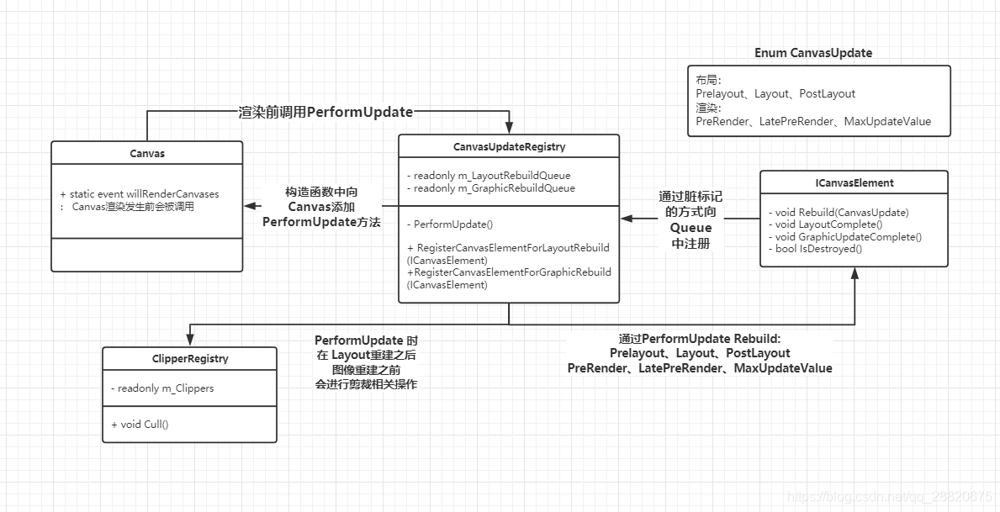

CanvasUpdateRegistry
<!--more-->



CanvasUpdateRegistry 是 UGUI 渲染更新链路的中央调度器。它回答的核心问题是：UI 元素发生变化（颜色、文本、尺寸、布局）后，什么时候真正重建网格和布局？ 答案不是“立即重建”，而是“先标记为脏、登记到队列，等到帧末 Canvas.willRenderCanvases 触发时统一批量重建”。

<details>
<summary>点击展开代码</summary>

```cs
using System;
using System.Collections.Generic;
using UnityEngine.UI.Collections;

namespace UnityEngine.UI
{
    /// <summary>
    /// Values of 'update' called on a Canvas update.
    /// </summary>
    /// <remarks> If modifying also modify m_CanvasUpdateProfilerStrings to match.</remarks>
    public enum CanvasUpdate
    {
        /// <summary>
        /// Called before layout.
        /// </summary>
        Prelayout = 0,
        /// <summary>
        /// Called for layout.
        /// </summary>
        Layout = 1,
        /// <summary>
        /// Called after layout.
        /// </summary>
        PostLayout = 2,
        /// <summary>
        /// Called before rendering.
        /// </summary>
        PreRender = 3,
        /// <summary>
        /// Called late, before render.
        /// </summary>
        LatePreRender = 4,
        /// <summary>
        /// Max enum value. Always last.
        /// </summary>
        MaxUpdateValue = 5
    }

    /// <summary>
    /// This is an element that can live on a Canvas.
    /// </summary>
    public interface ICanvasElement
    {
        /// <summary>
        /// Rebuild the element for the given stage.
        /// </summary>
        /// <param name="executing">The current CanvasUpdate stage being rebuild.</param>
        void Rebuild(CanvasUpdate executing);

        /// <summary>
        /// Get the transform associated with the ICanvasElement.
        /// </summary>
        Transform transform { get; }

        /// <summary>
        /// Callback sent when this ICanvasElement has completed layout.
        /// </summary>
        void LayoutComplete();

        /// <summary>
        /// Callback sent when this ICanvasElement has completed Graphic rebuild.
        /// </summary>
        void GraphicUpdateComplete();

        /// <summary>
        /// Used if the native representation has been destroyed.
        /// </summary>
        /// <returns>Return true if the element is considered destroyed.</returns>
        bool IsDestroyed();
    }

    /// <summary>
    /// A place where CanvasElements can register themselves for rebuilding.
    /// </summary>
    public class CanvasUpdateRegistry
    {
        private static CanvasUpdateRegistry s_Instance;

        private bool m_PerformingLayoutUpdate;
        private bool m_PerformingGraphicUpdate;

        // This list matches the CanvasUpdate enum above. Keep in sync
        private string[] m_CanvasUpdateProfilerStrings = new string[] { "CanvasUpdate.Prelayout", "CanvasUpdate.Layout", "CanvasUpdate.PostLayout", "CanvasUpdate.PreRender", "CanvasUpdate.LatePreRender" };
        private const string m_CullingUpdateProfilerString = "ClipperRegistry.Cull";

        private readonly IndexedSet<ICanvasElement> m_LayoutRebuildQueue = new IndexedSet<ICanvasElement>();
        private readonly IndexedSet<ICanvasElement> m_GraphicRebuildQueue = new IndexedSet<ICanvasElement>();

        protected CanvasUpdateRegistry()
        {
            Canvas.willRenderCanvases += PerformUpdate;
        }

        /// <summary>
        /// Get the singleton registry instance.
        /// </summary>
        public static CanvasUpdateRegistry instance
        {
            get
            {
                if (s_Instance == null)
                    s_Instance = new CanvasUpdateRegistry();
                return s_Instance;
            }
        }

        private bool ObjectValidForUpdate(ICanvasElement element)
        {
            var valid = element != null;

            var isUnityObject = element is Object;
            if (isUnityObject)
                valid = (element as Object) != null; //Here we make use of the overloaded UnityEngine.Object == null, that checks if the native object is alive.

            return valid;
        }

        private void CleanInvalidItems()
        {
            // So MB's override the == operator for null equality, which checks
            // if they are destroyed. This is fine if you are looking at a concrete
            // mb, but in this case we are looking at a list of ICanvasElement
            // this won't forward the == operator to the MB, but just check if the
            // interface is null. IsDestroyed will return if the backend is destroyed.

            var layoutRebuildQueueCount = m_LayoutRebuildQueue.Count;
            for (int i = layoutRebuildQueueCount - 1; i >= 0; --i)
            {
                var item = m_LayoutRebuildQueue[i];
                if (item == null)
                {
                    m_LayoutRebuildQueue.RemoveAt(i);
                    continue;
                }

                if (item.IsDestroyed())
                {
                    m_LayoutRebuildQueue.RemoveAt(i);
                    item.LayoutComplete();
                }
            }

            var graphicRebuildQueueCount = m_GraphicRebuildQueue.Count;
            for (int i = graphicRebuildQueueCount - 1; i >= 0; --i)
            {
                var item = m_GraphicRebuildQueue[i];
                if (item == null)
                {
                    m_GraphicRebuildQueue.RemoveAt(i);
                    continue;
                }

                if (item.IsDestroyed())
                {
                    m_GraphicRebuildQueue.RemoveAt(i);
                    item.GraphicUpdateComplete();
                }
            }
        }

        private static readonly Comparison<ICanvasElement> s_SortLayoutFunction = SortLayoutList;
        private void PerformUpdate()
        {
            UISystemProfilerApi.BeginSample(UISystemProfilerApi.SampleType.Layout);
            CleanInvalidItems();

            m_PerformingLayoutUpdate = true;

            m_LayoutRebuildQueue.Sort(s_SortLayoutFunction);

            for (int i = 0; i <= (int)CanvasUpdate.PostLayout; i++)
            {
                UnityEngine.Profiling.Profiler.BeginSample(m_CanvasUpdateProfilerStrings[i]);

                for (int j = 0; j < m_LayoutRebuildQueue.Count; j++)
                {
                    var rebuild = m_LayoutRebuildQueue[j];
                    try
                    {
                        if (ObjectValidForUpdate(rebuild))
                            rebuild.Rebuild((CanvasUpdate)i);
                    }
                    catch (Exception e)
                    {
                        Debug.LogException(e, rebuild.transform);
                    }
                }
                UnityEngine.Profiling.Profiler.EndSample();
            }

            for (int i = 0; i < m_LayoutRebuildQueue.Count; ++i)
                m_LayoutRebuildQueue[i].LayoutComplete();

            m_LayoutRebuildQueue.Clear();
            m_PerformingLayoutUpdate = false;
            UISystemProfilerApi.EndSample(UISystemProfilerApi.SampleType.Layout);
            UISystemProfilerApi.BeginSample(UISystemProfilerApi.SampleType.Render);

            // now layout is complete do culling...
            UnityEngine.Profiling.Profiler.BeginSample(m_CullingUpdateProfilerString);
            ClipperRegistry.instance.Cull();
            UnityEngine.Profiling.Profiler.EndSample();

            m_PerformingGraphicUpdate = true;

            for (var i = (int)CanvasUpdate.PreRender; i < (int)CanvasUpdate.MaxUpdateValue; i++)
            {
                UnityEngine.Profiling.Profiler.BeginSample(m_CanvasUpdateProfilerStrings[i]);
                for (var k = 0; k < m_GraphicRebuildQueue.Count; k++)
                {
                    try
                    {
                        var element = m_GraphicRebuildQueue[k];
                        if (ObjectValidForUpdate(element))
                            element.Rebuild((CanvasUpdate)i);
                    }
                    catch (Exception e)
                    {
                        Debug.LogException(e, m_GraphicRebuildQueue[k].transform);
                    }
                }
                UnityEngine.Profiling.Profiler.EndSample();
            }

            for (int i = 0; i < m_GraphicRebuildQueue.Count; ++i)
                m_GraphicRebuildQueue[i].GraphicUpdateComplete();

            m_GraphicRebuildQueue.Clear();
            m_PerformingGraphicUpdate = false;
            UISystemProfilerApi.EndSample(UISystemProfilerApi.SampleType.Render);
        }

        private static int ParentCount(Transform child)
        {
            if (child == null)
                return 0;

            var parent = child.parent;
            int count = 0;
            while (parent != null)
            {
                count++;
                parent = parent.parent;
            }
            return count;
        }

        private static int SortLayoutList(ICanvasElement x, ICanvasElement y)
        {
            Transform t1 = x.transform;
            Transform t2 = y.transform;

            return ParentCount(t1) - ParentCount(t2);
        }

        /// <summary>
        /// Try and add the given element to the layout rebuild list.
        /// Will not return if successfully added.
        /// </summary>
        /// <param name="element">The element that is needing rebuilt.</param>
        public static void RegisterCanvasElementForLayoutRebuild(ICanvasElement element)
        {
            instance.InternalRegisterCanvasElementForLayoutRebuild(element);
        }

        /// <summary>
        /// Try and add the given element to the layout rebuild list.
        /// </summary>
        /// <param name="element">The element that is needing rebuilt.</param>
        /// <returns>
        /// True if the element was successfully added to the rebuilt list.
        /// False if either already inside a Graphic Update loop OR has already been added to the list.
        /// </returns>
        public static bool TryRegisterCanvasElementForLayoutRebuild(ICanvasElement element)
        {
            return instance.InternalRegisterCanvasElementForLayoutRebuild(element);
        }

        private bool InternalRegisterCanvasElementForLayoutRebuild(ICanvasElement element)
        {
            if (m_LayoutRebuildQueue.Contains(element))
                return false;

            /* TODO: this likely should be here but causes the error to show just resizing the game view (case 739376)
            if (m_PerformingLayoutUpdate)
            {
                Debug.LogError(string.Format("Trying to add {0} for layout rebuild while we are already inside a layout rebuild loop. This is not supported.", element));
                return false;
            }*/

            return m_LayoutRebuildQueue.AddUnique(element);
        }

        /// <summary>
        /// Try and add the given element to the rebuild list.
        /// Will not return if successfully added.
        /// </summary>
        /// <param name="element">The element that is needing rebuilt.</param>
        public static void RegisterCanvasElementForGraphicRebuild(ICanvasElement element)
        {
            instance.InternalRegisterCanvasElementForGraphicRebuild(element);
        }

        /// <summary>
        /// Try and add the given element to the rebuild list.
        /// </summary>
        /// <param name="element">The element that is needing rebuilt.</param>
        /// <returns>
        /// True if the element was successfully added to the rebuilt list.
        /// False if either already inside a Graphic Update loop OR has already been added to the list.
        /// </returns>
        public static bool TryRegisterCanvasElementForGraphicRebuild(ICanvasElement element)
        {
            return instance.InternalRegisterCanvasElementForGraphicRebuild(element);
        }

        private bool InternalRegisterCanvasElementForGraphicRebuild(ICanvasElement element)
        {
            if (m_PerformingGraphicUpdate)
            {
                Debug.LogError(string.Format("Trying to add {0} for graphic rebuild while we are already inside a graphic rebuild loop. This is not supported.", element));
                return false;
            }

            return m_GraphicRebuildQueue.AddUnique(element);
        }

        /// <summary>
        /// Remove the given element from both the graphic and the layout rebuild lists.
        /// </summary>
        /// <param name="element"></param>
        public static void UnRegisterCanvasElementForRebuild(ICanvasElement element)
        {
            instance.InternalUnRegisterCanvasElementForLayoutRebuild(element);
            instance.InternalUnRegisterCanvasElementForGraphicRebuild(element);
        }

        /// <summary>
        /// Disable the given element from both the graphic and the layout rebuild lists.
        /// </summary>
        /// <param name="element"></param>
        public static void DisableCanvasElementForRebuild(ICanvasElement element)
        {
            instance.InternalDisableCanvasElementForLayoutRebuild(element);
            instance.InternalDisableCanvasElementForGraphicRebuild(element);
        }

        private void InternalUnRegisterCanvasElementForLayoutRebuild(ICanvasElement element)
        {
            if (m_PerformingLayoutUpdate)
            {
                Debug.LogError(string.Format("Trying to remove {0} from rebuild list while we are already inside a rebuild loop. This is not supported.", element));
                return;
            }

            element.LayoutComplete();
            instance.m_LayoutRebuildQueue.Remove(element);
        }

        private void InternalUnRegisterCanvasElementForGraphicRebuild(ICanvasElement element)
        {
            if (m_PerformingGraphicUpdate)
            {
                Debug.LogError(string.Format("Trying to remove {0} from rebuild list while we are already inside a rebuild loop. This is not supported.", element));
                return;
            }
            element.GraphicUpdateComplete();
            instance.m_GraphicRebuildQueue.Remove(element);
        }

        private void InternalDisableCanvasElementForLayoutRebuild(ICanvasElement element)
        {
            if (m_PerformingLayoutUpdate)
            {
                Debug.LogError(string.Format("Trying to remove {0} from rebuild list while we are already inside a rebuild loop. This is not supported.", element));
                return;
            }

            element.LayoutComplete();
            instance.m_LayoutRebuildQueue.DisableItem(element);
        }

        private void InternalDisableCanvasElementForGraphicRebuild(ICanvasElement element)
        {
            if (m_PerformingGraphicUpdate)
            {
                Debug.LogError(string.Format("Trying to remove {0} from rebuild list while we are already inside a rebuild loop. This is not supported.", element));
                return;
            }
            element.GraphicUpdateComplete();
            instance.m_GraphicRebuildQueue.DisableItem(element);
        }

        /// <summary>
        /// Are graphics layouts currently being calculated..
        /// </summary>
        /// <returns>True if the rebuild loop is CanvasUpdate.Prelayout, CanvasUpdate.Layout or CanvasUpdate.Postlayout</returns>
        public static bool IsRebuildingLayout()
        {
            return instance.m_PerformingLayoutUpdate;
        }

        /// <summary>
        /// Are graphics currently being rebuild.
        /// </summary>
        /// <returns>True if the rebuild loop is CanvasUpdate.PreRender or CanvasUpdate.Render</returns>
        public static bool IsRebuildingGraphics()
        {
            return instance.m_PerformingGraphicUpdate;
        }
    }
}

```

</details>


# 一、两个前置定义
## 1.1 CanvasUpdate 枚举：重建的阶段

```cs
public enum CanvasUpdate
{
    Prelayout = 0,      // 布局前
    Layout = 1,         // 布局中
    PostLayout = 2,     // 布局后
    PreRender = 3,      // 渲染前
    LatePreRender = 4,  // 渲染前晚期
    MaxUpdateValue = 5  // 最大值，哨兵
}
```

它把一次重建拆成五个阶段，Rebuild(CanvasUpdate executing) 会根据当前阶段做不同的事：

|阶段	|归属	|典型工作|
|---|---|---|
Prelayout / Layout / PostLayout	|**布局阶段**|	LayoutRebuilder 计算子元素位置和尺寸|
PreRender / LatePreRender|	图形阶段|	Graphic 生成网格、更新材质|

**先布局、后图形是核心顺序**：布局决定每个元素的位置和尺寸，图形再根据这些结果生成网格。顺序反了，图形会用旧的布局数据。


## 1.2 ICanvasElement 接口：可重建元素的契约

```cs
public interface ICanvasElement
{
    void Rebuild(CanvasUpdate executing);   // 按阶段重建
    Transform transform { get; }            // 用于排序
    void LayoutComplete();                  // 布局完成回调
    void GraphicUpdateComplete();           // 图形更新完成回调
    bool IsDestroyed();                     // 原生对象是否已销毁
}
```

任何“可以被 Canvas 重建”的对象都实现这个接口。最典型的是：

- Graphic（Image、Text 等）——参与图形重建；

- LayoutRebuilder——参与布局重建。

**Rebuild 是核心方法，LayoutComplete / GraphicUpdateComplete 是重建完成后的通知**，transform 用于排序，IsDestroyed 用于清理已销毁元素。


# 二、CanvasUpdateRegistry 的核心结构

## 2.1 两个队列：布局队列 + 图形队列

```cs
private readonly IndexedSet<ICanvasElement> m_LayoutRebuildQueue = new IndexedSet<ICanvasElement>();
private readonly IndexedSet<ICanvasElement> m_GraphicRebuildQueue = new IndexedSet<ICanvasElement>();
```

用 IndexedSet 而不是普通 List 或 HashSet，是因为它同时满足两个需求：

- **去重**：同一个元素多次标记脏，队列里只保留一份，避免重复重建。

- **按索引遍历**：重建时需要按下标遍历，HashSet 做不到。

## 2.2 单例 + 挂载 willRenderCanvases 事件

```cs
protected CanvasUpdateRegistry()
{
    Canvas.willRenderCanvases += PerformUpdate;
}

public static CanvasUpdateRegistry instance
{
    get
    {
        if (s_Instance == null)
            s_Instance = new CanvasUpdateRegistry();
        return s_Instance;
    }
}
```

- 单例：全局只有一个注册表。

- 构造时订阅 Canvas.willRenderCanvases：这是 Unity 提供的事件，**在 Canvas 渲染之前触发**。UGUI 把重建时机挂在这里，**保证“重建发生在渲染前，重建结果能被这一帧渲染使用”**。

这是整条链路的驱动源：**脏标记只是登记，真正触发重建的是 willRenderCanvases**。


## 2.3 两个状态标志：防止重建中再注册

```cs
private bool m_PerformingLayoutUpdate;
private bool m_PerformingGraphicUpdate;
```

重建过程中，**如果某个元素的 Rebuild 又触发了新的脏标记**（比如布局重建改变了尺寸，导致某个 Graphic 变脏），**直接往队列里加会破坏正在进行的遍历**。这两个标志用来检测“是否正在重建”，配合 IsRebuildingLayout() / IsRebuildingGraphics() 供外部查询。


# 三、注册与注销：脏标记的入口

## 3.1 注册布局重建

```cs

/// <summary>
/// Try and add the given element to the layout rebuild list.
/// Will not return if successfully added.
/// </summary>
/// <param name="element">The element that is needing rebuilt.</param>
public static void RegisterCanvasElementForLayoutRebuild(ICanvasElement element)
{
    instance.InternalRegisterCanvasElementForLayoutRebuild(element);
}

/// <summary>
/// Try and add the given element to the layout rebuild list.
/// </summary>
/// <param name="element">The element that is needing rebuilt.</param>
/// <returns>
/// True if the element was successfully added to the rebuilt list.
/// False if either already inside a Graphic Update loop OR has already been added to the list.
/// </returns>
public static bool TryRegisterCanvasElementForLayoutRebuild(ICanvasElement element)
{
    return instance.InternalRegisterCanvasElementForLayoutRebuild(element);
}

private bool InternalRegisterCanvasElementForLayoutRebuild(ICanvasElement element)
{
    if (m_LayoutRebuildQueue.Contains(element))
        return false;

    /* TODO: this likely should be here but causes the error to show just resizing the game view (case 739376)
    if (m_PerformingLayoutUpdate)
    {
        Debug.LogError(string.Format("Trying to add {0} for layout rebuild while we are already inside a layout rebuild loop. This is not supported.", element));
        return false;
    }*/

    return m_LayoutRebuildQueue.AddUnique(element);
}
```

- 先 Contains 再 AddUnique：已经在队列里就直接返回 false，不重复添加。

- AddUnique 是 IndexedSet 的方法，内部也会去重，这里是双重保险。

- TryRegister... 版本返回 bool，告诉调用方“这次是否真的加进去了”；无返回值的 Register... 版本不关心结果，直接加。


## 3.2 注册图形重建

```cs
/// <summary>
/// Try and add the given element to the rebuild list.
/// Will not return if successfully added.
/// </summary>
/// <param name="element">The element that is needing rebuilt.</param>
public static void RegisterCanvasElementForGraphicRebuild(ICanvasElement element)
{
    instance.InternalRegisterCanvasElementForGraphicRebuild(element);
}

/// <summary>
/// Try and add the given element to the rebuild list.
/// </summary>
/// <param name="element">The element that is needing rebuilt.</param>
/// <returns>
/// True if the element was successfully added to the rebuilt list.
/// False if either already inside a Graphic Update loop OR has already been added to the list.
/// </returns>
public static bool TryRegisterCanvasElementForGraphicRebuild(ICanvasElement element)
{
    return instance.InternalRegisterCanvasElementForGraphicRebuild(element);
}

private bool InternalRegisterCanvasElementForGraphicRebuild(ICanvasElement element)
{
    if (m_PerformingGraphicUpdate)
    {
        Debug.LogError(string.Format("Trying to add {0} for graphic rebuild while we are already inside a graphic rebuild loop. This is not supported.", element));
        return false;
    }

    return m_GraphicRebuildQueue.AddUnique(element);
}
```

和布局版注册的关键区别：**图形重建队列拒绝在 m_PerformingGraphicUpdate == true 时注册**。因为图形重建过程中再往队列里加元素，会破坏正在遍历的 IndexedSet，Unity 直接报错拒绝。

布局版这里有一段被注释掉的相同检查，注释说明“这个检查会引发 case 739376（仅调整 Game 视图就报错）”，所以布局版暂时没启用这个保护。


## 3.3 注销与禁用

<details>
<summary>点击展开代码</summary>

```cs
/// <summary>
        /// Remove the given element from both the graphic and the layout rebuild lists.
        /// </summary>
        /// <param name="element"></param>
        public static void UnRegisterCanvasElementForRebuild(ICanvasElement element)
        {
            instance.InternalUnRegisterCanvasElementForLayoutRebuild(element);
            instance.InternalUnRegisterCanvasElementForGraphicRebuild(element);
        }

        /// <summary>
        /// Disable the given element from both the graphic and the layout rebuild lists.
        /// </summary>
        /// <param name="element"></param>
        public static void DisableCanvasElementForRebuild(ICanvasElement element)
        {
            instance.InternalDisableCanvasElementForLayoutRebuild(element);
            instance.InternalDisableCanvasElementForGraphicRebuild(element);
        }

        private void InternalUnRegisterCanvasElementForLayoutRebuild(ICanvasElement element)
        {
            if (m_PerformingLayoutUpdate)
            {
                Debug.LogError(string.Format("Trying to remove {0} from rebuild list while we are already inside a rebuild loop. This is not supported.", element));
                return;
            }

            element.LayoutComplete();
            instance.m_LayoutRebuildQueue.Remove(element);
        }

        private void InternalUnRegisterCanvasElementForGraphicRebuild(ICanvasElement element)
        {
            if (m_PerformingGraphicUpdate)
            {
                Debug.LogError(string.Format("Trying to remove {0} from rebuild list while we are already inside a rebuild loop. This is not supported.", element));
                return;
            }
            element.GraphicUpdateComplete();
            instance.m_GraphicRebuildQueue.Remove(element);
        }

        private void InternalDisableCanvasElementForLayoutRebuild(ICanvasElement element)
        {
            if (m_PerformingLayoutUpdate)
            {
                Debug.LogError(string.Format("Trying to remove {0} from rebuild list while we are already inside a rebuild loop. This is not supported.", element));
                return;
            }

            element.LayoutComplete();
            instance.m_LayoutRebuildQueue.DisableItem(element);
        }

        private void InternalDisableCanvasElementForGraphicRebuild(ICanvasElement element)
        {
            if (m_PerformingGraphicUpdate)
            {
                Debug.LogError(string.Format("Trying to remove {0} from rebuild list while we are already inside a rebuild loop. This is not supported.", element));
                return;
            }
            element.GraphicUpdateComplete();
            instance.m_GraphicRebuildQueue.DisableItem(element);
        }

```

</details>

- 从两个队列里都移除，并调用对应的 LayoutComplete() / GraphicUpdateComplete() 做清理。

- 还有 DisableCanvasElementForRebuild，用 **IndexedSet.DisableItem 而不是 Remove——“禁用”不等于“移除”**，元素还留在集合里但被标记为禁用，遍历时跳过。这样如果元素**重新启用，不需要重新添加**。

注销时同样检查 m_PerformingLayoutUpdate / m_PerformingGraphicUpdate，重建中不允许移除。


# 四、PerformUpdate：重建的核心流程

<details>
<summary>点击展开代码</summary>

```cs
private void PerformUpdate()
{
    UISystemProfilerApi.BeginSample(UISystemProfilerApi.SampleType.Layout);
    CleanInvalidItems();

    m_PerformingLayoutUpdate = true;

    m_LayoutRebuildQueue.Sort(s_SortLayoutFunction);

    for (int i = 0; i <= (int)CanvasUpdate.PostLayout; i++)
    {
        UnityEngine.Profiling.Profiler.BeginSample(m_CanvasUpdateProfilerStrings[i]);

        for (int j = 0; j < m_LayoutRebuildQueue.Count; j++)
        {
            var rebuild = m_LayoutRebuildQueue[j];
            try
            {
                if (ObjectValidForUpdate(rebuild))
                    rebuild.Rebuild((CanvasUpdate)i);
            }
            catch (Exception e)
            {
                Debug.LogException(e, rebuild.transform);
            }
        }
        UnityEngine.Profiling.Profiler.EndSample();
    }

    for (int i = 0; i < m_LayoutRebuildQueue.Count; ++i)
        m_LayoutRebuildQueue[i].LayoutComplete();

    m_LayoutRebuildQueue.Clear();
    m_PerformingLayoutUpdate = false;
    UISystemProfilerApi.EndSample(UISystemProfilerApi.SampleType.Layout);
    UISystemProfilerApi.BeginSample(UISystemProfilerApi.SampleType.Render);

    // now layout is complete do culling...
    UnityEngine.Profiling.Profiler.BeginSample(m_CullingUpdateProfilerString);
    ClipperRegistry.instance.Cull();
    UnityEngine.Profiling.Profiler.EndSample();

    m_PerformingGraphicUpdate = true;

    for (var i = (int)CanvasUpdate.PreRender; i < (int)CanvasUpdate.MaxUpdateValue; i++)
    {
        UnityEngine.Profiling.Profiler.BeginSample(m_CanvasUpdateProfilerStrings[i]);
        for (var k = 0; k < m_GraphicRebuildQueue.Count; k++)
        {
            try
            {
                var element = m_GraphicRebuildQueue[k];
                if (ObjectValidForUpdate(element))
                    element.Rebuild((CanvasUpdate)i);
            }
            catch (Exception e)
            {
                Debug.LogException(e, m_GraphicRebuildQueue[k].transform);
            }
        }
        UnityEngine.Profiling.Profiler.EndSample();
    }

    for (int i = 0; i < m_GraphicRebuildQueue.Count; ++i)
        m_GraphicRebuildQueue[i].GraphicUpdateComplete();

    m_GraphicRebuildQueue.Clear();
    m_PerformingGraphicUpdate = false;
    UISystemProfilerApi.EndSample(UISystemProfilerApi.SampleType.Render);
}
```

</details>

这是整个类最核心的方法，由 Canvas.willRenderCanvases 事件驱动。

## 4.1 阶段 0：清理无效元素

```cs
UISystemProfilerApi.BeginSample(UISystemProfilerApi.SampleType.Layout);
CleanInvalidItems();

private void CleanInvalidItems()
{
    // So MB's override the == operator for null equality, which checks
    // if they are destroyed. This is fine if you are looking at a concrete
    // mb, but in this case we are looking at a list of ICanvasElement
    // this won't forward the == operator to the MB, but just check if the
    // interface is null. IsDestroyed will return if the backend is destroyed.

    var layoutRebuildQueueCount = m_LayoutRebuildQueue.Count;
    for (int i = layoutRebuildQueueCount - 1; i >= 0; --i)
    {
        var item = m_LayoutRebuildQueue[i];
        if (item == null)
        {
            m_LayoutRebuildQueue.RemoveAt(i);
            continue;
        }

        if (item.IsDestroyed())
        {
            m_LayoutRebuildQueue.RemoveAt(i);
            item.LayoutComplete();
        }
    }

    var graphicRebuildQueueCount = m_GraphicRebuildQueue.Count;
    for (int i = graphicRebuildQueueCount - 1; i >= 0; --i)
    {
        var item = m_GraphicRebuildQueue[i];
        if (item == null)
        {
            m_GraphicRebuildQueue.RemoveAt(i);
            continue;
        }

        if (item.IsDestroyed())
        {
            m_GraphicRebuildQueue.RemoveAt(i);
            item.GraphicUpdateComplete();
        }
    }
}
```

```
题外话
UISystemProfilerApi.BeginSample(UISystemProfilerApi.SampleType.Layout);

UISystemProfilerApi.BeginSample / EndSample 是 Unity 提供给 UGUI 的 Profiler 打点 API，用来在 Unity Profiler 里把 UGUI 的更新过程标记成带名字的采样块，方便你在Unity Profiler中直观看到“这一帧 UI 布局花了多久、图形重建花了多久、裁剪花了多久”。
```

遍历两个队列，移除：

- item == null：接口引用本身就是 null。

- item.IsDestroyed()：原生对象已销毁，但 C# 接口引用还在。

这里有一个关键注释解释了为什么需要 IsDestroyed()：

MonoBehaviour 重载了 ==，但它只在“具体类型”比较时生效。队列里存的是 ICanvasElement 接口，item == null 不会转发到 MonoBehaviour 的重载，只检查接口引用是否为 null。所以要额外调 IsDestroyed() 判断原生对象是否已销毁。

## 4.2 阶段 1：布局重建

```cs
m_PerformingLayoutUpdate = true;

m_LayoutRebuildQueue.Sort(s_SortLayoutFunction);

for (int i = 0; i <= (int)CanvasUpdate.PostLayout; i++)
{
    for (int j = 0; j < m_LayoutRebuildQueue.Count; j++)
    {
        var rebuild = m_LayoutRebuildQueue[j];
        try
        {
            if (ObjectValidForUpdate(rebuild))
                rebuild.Rebuild((CanvasUpdate)i);
        }
        catch (Exception e)
        {
            Debug.LogException(e, rebuild.transform);
        }
    }
}

for (int i = 0; i < m_LayoutRebuildQueue.Count; ++i)
    m_LayoutRebuildQueue[i].LayoutComplete();

m_LayoutRebuildQueue.Clear();
m_PerformingLayoutUpdate = false;
```

1. 先排序：s_SortLayoutFunction 按父级数量升序排。

2. 外层循环三个阶段：Prelayout(0) → Layout(1) → PostLayout(2)，每个阶段遍历整个队列，调 Rebuild((CanvasUpdate)i)。

3. ObjectValidForUpdate：再检查一次有效性（element != null，如果是 Unity Object 还要判断原生对象是否存活）。

4. 异常隔离：单个元素 Rebuild 抛异常只 LogException，不中断其他元素。

5. 全部重建完后，对每个元素调 LayoutComplete()，然后 Clear() 队列。

6. m_PerformingLayoutUpdate 在重建期间为 true，结束后置 false。

- 为什么先排序：布局重建有依赖关系——**父级必须比子级先重建**。父级的尺寸决定子级的位置。SortLayoutList 按父级数量（深度）升序排，**深度小的（更靠近根）排在前面，保证父级先于子级重建**。
```cs
private static int SortLayoutList(ICanvasElement x, ICanvasElement y)
{
    return ParentCount(x.transform) - ParentCount(y.transform);
}
```
ParentCount 沿 transform.parent 一路向上数，得到层级深度。深度小的优先。


## 4.3 阶段 2：裁剪

```cs
ClipperRegistry.instance.Cull();
```

**布局完成后、图形重建前**，先做裁剪计算（Mask / RectMask2D 相关）。因为图形**重建生成网格时，需要用裁剪后的矩形信息**。


## 4.4 阶段 3：图形重建
```cs
m_PerformingGraphicUpdate = true;

for (var i = (int)CanvasUpdate.PreRender; i < (int)CanvasUpdate.MaxUpdateValue; i++)
{
    for (var k = 0; k < m_GraphicRebuildQueue.Count; k++)
    {
        try
        {
            var element = m_GraphicRebuildQueue[k];
            if (ObjectValidForUpdate(element))
                element.Rebuild((CanvasUpdate)i);
        }
        catch (Exception e)
        {
            Debug.LogException(e, m_GraphicRebuildQueue[k].transform);
        }
    }
}

for (int i = 0; i < m_GraphicRebuildQueue.Count; ++i)
    m_GraphicRebuildQueue[i].GraphicUpdateComplete();

m_GraphicRebuildQueue.Clear();
m_PerformingGraphicUpdate = false;
```


- 和**布局重建**的代码结构完全对称：

- 外层循环 PreRender(3) → LatePreRender(4) 两个阶段。

- 每个阶段遍历整个图形队列，调 Rebuild。

- 全部完成后调 GraphicUpdateComplete()，Clear() 队列。

- 异常隔离、有效性检查、状态标志，都和布局重建一致。


图形队列**不排序**——因为图形重建（生成网格）不依赖父子顺序，**每个 Graphic 独立生成自己的网格**。布局队列需要排序，是因为布局有父子依赖。

## 4.5 整体顺序图
```cs
willRenderCanvases 触发
  ↓
CleanInvalidItems()                   清理已销毁元素
  ↓
布局重建（m_PerformingLayoutUpdate = true）
  ├─ 按层级深度排序
  ├─ Prelayout → Layout → PostLayout  三阶段遍历重建
  ├─ LayoutComplete() 通知
  └─ Clear 队列
  ↓
ClipperRegistry.Cull()                裁剪计算
  ↓
图形重建（m_PerformingGraphicUpdate = true）
  ├─ PreRender → LatePreRender        两阶段遍历重建
  ├─ GraphicUpdateComplete() 通知
  └─ Clear 队列
  ↓
渲染使用重建结果
```

# 五、几个值得注意的设计点
1. 为什么用 IndexedSet 而不是 List
**去重**：同一个 Graphic 在一帧内可能多次 SetVerticesDirty()，用 List 会重复添加，重建多次；IndexedSet 去重，只重建一次。

快速查找：Contains 是 O(1)，List 是 O(n)。

按下标遍历：重建时需要 for (int j = 0; j < queue.Count; j++) 按下标访问，HashSet 不支持。

2. 为什么布局要排序、图形不排序
布局有父子依赖：父级的尺寸决定子级的位置，父级必须先重建。按层级深度升序排，保证父先于子。

图形无依赖：每个 Graphic 独立生成自己的网格，互不影响，顺序无关。

3. 为什么 CleanInvalidItems 要调 IsDestroyed
队列里存的是 ICanvasElement 接口。item == null 对接口只检查引用是否为 null，不会触发 MonoBehaviour 重载的 ==。原生对象已销毁但 C# 接口引用还在时，item == null 是 false，必须显式调 IsDestroyed() 才能识别。这是你之前学的 UIBehaviour.IsDestroyed() 的实际用途。

4. 异常隔离的意义
单个元素的 Rebuild 抛异常，只记录日志并继续处理下一个元素。如果不用 try-catch，一个坏组件会让整个 UI 更新中断，所有 UI 停止刷新——这是灾难性的。隔离保证“一个坏组件不影响其他 UI”。

5. m_Performing... 标志的作用
重建过程中，元素的 Rebuild 可能触发新的脏标记（比如布局改变导致 Graphic 变脏）。图形队列直接拒绝在 m_PerformingGraphicUpdate 期间注册，避免破坏正在遍历的集合。布局队列的相同检查被注释掉了（因为引发 case 739376），但标志本身仍然用于 IsRebuildingLayout() / IsRebuildingGraphics() 查询。
   - 如果启用这个检查，**仅仅是在编辑器里拖动 Game 视图的窗口大小，就会触发这个错误。对于一个在编辑器中频繁发生的、非用户代码逻辑引发的错误，它对开发者来说是极大的噪音**，因此 Unity 官方选择注释掉这个检查，来换取编辑器的使用体验。

# 六、总结

CanvasUpdateRegistry 是 UGUI 系统中一个非常出色的设计，它是 UGUI 与 Canvas 之间的中介，**统一管理了 UI 元素的布局与渲染过程**。

CanvasUpdateRegistry 将 PerformUpdate 函数注册到了 Canvas.willRenderCanvases 事件中，每当 Canvas 即将渲染时，PerformUpdate 函数就会被调用。PerformUpdate 函数会遍历 m_LayoutRebuildQueue 与 m_GraphicRebuildQueue 中的元素，根据当前的阶段调用元素的 Rebuild 方法，完成元素的更新逻辑。

所谓阶段，是指 CanvasUpdateRegistry 内部对一个 UI 元素更新过程的划分。总体而言，该过程分为布局与渲染两个阶段，在此基础上又细分为五个子阶段。在更新过程中，会根据当前的阶段调用元素的 Rebuild 方法，完成元素的更新逻辑。
```cs
总结内容引用自：https://qlipphoth.github.io/2024/08/29/2024-8-29-2/
```

**CanvasUpdateRegistry把“UI 元素变化”和“实际重建网格/布局”解耦：变化时只标记脏、登记队列，真正重建推迟到帧末统一批量处理。这样既避免了同一帧内的重复重建，又保证了布局先于图形、重建先于渲染的正确顺序。**