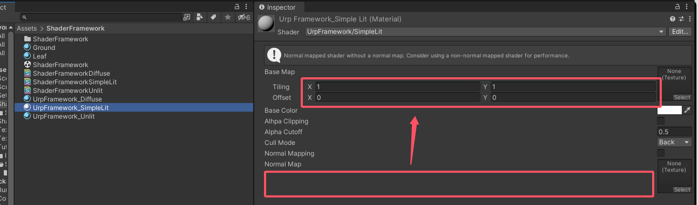
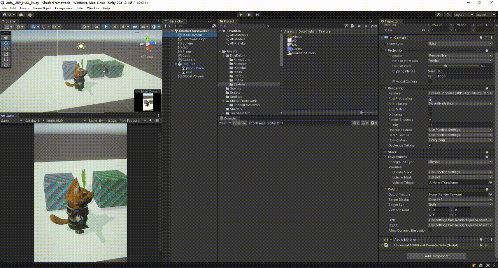
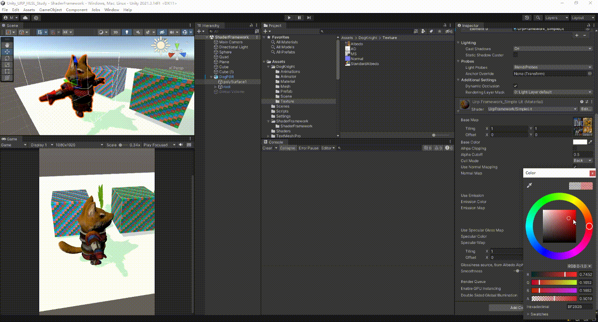
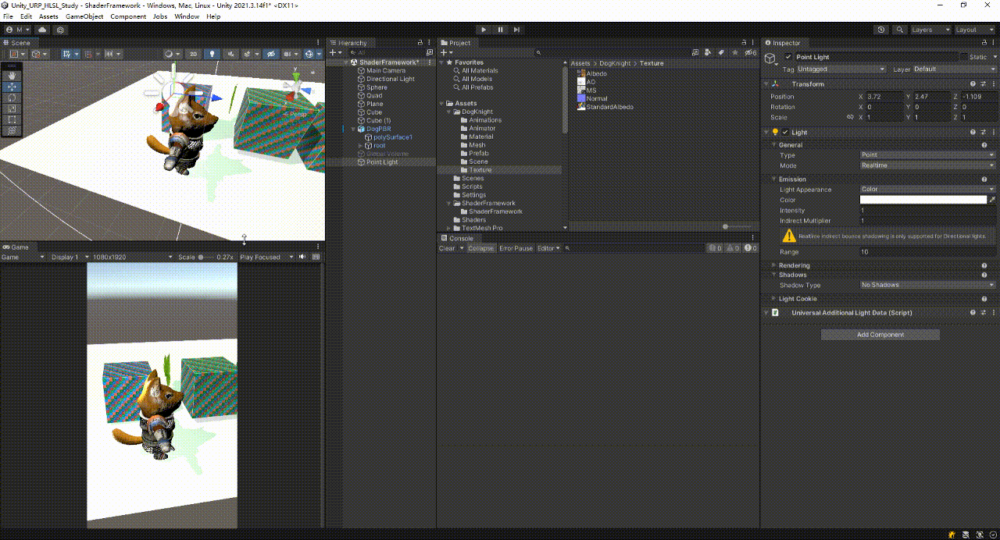
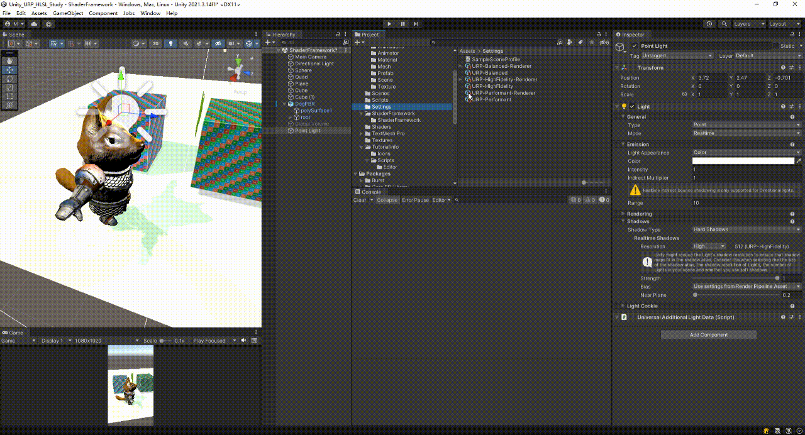

手写URP-Shader代码框架-BlinnPhong-Shader框架
<!--more-->
# 零、目的
目的：模拟Unity URP 官方源码的SimpleLit的实现
- 法线贴图的支持
- 高光反射
- 自发光支持
- 平滑度支持
- 多光源支持

准备：
从之前的漫反射模型shader复制一份shader出来重命名ShaderFrameworkSimpleLit

下面的内容均指代相对于漫反射模型shader新增的内容！
# 一、SimpleLit参数定义
## 1.1 定义属性
1. 代码
```c
Properties
{
   [Toggle(_NORMALMAP)]_NormalMapToggle("Use Normal Mapping",Float) = 0 //是否使用法线贴图卡关
    //法线2d贴图，添加NoScaleOffset表示不支持tiling(scaling)和offset（平铺和偏移）
    //默认设置为bump图，bump表示bump法线图，其法线方向没有被扰动的，与物体表秒垂直
    [NoScaleOffset]_BumpMap("Normal Map",2d) = "bump"{}   

    //是否使用自发光
    [Toggle(_EMISSION)]_EmissionToggle("Use Emission",Float) = 0
    //自发光颜色 ，为(0,0,0)黑色时代表不发光
    //由于希望自发光的光线反弹能够对别的物体产生影响，所以自发光颜色都应超过1.0的数值
    //超过1.0的值越大，自发光的系数强度就越高
    //因此加入[HDR]
    [HDR]_EmissionColor("Emission Color",Color) = (0,0,0)
    //自发光贴图，且不支持tiling(scaling)和offset（平铺和偏移）
    //默认设置为白色图
    [NoScaleOffset]_EmissionMap("Emission Map",2d) = "white"{}

    //是否开启高光光泽度贴图 。 高光光泽度贴图就是 “镜面光贴图 + 光泽度贴图”按固定通道打包成一张的贴图。
    [Toggle(_SPECGLOSSMAP)]_SpecGlossMapToggle("Use Specular Gloss Map",Float) = 0
    //镜面高光（反射）颜色
    _SpecColor("Specular Color", Color) = (0.5, 0.5, 0.5, 0.5)
    //镜面光贴图
    _SpecGlosMap("Specular Map", 2d) = "white"{}


    /*
    由于光泽度贴图是一张灰度图，所以可以跟其他的彩色贴图合并的。
    比如就可以跟漫反射(固有色)贴图"_BaseMap"合并到一张支持RGBA颜色的贴图里面。RGB通道用来放漫反射(固有色)颜色，A通道用来放光泽度
    或者
    也可以跟镜面光贴图"Specular Map"合并，RGB通道用来放镜面光贴图的颜色，A通道放光泽度
    因此声明一个开关。当开关打开时（值为1），与漫反射贴图合并，反之与镜面光贴图合并
    */
    [Toggle(_GLOSSINESS_FROM_BASE_ALPHA)]_GlossSource("Glossiness source, from Albedo Alpha (if on) vs from Specular (if off)",Float) = 0

    //平滑度支持
    _Smoothness("Smoothness",Range(0.0,1.0)) = 0.5 
}
```
2. 属性定义具体表现
- [NoScaleOffset] 效果

- 自发光系数

- 自发光开关以及贴图

## 1.2 定义变量及引入头文件
- 注意这里为什么没有像之前_BaseMap一样，去定义_BumpMap、_EmissionMap、_SpecGlosMap。
  - 因为引入了SurfaceInput.hlsl，里面已经定了三个相关的变量了

```c

 //一些公用的内容
HLSLINCLUDE
        //自发光颜色 
        float4 _EmissionColor;
        //镜面高光（反射）颜色
        float4 _SpecColor;
        //平滑度
        float _Smoothness;

    CBUFFER_END
ENDHLSL

Pass
{
    HLSLPROGRAM
        #include "Packages/com.unity.render-pipelines.universal/ShaderLibrary/SurfaceInput.hlsl"

        #pragma shader_feature _NORMALMAP //变体开关 => 使用法线贴图
        #pragma shader_feature _EMISSION //变体开关 => 使用自发光
        #pragma shader_feature _SPECGLOSSMAP // 变体开关 => 使用高光光泽度贴图
        #define _SPECULAR_COLOR//强制开启高光颜色（镜面反射）
        #pragma shader_feature _GLOSSINESS_FROM_BASE_ALPHA //变体开关=>光泽度贴图来自于BaseMap的alpha贴图来

        //引用了 "Packages/com.unity.render-pipelines.universal/ShaderLibrary/SurfaceInput.hlsl" 库，里面也定义了TEXTURE2D(_BaseMap); SAMPLER(sampler_BaseMap); 直接去掉
        //TEXTURE2D(_BaseMap); SAMPLER(sampler_BaseMap);//定义2d纹理、筛选器
        // 注意这里为什么没有像之前_BaseMap一样，去定义_BumpMap、_EmissionMap。,也是因为引入了SurfaceInput.hlsl，里面已经定义了相关的变量了
    ENDHLSL
}

```

# 二、SimpleLitPassVertex
## 2.1 顶点数据修改
```c
struct Attributes {
    #ifdef _NORMALMAP //法线贴图开关开启
        float4 tangentOS:TANGENT//切线空间的切线向量(法线贴图相关参数）
    #endif
};
```

## 2.2 片元数据修改
```c
struct Varyings { 
    #ifdef _NORMALMAP //法线贴图开关开启
        half4 normalWS  :TEXCOORD3;//法线
        half4 tangentWS :TEXCOORD4;//切线
        half4 bitangentWS:TEXCOORD5;//副切线
    #else
        //每个片元世界坐标中的法线，用于计算漫反射
        float3 normalWS     :TEXCOORD3;
    #endif

    //如果使用额外的顶点灯光
    #ifdef _ADDITIONAL_LIGHTS_VERTEX
        half4 fogFactorAndVertexLight :TEXCOORD6; // x:存储雾效信息， yzw:存储顶点光照信息
    #else
        half fogFactor :TEXCOORD6; //不存储额外顶点光照信息。（每个通道可以存4维向量，目前只放了一个half 还有3维度的向量可以放到该通道）
    #endif

    //如果阴影数据提前传入 （而不是在片元着色器中计算的）
    #ifdef REQUIRES_VERTEX_SHADOWCOORD_INTERPOLATOR
        float3 shadowCoord :TEXCOORD7;//用于存储阴影数据的变量
    #endif
};
```

## 2.3 顶点着色器修改

```c
//顶点着色器，传入数据声明变量名为IN
Varyings SimpleLitPassVertex(Attributes IN) 
{
    #ifdef _NORMALMAP //如果开启法线贴图 ，则多传入一个法线数据
        VertexNormalInputs normalInputs = GetVertexNormalInputs(IN.normalOS, IN.tangentOS);
    #else
        VertexNormalInputs normalInputs = GetVertexNormalInputs(IN.normalOS);
    #endif

    // 获得视空间的方向信息
    half3 viewDirWS = GetWorldSpaceViewDir(positionInputs.positionWS);

    #ifdef _NORMALMAP //如果开启法线贴图 ，则多传入一个法线数据
        //通道已经定到7了，且有些老设备也只支持到通道7，所以不能再在Varyings中定义新的变量了。
        //不过由于OUT.normalWS定义为四维向量，但normalInputs.normalWS是个三维变量
        //因此可以把多的一维拿来存 试方向信息 便于后续计算高光反射
        OUT.normalWS = float4(normalInputs.normalWS, viewDirWS.x);
        OUT.tangentWS = float4(normalInputs.tangentWS, viewDirWS.y);
        OUT.bitangentWS = float4(normalInputs.bitangentWS, viewDirWS.z);
    #else
        // 未开启法线贴图：只需要法线
        /*
        如果没开法线贴图，片元着色器直接用顶点插值过来的世界空间法线 normalWS 就行，不需要 T、B，所以 tangentWS 和 bitangentWS 可以完全不赋值。
        并且做一下归一化处理
        */
        OUT.normalWS = NormalizeNormalPerVertex(normalInputs.normalWS);
    #endif

    half fogFactor = ComputeFogFactor(positionInputs.positionCS.z);
    half3 vertexLight = VertexLighting(positionInputs.positionWS,normalInputs.normalWS);
    
    #ifdef _ADDITIONAL_LIGHTS_VERTEX //如果使用额外点光源
        //参数：雾效，顶点光照信息（当场景中的逐像素光比较多的时候，unity为了优化性能，会把设定的像素光数量之外的灯光用顶点光照来计算
        OUT.fogFactorAndVertexLight = half4(fogFactor, vertexLight);
    #else
        OUT.fogFactor = fogFactor;
    #endif

    //如果阴影数据提前传入 （而不是在片元着色器中计算的）
    #ifdef REQUIRES_VERTEX_SHADOWCOORD_INTERPOLATOR
        OUT.shadowCoord = GetShadowCoord();
    #endif
}
```
# 三、SimpleLitPassFragment
提前拟好片元着色器代码
```c
void InitSurfaceData(Varyings IN, out SurfaceData surfaceData)
{

}

void InitInputData(Varyings IN, half3 normalTS, out InputData inputData)
{

}

//片元着色器 (作用在目标缓冲器，所以定义返回值的语义为SV_TARGET，大小写不敏感）
half4 SimpleLitPassFragment(Varyings IN) :SV_TARGET
{
    //计算surfaceData
    SurfaceData surfaceData = (SurfaceData)0;
    InitSurfaceData(IN, surfaceData);

    //计算inputData
    InputData inputData = (InputData)0;
    InitInputData(IN, surfaceData.normalTS, inputData)
    

    //直接使用Unity提供好的计算BlinnPhong光照的函数,获得BlinnPhong颜色
    half4 color = UniversalFragmentBlinnPhong(inputData,surfaceData);

    //将颜色与雾效混合
    // MixFog(color.rgb,?);
    return color;
}
```
# 四、实现 InitSurfaceData方法
- SurfaceData 结构

- SurfaceData 必须匹配 Universal ShaderGrapth master node。也就是两者内容都一一对应。Base Color 就是 albedo

- 修改代码
```c
HLSLPROGRAM
    TEXTURE2D(_SpecGlosMap);SAMPLER(sampler_SpecGlosMap);

ENDHLSL
/*
SampleSpecularSmoothness在 URP 的 SimpleLitInput.hlsl 里有标准的实现。它的作用是根据当前的材质关键字，统一采样并计算出镜面反射颜色（Specular）和光滑度（Smoothness）。
*/
half4 SampleSpecularSmoothness(float2 uv, half alpha, half4 specColor, TEXTURE2D_PARAM(specMap, sampler_specMap))
{
    // 默认值：无高光，完全光滑
    half4 specularSmoothness = half4(0.0h, 0.0h, 0.0h, 1.0h);

    // 1. 决定高光颜色（RGB）的来源
    #ifdef _SPECGLOSSMAP
        // 如果启用了高光贴图，则采样并与材质颜色相乘
        specularSmoothness = SAMPLE_TEXTURE2D(specMap, sampler_specMap, uv) * specColor;
    #elif defined(_SPECULAR_COLOR)
        // 否则，仅使用材质上的 _SpecColor
        specularSmoothness = specColor;
    #endif

    #if UNITY_VERSION >= 202120
        // 2. 决定光滑度（A）的来源
        #ifdef _GLOSSINESS_FROM_BASE_ALPHA
            // 如果开关开启，从 Base Map 的 Alpha 通道取
            // 这里用 exp2 是为了将 0-1 的 alpha 映射到更符合感知的平滑度范围
            specularSmoothness.a = exp2(10 * alpha + 1);
        #else
            // 否则，从 specularSmoothness 的 Alpha 通道取（即高光贴图的 A 通道）
            specularSmoothness.a = exp2(10 * specularSmoothness.a + 1);
        #endif
    #endif

    return specularSmoothness;
}

void InitSurfaceData(Varyings IN, out SurfaceData surfaceData)
{
    //获取颜色。采样：从纹理中按 UV 取出颜色
    half4 baseMap = SAMPLE_TEXTURE2D(_BaseMap,sampler_BaseMap, IN.uv);

    //透明剔除
    #ifdef _ALPHATEST_ON // 是如果定义了 _ALPHATEST_ON 的代码版本
            clip(baseMap.a - _Cutoff);
    #endif

    //计算固有色。把纹理颜色和材质颜色、顶点颜色相乘
    half4 diffuse = baseMap * _BaseColor * IN.color;
    surfaceData.albedo = diffuse.rgb;
    //对法线贴图采样 得到切线空间下的法线
    //surfaceData.normalTS = SAMPLE_TEXTURE2D(_BumpMap, sampler_BumpMap, IN.uv);
    //可能存在法线贴图没开启的情况，此时用上面的写法不对，直接调用 SampleNormal  ，其兼容了没有开启法线和开启法线贴图的情况
    surfaceData.normalTS = SampleNormal(IN.uv,_BumpMap, sampler_BumpMap);
    //对自发光贴图采样 得到自发光
    //surfaceData.emission = SAMPLE_TEXTURE2D(_EmissionMap, sampler_EmissionMap, IN.uv);
    //SampleEmission的情况同理SampleNormal()
    surfaceData.emission = SampleEmission(IN.uv, _EmissionColor, _EmissionMap, sampler_EmissionMap);
    surfaceData.occlusion = 1.0; //环境遮蔽

    half4 specular = SampleSpecularSmoothness(IN.uv, baseMap.a, _SpecColor, _SpecGlosMap, sampler_SpecGlosMap);
    //镜面光（镜面反射的值是一个rgb值
    surfaceData.specular = specular.rgb;
    //平滑度 specular 的alpha通道用于存储平滑度。 具体原因可以看 [Toggle(_GLOSSINESS_FROM_BASE_ALPHA)]_GlossSource 的注释
    surfaceData.smoothness = specular.a * _Smoothness;
}
```
# 五、实现 InitInputData 方法
- InputData结构

- 具体代码
```c
void InitInputData(Varyings IN, half3 normalTS, out InputData inputData)
{
    inputData = (InputData)0;

    //计算法线数据 
    //切线空间法线转世界空间法线
    inputData.positionWS = IN.positionWS;
    #ifdef _NORMALMAP
        inputData.normalWS = TransformTangentToWorld(normalTS, half3x3(IN.tangentWS.xyz,IN.bitangentWS.xyz, IN.normalWS.xyz));
        //视方向向量（从之前存在第四维上的数据上直接取
        half3 viewDirWS = half3(IN.normalWS.w, IN.tangentWS.w, IN.bitangentWS.w);

    #else
        inputData.normalWS = IN.normalWS;
        half3 viewDirWS = GetWorldSpaceViewDir(IN.positionWS);
    #endif

    //从顶点空间带到片元着色器的向量数据 都需要归一化
    //法线归一化
    inputData.normalWS = NormalizeNormalPerPixel(inputData.normalWS);
    //视方向归一化
    SafeNormalize(viewDirWS);
    inputData.viewDirectionWS = viewDirWS;

    //如果阴影数据提前传入 （而不是在片元着色器中计算的）
    #ifdef REQUIRES_VERTEX_SHADOWCOORD_INTERPOLATOR
        inputData.shadowCoord = IN.shadowCoord;//用于存储阴影数据的变量
    #elif defined(MAIN_LIGHT_CALCULATE_SHADOWS) //如果主灯计算阴影
        inputData.shadowCoord = TransformWorldToShadowCoord(IN.positionWS);
    #else
        inputData.shadowCoord = float4(0, 0, 0, 0);
    #endif

    //雾效
    #ifdef _ADDITIONAL_LIGHTS_VERTEX //如果使用额外点光源
        inputData.vertexLighting = IN.fogFactorAndVertexLight.yzw;
        inputData.fogCoord = IN.fogFactorAndVertexLight.x;
    #else
        inputData.shadowCoord = half4(0,0,0,0);
        inputData.fogCoord = IN.fogFactor.x;
    #endif

        
    
            
    //全局光照信息
    inputData.bakedGI = SAMPLE_GI(IN.lightmapUV, IN.vertexSH, IN.normalWS);
    //屏幕空间UV
    inputData.normalizedScreenSpaceUV = GetNormalizedScreenSpaceUV(IN.positionCS);
    //阴影遮罩信息（来自shadowMask贴图）
    inputData.shadowMask = SAMPLE_SHADOWMASK(IN.lightmapUV);
}
```
# 六、SimpleLit渲染效果测试
- 地面颜色/自发光设置为暗白色（C8C8C8）
- 烘焙下场景generate lighting
- 从资源商店下载资源包-DogKnight
- 将mesh/dogpbr预制拖入场景并挂上该shader创建出来的材质
- 将拖入场景的dogpbr预制上的polysurface1的skinned mesh renderer的meterials/element0设置为本shader创建出来的材质
- 从dogknight/texture找到Albedo拖入材质的basemap
- --------法线
- 勾选使用法线贴图，从dogknight/texture找到Normal并拖入材质的NormalMap
- --------自发光
- 勾选material的use emission，从dogknight/texture找到MS并拖入材质的Emission Map，场景中右键创建Volume->Global Volume->组件上的volume/profile选择samplesceneprofile
- 选择Main Camera->Camera组件->Rendering->勾选Post Processing
- 选择刚刚新建的 Global Volume 调整Bloom->Intensity可以看到自发光效果

- 看完自发光后取消material的use emission的勾选
- ---------光高光泽度
- 勾选上光高光泽Use Specular Gloss Map
- 设置Specular Color为 808080 ，A通道设置为0.5代表平滑度
- 从dogknight/texture找到MS并拖入材质的Specular Map
- 将material/Smoothness调低一点0.05左右（不然不会受到Specular Map和Specular Color的影响），此时调整Specular Color 可以看出光泽区别

- -------多光源支持
- 场景右键->Light->Point Light
- 代码里新支持 多光源的变体
```c
#pragma multi_compile _MAIN_LIGHT_SHADOWS_CASCADE
#pragma multi_compile _ADDITIONAL_LIGHTS
#pragma mUlti_compile _ADDITIONAL_LIGHT_SHADOWS //受到其他光的阴影影响
```
- 场景中Point Light的Shadows修改为hand shadows
- 移动点光源可以看到具体效果

- --------shader开启顶点光
- 找到项目文件夹中的Settings/URP-HightFiedlity -> Lighting -> Additional Lights->设置为Per Vertex
- 此时就能看到顶点光只对本shader有用，因为本shader编写了 _ADDITIONAL_LIGHTS_VERTEX相关的代码

# 七、完整代码
```c
// 漫反射模型shader框架 
//1. 透明剔除
//2. 剔除模式选择
//3. 阴影渲染
//4. 支持Depth Priming选项
//5. 支持漫反射的URP代码框架
//6. 支持GI的URP框架
// -----
//7. 法线贴图的支持
//8. 高光反射/光泽度支持
//9. 自发光支持
//10.平滑度支持
//11.多光源支持
Shader "UrpFramework/SimpleLit"//7. 模拟Unity URP 官方源码的SimpleLit的实现
{
    Properties
    {
        _BaseMap("Base Map",2d) = "white"{} //基本贴图
        _BaseColor("Base Color",Color) = (1,1,1,1) //固有色
        [Toggle(_ALPHATEST_ON)] _AlphaTestToggle("Alhpa Clipping", Float) = 0 // 增加剔除代码开关（变体）
        _Cutoff("Alpha Cutoff", Float) = 0.5 //方便剔除的阈值自定义
        [Enum(Off,0,Front,1,Back,2)]_Cull("Cull Mode", Float) = 2.0 //设置枚举类型。不剔除、正面剔除、背面剔除

        [Toggle(_NORMALMAP)]_NormalMapToggle("Use Normal Mapping",Float) = 0 //是否使用法线贴图开关
         //法线2d贴图，添加NoScaleOffset表示不支持tiling(scaling)和offset（平铺和偏移）
        //默认设置为bump图，bump表示bump法线图，其法线方向没有被扰动的，与物体表秒垂直
        [NoScaleOffset]_BumpMap("Normal Map",2d) = "bump"{}   

        //是否使用自发光
        [Toggle(_EMISSION)]_EmissionToggle("Use Emission",Float) = 0
        //自发光颜色 ，为(0,0,0)黑色时代表不发光
        //由于希望自发光的光线反弹能够对别的物体产生影响，所以自发光颜色都应超过1.0的数值
        //超过1.0的值越大，自发光的系数强度就越高
        //因此加入[HDR]
        [HDR]_EmissionColor("Emission Color",Color) = (0,0,0)
        //自发光贴图，且不支持tiling(scaling)和offset（平铺和偏移）
        //默认设置为白色图
        [NoScaleOffset]_EmissionMap("Emission Map",2d) = "white"{}

        //是否开启高光光泽度贴图 。 高光光泽度贴图就是 “镜面光贴图 + 光泽度贴图”按固定通道打包成一张的贴图。
        [Toggle(_SPECGLOSSMAP)]_SpecGlossMapToggle("Use Specular Gloss Map",Float) = 0
        //镜面高光（反射）颜色
        _SpecColor("Specular Color", Color) = (0.5, 0.5, 0.5, 0.5)
        //镜面光贴图
        _SpecGlosMap("Specular Map", 2d) = "white"{}


        /*
        由于光泽度贴图是一张灰度图，所以可以跟其他的彩色贴图合并的。
        比如就可以跟漫反射(固有色)贴图"_BaseMap"合并到一张支持RGBA颜色的贴图里面。RGB通道用来放漫反射(固有色)颜色，A通道用来放光泽度
        或者
        也可以跟镜面光贴图"Specular Map"合并，RGB通道用来放镜面光贴图的颜色，A通道放光泽度
        因此声明一个开关。当开关打开时（值为1），与漫反射贴图合并，反之与镜面光贴图合并
        */
        [Toggle(_GLOSSINESS_FROM_BASE_ALPHA)]_GlossSource("Glossiness source, from Albedo Alpha (if on) vs from Specular (if off)",Float) = 0
    
        //平滑度支持
        _Smoothness("Smoothness",Range(0.0,1.0)) = 0.5
    }
    SubShader
    {
        Tags
        {
            "RenderPipeline" = "UniversalPipeline"
            "RenderType" = "Opaque" //给渲染网格物体分类用的字段
            "Queue" = "Geometry"
        }

        //一些公用的内容
        HLSLINCLUDE
            #include "Packages/com.unity.render-pipelines.universal/ShaderLibrary/Core.hlsl" //urp管线的一些基本的函数功能都在Core.hlsl中
            //写入需要被共享的变量
            CBUFFER_START(UnityPerMaterial)
                //TEXTURE2D(_BaseMap); SAMPLER(sampler_BaseMap); float4 _BaseMap_ST;//定义2d纹理、筛选器、ST
                
                //定义ST。由于下面的pass引用了 "Packages/com.unity.render-pipelines.universal/ShaderLibrary/SurfaceInput.hlsl" 库，里面也定义了TEXTURE2D(_BaseMap); SAMPLER(sampler_BaseMap);，所以不能放到HLSLINCLUDE了
                float4 _BaseMap_ST;

                float4  _BaseColor;
                float _Cutoff;

                //自发光颜色 
                float4 _EmissionColor;
                //镜面高光（反射）颜色
                float4 _SpecColor;
                //平滑度
                float _Smoothness;

            CBUFFER_END
        ENDHLSL

        Pass
        {
            Name "ForwardLit" //pass名字

            Tags{"LightMode" = "UniversalForward"}

            Cull [_Cull]

            // 不写Tags表示放在SRPDefaultUnlit里

            HLSLPROGRAM
                #include "Packages/com.unity.render-pipelines.universal/ShaderLibrary/Lighting.hlsl"//使用DECLARE_LIGHTMAP_OR_SH需要用到的库
                #include "Packages/com.unity.render-pipelines.universal/ShaderLibrary/SurfaceInput.hlsl"

                #pragma vertex SimpleLitPassVertex //声明顶点着色器 (函数）
                #pragma fragment SimpleLitPassFragment //声明片元着色器 (函数）

                #pragma shader_feature _ALPHATEST_ON //变体开关=> 定义开关后，shader编辑器内部会生成两个版本的代码（一个是定义了_ALPHATEST_ON开关的代码 一个是没定义_ALPHATEST_ON开关的代码）
                #pragma shader_feature _NORMALMAP //变体开关 => 使用法线贴图
                #pragma shader_feature _EMISSION //变体开关 => 使用自发光
                #pragma shader_feature _SPECGLOSSMAP // 变体开关 => 使用高光光泽度贴图
                #define _SPECULAR_COLOR//强制开启高光颜色（镜面反射）
                #pragma shader_feature _GLOSSINESS_FROM_BASE_ALPHA //变体开关=>光泽度贴图来自于BaseMap的alpha贴图来

                //如果变体开关针对的是所有的shader则用multi_compile 如果针对特定的材质，则用shader_feature
                #pragma multi_compile LIGHTMAP_ON //变体开关=> 打开生成光照贴图版本的shader代码。
                #pragma multi_compile _MAIN_LIGHT_SHADOWS //变体开关=> 打开光照模型阴影版本
                #pragma multi_compile _MAIN_LIGHT_SHADOWS_CASCADE
                #pragma multi_compile _ADDITIONAL_LIGHTS
                #pragma mUlti_compile _ADDITIONAL_LIGHT_SHADOWS //受到其他光的阴影影响

                //引用了 "Packages/com.unity.render-pipelines.universal/ShaderLibrary/SurfaceInput.hlsl" 库，里面也定义了TEXTURE2D(_BaseMap); SAMPLER(sampler_BaseMap); 直接去掉
                //TEXTURE2D(_BaseMap); SAMPLER(sampler_BaseMap);//定义2d纹理、筛选器
                // 注意这里为什么没有像之前_BaseMap一样，去定义_BumpMap、_EmissionMap。,也是因为引入了SurfaceInput.hlsl，里面已经定义了相关的变量了
                TEXTURE2D(_SpecGlosMap);SAMPLER(sampler_SpecGlosMap);

                struct Attributes {//声明传入的顶点数据
                    // 命名规则：pos+（所处坐标空间的）后缀：1. OS - 对象空间 Object Space ；2. WS - 世界空间 World Space；3. VS - 视图空间 View Space；4. CS - 裁剪空间 Clip Space
                    float4 positionOS   :POSITION;//位置  (  :POSITION 表示标记传入位置信息 
                    float4 normalOS     :NORMAL; //漫反射法线
                    #ifdef _NORMALMAP //法线贴图开关开启
                        float4 tangentOS:TANGENT;//切线空间的切线向量(法线贴图相关参数）
                    #endif
                    float2 uv           :TEXCOORD0;//用于确定贴图跟立方体每个面上每个点之间的映射关系 。 TEXCOORD0 会随着版本的不同支持的通道数也会不一样
                    float2 lightmapUV   :TEXCOORD1; //光照贴图uv坐标。光照贴图可用于实现 光打到地面上会漫反射到物体表面（unity会主动计算）
                    float4 color        :COLOR; //顶点颜色
                };

                struct Varyings { //声明顶点转换到片元着色器的一些像素信息数据（在内置管线中称为 v2f，在urp管线中称为 Varying）
                    float4 positionCS   :SV_POSITION; //因为包含投影信息，所以是float4。 （: SV_POSITION表示输出位置
                    float2 uv           :TEXCOORD0;
                    // 定义lightmapUV 和 vertexSH
                    // URP 中用于处理全局光照（GI） 的关键宏
                    //参数1：当使用光照贴图时，你希望声明的光照贴图 UV 变量名。通常约定俗成命名为 lightmapUV 或 staticLightmapUV
                    //参数2：当使用光照探针时，你希望声明的顶点球谐光照变量名。
                    //参数3：指定这个变量占用哪个 TEXCOORD 语义槽
                    DECLARE_LIGHTMAP_OR_SH(lightmapUV, vertexSH, 1);

                    ////每个片元世界空间位置(世界坐标)
                    float3 positionWS   :TEXCOORD2;

                    #ifdef _NORMALMAP //法线贴图开关开启
                        half4 normalWS  :TEXCOORD3;//法线
                        half4 tangentWS :TEXCOORD4;//切线
                        half4 bitangentWS:TEXCOORD5;//副切线
                    #else
                        //每个片元世界坐标中的法线，用于计算漫反射
                        float3 normalWS     :TEXCOORD3;
                    #endif

                    //如果使用额外的顶点灯光
                    #ifdef _ADDITIONAL_LIGHTS_VERTEX
                        half4 fogFactorAndVertexLight :TEXCOORD6; // x:存储雾效信息， yzw:存储顶点光照信息
                    #else
                        half fogFactor :TEXCOORD6; //不存储额外顶点光照信息。（每个通道可以存4维向量，目前只放了一个half 还有3维度的向量可以放到该通道）
                    #endif

                    //如果阴影数据提前传入 （而不是在片元着色器中计算的）
                    #ifdef REQUIRES_VERTEX_SHADOWCOORD_INTERPOLATOR
                        float3 shadowCoord :TEXCOORD7;//用于存储阴影数据的变量
                    #endif

                    float4 color        :COLOR; //顶点颜色
                };

                //顶点着色器，传入数据声明变量名为IN
                Varyings SimpleLitPassVertex(Attributes IN) 
                {
                    Varyings OUT = (Varyings)0; //初始化输出数据为0

                    //计算在各个坐标下顶点位置的函数
                    VertexPositionInputs positionInputs = GetVertexPositionInputs(IN.positionOS.xyz);

                    OUT.positionCS = positionInputs.positionCS;
                    OUT.positionWS = positionInputs.positionWS;

                    #ifdef _NORMALMAP //如果开启法线贴图 ，则多传入一个法线数据
                        VertexNormalInputs normalInputs = GetVertexNormalInputs(IN.normalOS, IN.tangentOS);
                    #else
                        VertexNormalInputs normalInputs = GetVertexNormalInputs(IN.normalOS);
                    #endif

                    // 获得视空间的方向信息
                    half3 viewDirWS = GetWorldSpaceViewDir(positionInputs.positionWS);

                    #ifdef _NORMALMAP //如果开启法线贴图 ，则多传入一个法线数据
                        //通道已经定到7了，且有些老设备也只支持到通道7，所以不能再在Varyings中定义新的变量了。
                        //不过由于OUT.normalWS定义为四维向量，但normalInputs.normalWS是个三维变量
                        //因此可以把多的一维拿来存 试方向信息 便于后续计算高光反射
                        OUT.normalWS = float4(normalInputs.normalWS, viewDirWS.x);
                        OUT.tangentWS = float4(normalInputs.tangentWS, viewDirWS.y);
                        OUT.bitangentWS = float4(normalInputs.bitangentWS, viewDirWS.z);
                    #else
                        // 未开启法线贴图：只需要法线
                        /*
                        如果没开法线贴图，片元着色器直接用顶点插值过来的世界空间法线 normalWS 就行，不需要 T、B，所以 tangentWS 和 bitangentWS 可以完全不赋值。
                        并且做一下归一化处理
                        */
                        OUT.normalWS = NormalizeNormalPerVertex(normalInputs.normalWS);
                    #endif

                    half fogFactor = ComputeFogFactor(positionInputs.positionCS.z);
                    half3 vertexLight = VertexLighting(positionInputs.positionWS,normalInputs.normalWS);
                    
                    #ifdef _ADDITIONAL_LIGHTS_VERTEX //如果使用额外点光源
                        //参数：雾效，顶点光照信息（当场景中的逐像素光比较多的时候，unity为了优化性能，会把设定的像素光数量之外的灯光用顶点光照来计算
                        OUT.fogFactorAndVertexLight = half4(fogFactor, vertexLight);
                    #else
                        OUT.fogFactor = fogFactor;
                    #endif

                    //如果阴影数据提前传入 （而不是在片元着色器中计算的）
                    #ifdef REQUIRES_VERTEX_SHADOWCOORD_INTERPOLATOR
                        OUT.shadowCoord = GetShadowCoord();
                    #endif
                    
                    //计算lightmap的,算出的结果存到OUT.lightmapUV中
                    //unity_LightmapST 是Unity 自动传入的 float4 uniform，表示光照贴图的 缩放和偏移（ST 即 Scale/Translate）。
                    OUTPUT_LIGHTMAP_UV(IN.lightmapUV, unity_LightmapST, OUT.lightmapUV);
                    /*
                    用于计算并输出顶点球谐光照（Vertex SH） 的宏
                    光照探针的数据以球谐函数（Spherical Harmonics, SH） 的形式存储，OUTPUT_SH 就是根据顶点的世界空间法线，在顶点着色器里采样这些球谐系数，把结果写入 vertexSH 变量，供片元着色器使用
                    */
                    OUTPUT_SH(OUT.normalWS, OUT.vertexSH);

                    OUT.uv = TRANSFORM_TEX(IN.uv, _BaseMap); //顶点数据，传到片元数据中
                    OUT.color = IN.color;

                    return OUT;
                }

                /*
                SampleSpecularSmoothness在 URP 的 SimpleLitInput.hlsl 里有标准的实现。它的作用是根据当前的材质关键字，统一采样并计算出镜面反射颜色（Specular）和光滑度（Smoothness）。
                */
                half4 SampleSpecularSmoothness(float2 uv, half alpha, half4 specColor, TEXTURE2D_PARAM(specMap, sampler_specMap))
                {
                    // 默认值：无高光，完全光滑
                    half4 specularSmoothness = half4(0.0h, 0.0h, 0.0h, 1.0h);

                    // 1. 决定高光颜色（RGB）的来源
                    #ifdef _SPECGLOSSMAP
                        // 如果启用了高光贴图，则采样并与材质颜色相乘
                        specularSmoothness = SAMPLE_TEXTURE2D(specMap, sampler_specMap, uv) * specColor;
                    #elif defined(_SPECULAR_COLOR)
                        // 否则，仅使用材质上的 _SpecColor
                        specularSmoothness = specColor;
                    #endif

                    #if UNITY_VERSION >= 202120
                        // 2. 决定光滑度（A）的来源
                        #ifdef _GLOSSINESS_FROM_BASE_ALPHA
                            // 如果开关开启，从 Base Map 的 Alpha 通道取
                            // 这里用 exp2 是为了将 0-1 的 alpha 映射到更符合感知的平滑度范围
                            specularSmoothness.a = exp2(10 * alpha + 1);
                        #else
                            // 否则，从 specularSmoothness 的 Alpha 通道取（即高光贴图的 A 通道）
                            specularSmoothness.a = exp2(10 * specularSmoothness.a + 1);
                        #endif
                    #endif

                    return specularSmoothness;
                }

                void InitSurfaceData(Varyings IN, out SurfaceData surfaceData)
                {
                    surfaceData = (SurfaceData)0;
                    //获取颜色。采样：从纹理中按 UV 取出颜色
                    half4 baseMap = SAMPLE_TEXTURE2D(_BaseMap,sampler_BaseMap, IN.uv);

                    //透明剔除
                    #ifdef _ALPHATEST_ON // 是如果定义了 _ALPHATEST_ON 的代码版本
                          clip(baseMap.a - _Cutoff);
                    #endif

                    //计算固有色。把纹理颜色和材质颜色、顶点颜色相乘
                    half4 diffuse = baseMap * _BaseColor * IN.color;
                    surfaceData.albedo = diffuse.rgb;
                    //对法线贴图采样 得到切线空间下的法线
                    //surfaceData.normalTS = SAMPLE_TEXTURE2D(_BumpMap, sampler_BumpMap, IN.uv);
                    //可能存在法线贴图没开启的情况，此时用上面的写法不对，直接调用 SampleNormal  ，其兼容了没有开启法线和开启法线贴图的情况
                    surfaceData.normalTS = SampleNormal(IN.uv,_BumpMap, sampler_BumpMap);
                    //对自发光贴图采样 得到自发光
                    //surfaceData.emission = SAMPLE_TEXTURE2D(_EmissionMap, sampler_EmissionMap, IN.uv);
                    //SampleEmission的情况同理SampleNormal()
                    surfaceData.emission = SampleEmission(IN.uv, _EmissionColor, _EmissionMap, sampler_EmissionMap);
                    surfaceData.occlusion = 1.0; //环境遮蔽

                    half4 specular = SampleSpecularSmoothness(IN.uv, baseMap.a, _SpecColor, _SpecGlosMap, sampler_SpecGlosMap);
                    //镜面光（镜面反射的值是一个rgb值
                    surfaceData.specular = specular.rgb;
                    //平滑度 specular 的alpha通道用于存储平滑度。 具体原因可以看 [Toggle(_GLOSSINESS_FROM_BASE_ALPHA)]_GlossSource 的注释
                    surfaceData.smoothness = specular.a * _Smoothness;
                }

                void InitInputData(Varyings IN, half3 normalTS, out InputData inputData)
                {
                    inputData = (InputData)0;

                    //计算法线数据 
                    //切线空间法线转世界空间法线
                    inputData.positionWS = IN.positionWS;
                    #ifdef _NORMALMAP
                        inputData.normalWS = TransformTangentToWorld(normalTS, half3x3(IN.tangentWS.xyz,IN.bitangentWS.xyz, IN.normalWS.xyz));
                        //视方向向量（从之前存在第四维上的数据上直接取
                        half3 viewDirWS = half3(IN.normalWS.w, IN.tangentWS.w, IN.bitangentWS.w);

                    #else
                        inputData.normalWS = IN.normalWS;
                        half3 viewDirWS = GetWorldSpaceViewDir(IN.positionWS);
                    #endif

                    //从顶点空间带到片元着色器的向量数据 都需要归一化
                    //法线归一化
                    inputData.normalWS = NormalizeNormalPerPixel(inputData.normalWS);
                    //视方向归一化
                    SafeNormalize(viewDirWS);
                    inputData.viewDirectionWS = viewDirWS;

                    //如果阴影数据提前传入 （而不是在片元着色器中计算的）
                    #ifdef REQUIRES_VERTEX_SHADOWCOORD_INTERPOLATOR
                        inputData.shadowCoord = IN.shadowCoord;//用于存储阴影数据的变量
                    #elif defined(MAIN_LIGHT_CALCULATE_SHADOWS) //如果主灯计算阴影
                        inputData.shadowCoord = TransformWorldToShadowCoord(IN.positionWS);
                    #else
                        inputData.shadowCoord = float4(0, 0, 0, 0);
                    #endif

                    //雾效
                    #ifdef _ADDITIONAL_LIGHTS_VERTEX //如果使用额外点光源
                        inputData.vertexLighting = IN.fogFactorAndVertexLight.yzw;
                        inputData.fogCoord = IN.fogFactorAndVertexLight.x;
                    #else
                        inputData.shadowCoord = half4(0,0,0,0);
                        inputData.fogCoord = IN.fogFactor.x;
                    #endif

                        
                    
                            
                    //全局光照信息
                    inputData.bakedGI = SAMPLE_GI(IN.lightmapUV, IN.vertexSH, IN.normalWS);
                    //屏幕空间UV
                    inputData.normalizedScreenSpaceUV = GetNormalizedScreenSpaceUV(IN.positionCS);
                    //阴影遮罩信息（来自shadowMask贴图）
                    inputData.shadowMask = SAMPLE_SHADOWMASK(IN.lightmapUV);
                }

                //片元着色器 (作用在目标缓冲器，所以定义返回值的语义为SV_TARGET，大小写不敏感）
                half4 SimpleLitPassFragment(Varyings IN) :SV_TARGET
                {
                    //计算surfaceData（跟表面着色输出相关的数据——颜色数据，可以理解为 shadergraph的输入节点
                    SurfaceData surfaceData;
                    InitSurfaceData(IN, surfaceData); //

                    //计算inputData（向量数据，可以理解为 shadergraph的输出节点
                    InputData inputData;
                    InitInputData(IN, surfaceData.normalTS, inputData);
                    

                    //直接使用Unity提供好的计算BlinnPhong光照的函数,获得BlinnPhong颜色
                    half4 color = UniversalFragmentBlinnPhong(inputData,surfaceData);

                    //将颜色与雾效混合
                    // MixFog(color.rgb,?);
                    return color;
                }
            ENDHLSL
        }

        //阴影渲染
        Pass
        {
            Name "ShadowCaster"
            Tags{"LightMode" = "ShadowCaster"}

            ZWrite On
            ZTest LEqual

            ColorMask 0 //设置为0表示，在pass执行的过程中，对于计算出的颜色不写入。（只写入深度信息 ZTest LEqual）
            Cull[_Cull] //正面和背面都应该生成阴影 不然默认是背面剔除的话 从背面就看不到阴影了

            HLSLPROGRAM

                //材质相关的（一般是加在编写的每一个pass里）
                //加入透明剔除的变体开关,否则不透明的地方也会有阴影
                #pragma shader_feature _ALPHATEST_ON//源码里面也用了同名变体，所以会生效
                #pragma shader_feature _SMOOTHNESS_TEXTURE_ALBEDO_CHANNEL_A //将ALBEDO的通道的a作为一个平滑通道来使用

                #pragma multi_compile_instancing //支持GPU实例化（变体开关，只用在GPU实例化）

                // 阴影相关
                #pragma multi_compile_vertex _ _CASTING_PUNCTUAL_LIGHT_SHADOW//仅用在ShadowCaster这个pass中。处理（支持）局部光（点光源/聚光灯）的。变体开关，只用在顶点着色器

                //阴影计算比较复杂，作为框架的展示，可以调用unity写好的阴影的顶点着色器和片元着色器
                #pragma vertex ShadowPassVertex
                #pragma fragment ShadowPassFragment

                #include "Packages/com.unity.render-pipelines.core/ShaderLibrary/CommonMaterial.hlsl" //这个要配合ShadowCasterPass使用，也需要引入（SRP的库）
                #include "Packages/com.unity.render-pipelines.universal/ShaderLibrary/SurfaceInput.hlsl"//表面着色器输入的库
                #include "Packages/com.unity.render-pipelines.universal/Shaders/ShadowCasterPass.hlsl" //使用unity写好的顶点/片元着色器需要引入的HLSL（URP的库）
            ENDHLSL
        }
           

        //支持Depth Priming选项
        Pass
        {
            Name "DepthOnly"
            Tags{"LightMode" = "DepthOnly"}

            ZWrite On
            ZTest LEqual

            ColorMask 0 //设置为0表示，在pass执行的过程中，对于计算出的颜色不写入。（只写入深度信息 ZTest LEqual）

            HLSLPROGRAM
            //调用unity写好的顶点着色器和片元着色器
            #pragma vertex DepthOnlyVertex
            #pragma fragment DepthOnlyFragment

            //材质相关的（一般是加在编写的每一个pass里）
            //加入透明剔除的变体开关,否则不透明的地方也会有阴影
            #pragma shader_feature _ALPHATEST_ON//源码里面也用了同名变体，所以会生效
            #pragma shader_feature _SMOOTHNESS_TEXTURE_ALBEDO_CHANNEL_A //将ALBEDO的通道的a作为一个平滑通道来使用

            #pragma multi_compile_instancing //支持GPU实例化（变体开关，只用在GPU实例化）

            #include "Packages/com.unity.render-pipelines.core/ShaderLibrary/CommonMaterial.hlsl" //这个要配合ShadowCasterPass使用，也需要引入（SRP的库）
            #include "Packages/com.unity.render-pipelines.universal/ShaderLibrary/SurfaceInput.hlsl"//表面着色器输入的库
            #include "Packages/com.unity.render-pipelines.universal/Shaders/DepthOnlyPass.hlsl" //使用unity写好的顶点/片元着色器需要引入的HLSL（URP的库）
            ENDHLSL
        }
        //支持MSAA等一些复杂的效果
        Pass
        {
            Name "DepthNormals"
            Tags{"LightMode" = "DepthNormals"}

            ZWrite On
            ZTest LEqual

            //需要写入深度和法线信息所需不需要关闭ColorMask
            //ColorMask 0 //设置为0表示，在pass执行的过程中，对于计算出的颜色不写入。（只写入深度信息 ZTest LEqual）

            HLSLPROGRAM
            //调用unity写好的顶点着色器和片元着色器
            #pragma vertex DepthNormalsVertex
            #pragma fragment DepthNormalsFragment

            //材质相关的（一般是加在编写的每一个pass里）
            //加入透明剔除的变体开关,否则不透明的地方也会有阴影
            #pragma shader_feature_local _NORMAL_MAP  //DepthNormals 需要纹理贴图
            #pragma shader_feature _ALPHATEST_ON//源码里面也用了同名变体，所以会生效
            #pragma shader_feature _SMOOTHNESS_TEXTURE_ALBEDO_CHANNEL_A //将ALBEDO的通道的a作为一个平滑通道来使用

            #pragma multi_compile_instancing //支持GPU实例化（变体开关，只用在GPU实例化）

            #include "Packages/com.unity.render-pipelines.core/ShaderLibrary/CommonMaterial.hlsl" //这个要配合ShadowCasterPass使用，也需要引入（SRP的库）
            #include "Packages/com.unity.render-pipelines.universal/ShaderLibrary/SurfaceInput.hlsl"//表面着色器输入的库
            #include "Packages/com.unity.render-pipelines.universal/Shaders/DepthNormalsPass.hlsl" //使用unity写好的顶点/片元着色器需要引入的HLSL（URP的库）
            ENDHLSL
        }
    }
}


```