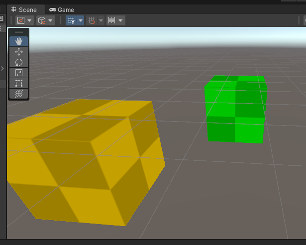
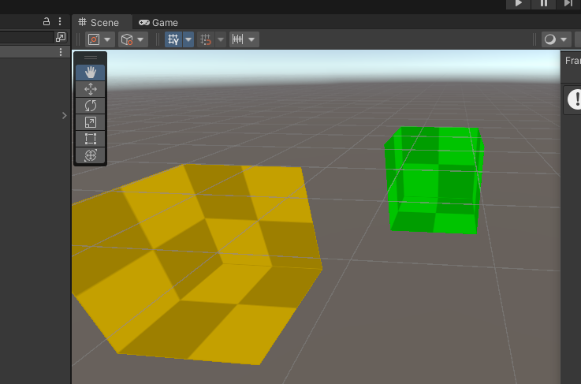

Pass学习
<!--more-->
# 零、一些与内置管线pass区别
1. 写多少个pass就会执行多少个pass，因此一个物体会根据pass数量渲染多次。urp会根据pass写的用途标志选择性的执行pass
# 一、LightMode学习
## 1.1 标记pass的用途
也是使用Tags进行标记，并添加LightMode字段

## 1.2 pass的LightMode类型
类型有
1. UniversalForward（用于URP管线的前向渲染）-一般用于几何体渲染输出
2. ShadowCaster-用于生成阴影贴图
3. DepthOnly-用于生成深度图，名为_CameraDepthTexture 的贴图
4. DepthNormal-场景对象的法线图，生成_CameraDepthTexture贴图+_CameraNormalsTexture贴图
5. Meta-用于光照贴图
6. Universal2D-用于2d对象渲染
7. SRPDefaultUnlit - 比较特殊，用于兼容不是为URP编写的Pass代码

## 1.3 代码
```c
Subshader
{
    pass
    {
        Tags
        {
            "LightMode" = "UniversalForward" 
        }
    }

}
```

# 二、LightMode与多Pass渲染

一个Subshader下使用两个pass，一个是UniversalForward 一个是SRPDefaultUnlit，这样可以让物体被渲染两次，但是再增加一个SRPDefaultUnlit没用。

如果一个pass不定义LightMode，那LightMode默认为SRPDefaultUnlit

```c
Subshader
{
    pass
    {
        Tags
        {
            "LightMode" = "UniversalPipeline"
        }
    }
    pass
    {
        Tags
        {
            "LightMode" = "SRPDefaultUnlit"
        }
    }
}
```

# 三、背面剔除
## 3.1 剔除类型
1. 默认剔除背/内部 Cull Back ,跟平时一样
2. 剔除外部Cull Front 看到内部
3. 不剔除任何部位 Cull Off，一般用于双面材质的渲染（如头发，半透明玻璃瓶

## 3.2 代码
```c
Subshader
{
    pass
    {
        Cull Back
    }
}
```

## 3.3 Cull Back和Cull Front的效果图
1. Cull Back

2. Cull Front



# 四、深度测试
## 4.1 说明
- 计算机图形硬件有一块，深度缓冲区，大小与分辨率大小一致，每一个格子记录像素的深度值，每一帧初始化为1.0，然后开始写入
- 在图形渲染管线中，摄像机能看到的最近点（近裁剪平面）深度值为0.0，最远点深度值为1.0。最近点和最远点在Unity中对应Camera组件上的Projection下的Clipping Planer的Near（映射0.0）和Far（映射1.0）。
## 4.2 参数说明
- 默认 ZTest LEqual，即当前像素深度值小于等于对应深度缓冲区深度值，则通过并写入
- ZTest Greater ，当前像素深度值大于对应深度缓冲区深度值，则通过并写入。
- ZTest Less , 当前像素深度值小于对应深度缓冲区深度值，则通过并写入
- ZTest GEqual, 当前像素深度值大于等于对应深度缓冲区深度值，则通过并写入。
- ZTest Equal, 当前像素深度值等于对应深度缓冲区深度值，则通过并写入。
- ZTest NotEqual, 当前像素深度值不等于对应深度缓冲区深度值，则通过并写入。
- ZTest Always, 当前像素始终通过，并写入。
- ZTest Never, 当前像素始终不通过。

## 4.3 代码
```c
Subshader
{
    pass
    {
        ZTest LEqual
    }
}
```

## 4.4 特殊情况
1. 当为ZTest Always
在Unity中，当两个使用相同材质且Shader设置为ZTest Always的物体相遇时，它们的渲染顺序并非由距离摄像机的远近决定，而是严格遵循Unity的渲染队列（Render Queue）顺序

2. 当为 ZTest Always 且 Cull Off
Cull Off 开启了双面渲染，但物体的内部几何体（背面）与外部几何体（正面）在同一个网格中发生了“自遮挡冲突”。

在 **ZTest Always 的强制作用下，GPU 抛弃了“深度排序”这一视觉正确性准则**，导致单个物体内部的三角形绘制顺序暴露出了问题。具体来看，这体现在两个层面：

- 1. 核心原因：单个物体内部的“画家算法”失效（自闪烁）
  - 对于一个封闭的 3D 物体（如球体、立方体），Cull Off 会同时渲染正面（朝外）和背面（朝内）。
  - 在正常情况下（ZTest LEqual），背面的像素因深度值更大，会被正面的像素遮挡掉，你看不到内部。
  但在 ZTest Always 下，深度测试直接通过，不进行深度比较。此时，渲染顺序降级为 GPU 提交三角形的顺序（即索引缓冲区的顺序）。**GPU 是并行且无序地处理网格三角形的，它不会对单个物体内的三角形做“从远到近”的排序**。于是：
    - 正面和背面的像素开始互相覆盖：可能背面的某个三角形比正面的三角形晚渲染，结果背面覆盖了本该可见的正面。
  - 结果：物体表面会出现大量无序的斑驳噪点、破碎的网状条纹或闪烁，看起来像是被撕碎了一样，这就是典型的“Z-Fighting”（深度冲突）在无深度测试下的极端表现。

- 2. 物体之间的顺序依然成立，但内部乱了
  - ZTest Always 保证了物体与物体之间的覆盖是确定的（后渲染的物体整体盖住先渲染的物体）。然而，每个物体自身的内部几何体是随机乱序覆盖的。

  - 这导致视觉上，物体可能同时出现“正面的纹理”和“内部的镜像纹理”混杂在一起，且杂乱无章。因为背面的法线虽然反了，但颜色光照可能依然有差异，混乱感极其明显。

- 3.具体表现


## 4.5 ZTest Greater的用途
ZTest Greater 可以用于 游戏中的玩家透视

# 五、深度写入与URP渲染管线分析
## 5.1 Zwrite
- 深度写入 ZWrite On（默认）/ ZWrite Off
  - ZWrite On 使用深度测试，每次深度测试通过后，写入到深入缓冲内，依据深度值进行，即无论物体绘制的先后顺序如何，近处的物体永远正确遮挡远处的物体
  - ZWrite Off 关闭深度测试，完全依赖绘制顺序，渲染顺序完全退化为画家算法（谁后画谁在上）。

## 5.2 Zwrite Off 在Camera 的Background Type在不同设置下的表现
1. Background Type 设置为skybox
用于 ZWrite Off完全依赖绘制顺序，而天空盒（skybox）是在所有不透明物体之后，最后渲染。因此永远只能看到天空盒。具体情况：
   - 清除：清空颜色和深度缓冲，颜色缓冲变为默认值（如灰色）。
   - 渲染物体：物体被渲染到颜色缓冲。但因 ZWrite Off，深度缓冲中该位置的值依然是清除后的“无限远”（1.0）。
   - 渲染天空盒：天空盒的每个像素进行深度测试（ZTest LEqual）。因为深度缓冲里的值是“无限远”（1.0），而天空盒的深度也是“无限远”（1.0），测试通过。于是，天空盒的像素便覆盖掉了颜色缓冲中已有的物体像素，导致物体“消失”。

2. Background Type 设置为Solid Color
除了背景外，也能看到物体。具体情况：
   - 清除：同样会清空颜色和深度缓冲。深度缓冲被重置为“无限远”（1.0）。
   - 渲染物体：物体被渲染，但因 ZWrite Off，深度缓冲依然为空。
   - 渲染背景：注意，**这里的“背景”并不是一个需要深度测试的3D物体。颜色缓冲中未被物体覆盖的区域**，直接被设置为指定的纯色。这个过程完全绕过了深度测试，因此不会覆盖已经画好的物体。


# 六、透明混合
通俗来讲就是 **已经在屏幕上可以看见的颜色 与 正要去屏幕上写入的颜色** 之间 进行混合（各占一定比例）
注意：混合对象的Queue要设置为Transparent （透明队列） ，不然效果会有问题，即
```c
Subshader
{
    pass
    {
        Tags
        {
            "Queue" = "Transparent"
        }
    }
}
```
## 6.1 Blend 关键字
## 6.2 代码
```c
Subshader
{
    pass
    {
        Blend SrcFactor DstFactor //SrcFactor 表示原颜色 (r,g,b,a)  DstFactor表示混合颜色(r,g,b,a) 
        // or 
        Blend SrcFactor DstFactor，SrcFactorA DstFactorA
        //to support different factors for Alpha channe
    }
}
```
## 6.3 最常见的混合命令

· Blend SrcAlpha OneMinusSrcAlpha- 传统的透明度
  - 计算公式:newBufferColor = (fragColor * fragColor.a) + (bufferColor * (1-fragColor.a))
  - 使用时要保证片元着色器返回值中的a值最好是小于1，否则也只会看到靠前物体的颜色，因为不是透明物体
    
```c
    ////顶点着色器的输出结果就是片元着色器的输入信息
    //float4 frag(v2f IN) :SV_TARGET//片元着色器，返回一个RGBA颜色结果
    //{
    //	float4 mainTexColor = SAMPLE_TEXTURE2D(_MainTex, sampler_MainTex,IN.uv);//取得每个点的纹理坐标颜色
    //	return mainTexColor * _MainColor * _ColorIntensity;
    //}

    //使用透明混合命令Blend SrcAlpha OneMinusSrcAlpha时片元着色器的写法
    float4 frag(v2f IN) :SV_TARGET
    {
        float4 mainTexColor = SAMPLE_TEXTURE2D(_MainTex, sampler_MainTex,IN.uv);
        float3 finalColor = (mainTexColor * _MainColor * _ColorIntensity).rgb;
        return float4(finalColor,0.5);
    }
```
·Blend One OneMinusSrcAlpha-预乘透明度
·Blend One One-叠加加
·Blend OneMinusDstColor One- 柔和叠加
·Blend DstColor Zero-相乘——正片叠底
·Blend DstColor SrcColor-两倍相乘

## 6.4 混合方式
其中着色器颜色结果乘以SrcFactor，现有颜色目标/缓冲区像素乘以DstFactor。然后，根据单独的**BlendOp**操作
(默认为Add)组合每个值，以生成普换缓冲区中的值的最终顾色结果。
即它决定“源颜色（当前 Shader 算出的颜色）”和“目标颜色（已经存在于帧缓冲中的颜色）”如何组合。 默认位Add
- **公式大致为： 最终颜色 = BlendOp(源颜色 * 源因子, 目标颜色 * 目标因子)**
这些因素可以是以下之一：
·One
·Zero
·SrcColor
·SrcAIpha
·DstColor
·DstAlpha
·OneMinusSrcColor
·OneMinusSrcAlpha
·OneMinusDstColor
·OneMinusDstAlpha

例1：
```c
Blend SrcAlpha OneMinusSrcAlpha
BlendOp Add
```
等价于常见的 Alpha 混合：
```
最终颜色 = 源颜色 * SrcAlpha + 目标颜色 * (1 - SrcAlpha)
```
例子2：
```c
Blend SrcAlpha One
BlendOp RevSub
```
表示：
```
最终颜色 = 目标颜色 - 源颜色 * SrcAlpha
```

## 6.6 效果
1.
```
Blend One One
```

2.
```
Blend SrcAlpha OneMinusSrcAlpha
```

3. 
```	
    Blend SrcAlpha OneMinusSrcAlpha
	BlendOp Sub
```


## 6.7 渲染半透明物体的注意事项（⭐）
在渲染半透明物体时，需确保
1. ZWrite关闭（深度写入关闭）
   - 渲染队列（Render Queue）相同的情况下，半透明物体都是从后向前渲染的
   - 不同Render Queue 会因为深度写入导致遮挡。
   - 半透明物体是在所有不透明物体渲染后才渲染的。
2. 半透明物体从后(离相机远)往前渲染（unity引擎已经处理了，但要了解），且在不透明物体渲染完毕后渲染

# 七、多Pass的shader开发
unity的urp渲染管线不支持多pass渲染（即多Pass的情况下 只能支持一个UniversalForward的pass，或者加上SRPDefaultUnlit能支持一下两个pass）
## 7.1 在URP管线下编写多Pass Shader的方法
1. RenderObject(可视化，比较傻瓜，只对使用特定LightMode的材质的对象生效)
2. RenderFeature（C#脚本，可控性好）
## 7.2 RenderObject详情
1. 设置前shader代码结构
```c
pass
{
    Tags
    {
        "LightMode" = "UniversalForward"
    }
}
pass
{
    Tags
    {
        "LightMode" = "Outline"
    }
}
```
2. 新建一个RenderObject
Unity窗口中Edit->ProjectSetting->Graphics->Scriptable Render Pipeline Settings。点击
目前我这边是URP-HighFidelity，找到其Renderer List中的内容，关联的是URP-HighFidelity-Render

拉到最下方找到Add Renderer Feature 选择Render Objects(Exportimental),即可新建一个RenderObject

3. 一些设置项
- Event，表示Pass执行的顺序
- Filters 筛选
  - Queue 对那些渲染队列筛选
  - Layer Mask 对那些layer筛选
  - LightMode Tags - 具体执行那些pass
4. 对使用特定LightMode的材质的对象生效的设置方式
- 设置方式

- 效果

5. 对所有使用某个shader的对象生效
其中PassIndex表示使用shader中的第几个pass，下标从0开始
- 设置方式

- 效果（给胶囊也挂上了StudyShader_BasicShader）shader


6. 让立方体只渲染轮廓，不渲染本体的设置及效果
新增一个layer叫cude，然后如图所示设置


7. 缺点
shader和lightmode的相关参数无法传入并修改，只能使用默认值，不太灵活

## 7.3 RenderFeature 详情
涉及C# 后续补充
1. 场景：
- 需要实现URP内置功能不支持的复杂效果，例如自定义的全屏后处理、需要访问深度/法线等G-Buffer数据、或涉及多步渲染的算法。
- 希望将自定义效果全局应用到多个场景或摄像机上，并集中管理参数。
- 需要对渲染流程拥有完全的控制权，包括创建和销毁临时渲染纹理（RenderTexture）、在特定的Pass间传递数据等。