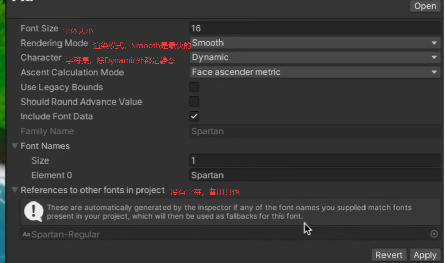

UGUI性能问题
<!--more-->

# 一、UI性能的四类问题
1. Canvas Re-batch 时间过长
- 负责管理UGUI元素，负责UI渲染网格的生成与更新，并向GPU发送DrawCall指令，在引擎native层由C++完成
- 对于每个canvas对象，在绘制之前都要进行合批过程，如果canvas下的所有元素每一帧都保持不变，那么在绘制前只需要合批一次保存下结果，并在之后的每帧继续使用该保存的结果，
- 如果UI元素发生了变化，则需要重新匹配几何体，画布被标记为dirty，被标记为dirty的canvas会触发Re-batch，重新合批
- **Canvas Re-batch 过程**
  - 根据UI元素深度关系进行排序
  - 检查UI元素的覆盖关系
  - 检查UI元素材质并进行合批，合批过程多线程运行。因此在移动平台上（手机），由于CPU核数不同，也会造成合批性能的差异
2. CanvasOver-dirty,Re-batch次数过多
- CanvasOver-dirty即为UI=重叠，打断合批
3. 生成网格顶点时间过长
- batch的渲染顶点顶点数过多
4. Fill-rate overutilization （GPU片元着色器利用率过高问题）
- UGUl中渲染是在Transparent半透明渲染队列中完成的，半透明队列的绘制顺序是**从后往前画**，由于Ul元素做AlphaBlend，我们在做Ul时很难保障每一个像素不被重画，UI的Overdraw太高，这会造成片元着色器利用率过高，造成GPU负担。
  - 在 Unity 中，Alpha Blend（透明度混合）是一种渲染状态，用于实现半透明效果。它的核心原理是：将当前像素的颜色与背景颜色按 Alpha 值进行混合，而不是直接覆盖
- UISpriteAtlas图集利用率不高的情况下，大量完全透明的像素被采样也会导致像素被重绘，再成片元着色器利用率过高；同时纹理采样器浪费了大量采样在无效的像素上，导致需要采样的图集像素不能尽快的被采样，造成纹理采样器的填充率过低同样也会带来性能问题。

# 二、UI Re-Build过程
Re-Build过程在Re-batch过程中完成，主要逻辑在C#层，用来重新计算layout布局和渲染网格重建
- 在WillRenderCanvases事件调用PerformUpdate::CanvasUpdateRegistry接口
  - 通过ICanvasElement.Rebuild方法重新构建Dirty的Layout组件
  - 通过ClippingRegistry.Cullf方法，任何已注册的裁剪组件Clipping Compnents(Such as Masks)的对象进行裁剪剔除操作
  - 任何Dirty的Graphics Compnents都会被要求重新生成图形元素
- Layout Rebuild（layout何时被标记为dirty）
  - UI元素位置、大小、颜色发生变化
  - 优先计算靠近Root节点，并根据层级深度排序
- Graphic Rebuild（Graphic何时被标记为dirty）
  - 顶点数据被标记成Dirty
  - 材质或贴图数据被标记成Dirty

# 三、UGUI性能优化
## 3.1 使用Canvas的基本准则
- 将所有可能打断合批的层移到最下边的图层，尽量避免UI元素出现重叠区
域
- 可以拆分使用多个同级或嵌套的Canvas来减少Canvas的Rebatch复杂度
- 拆分动态和静态对象放到不同Canvas下。
- 不使用Layout组件
- Canvas的RenderMode尽量Overlay模式，减少Camera调用的开销 
  - Overlay模式指 Canvas 的渲染模式，让 UI 始终显示在场景最前面，覆盖在 3D 物体和摄像机画面之上。

## 3.2 UGUI射线(Raycaster)优化
- 必要的需要交互Ul组件才开启“RaycastTarget”
- 开启“Raycast Targets”的Ul组件越少，层级越浅，性能越好
- 对于复杂的控件，尽量在根节点开启“RaycastTarget”
- 对于嵌套的Canvas，**OverrideSorting属性会打断射线，可以降低层级遍历的成本**

## 3.3 UI字体
- 避免字体框重叠，造成合批打断
- 字体网格重建（每个字体都是单独的四边形，即两个三角形构成）
  - UIText组件发生变化
  - 父级对象发生变化时
  - UI组件或其父对象enable/disable时（切换enable/disable时文本多了可能会掉帧
- 字体导入：TrueTypeFontImporter

- 动态字体与字体图集
- 运行时，根据UIText组件内容，动态生成字体图集，只会保存当前Actived状态的UIText控件中的字符
- 不同的字体库维护不同的Texture图集
- 字体Size、大小写、粗体、斜体等各种风格都会保存在不同的字体图集中（有无必要影响图集利用效率，一些利用不多的特殊字体可以采用图片代替或使用CustomFont，FontAssetsCreater创建静态字体资源）
- 当前FontTexture不包含UlText需要显示的字体时，当前FontTexture需要重建
- 如果当前图集太小，系统也会尝试重建，并加入需要使用的字形，文字图集只增不减
- 利用Font.RequestCharacterlnTexture可以有效降低启动时间

## 3.4 UI控件的优化
- 不需要交互的Ul元素一定要关闭RaycastTarget选项
- 如果是较大的背景图的UI元素建议也要使用Sprite的九宫格拉伸处理，充分减小UISprite大小，提高UIAtlas图集利用率
- 对于不可见的UI元素，一定不要使用材质的透明度控制显隐，因为那样UI网格依然在绘制，也不要采用active/deactiveUi控件进行显隐，因为那样会带来gc和重建开销。**尽量通过canvas的激活与关闭来控制**
- 使用全屏的UI界面时，要注意隐藏其背后的所有内容，给GPU休息机会。
- 在使用非全屏但模态对话框时，建议使用**OnDemandRendering**接口，对渲染进行降频。
- 优化裁剪UI Shader，根据实际使用需求移除多余特性关键字。
## 3.5 最容易产生性能问题的 滚动视图Scroll View优化
- 使用RectMask2d组件裁剪
- 使用基于位置的对象池作为实例化缓存。

# 四、其他
## 4.1 Unity下常见的等待函数（Profilter工具中显示的）
- WaitForTargetFPS：等待达到目标帧率，一般这种情况CPU与GPU都没什么负载问题
- Gfx.WaitForGfxCommandsFromMainThread/WaitForCommand：渲染线程已经准备接受新的渲染命令，一般瓶颈在CPU
- Gfx.WaitForPresentOnGfxThread/WaitForPresent: 主线程等待渲染线程绘制完成，一般瓶颈在GPU
- WaitForJobGroupID：等待工作线程完成，一般瓶颈在CPU